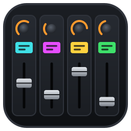
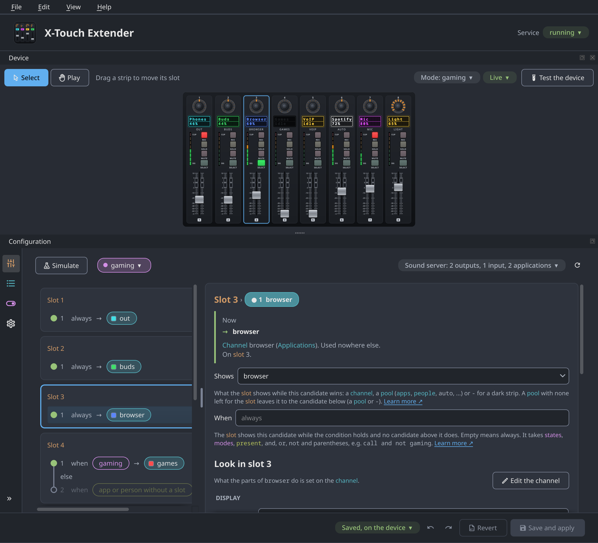

<p align="center"></p>

# xtouch-daemon

Use a Behringer X-Touch Extender as a hardware mixer for PipeWire on Linux: motor faders, LED meters and scribble
strips for your devices, applications and the people in your voice chat. What each strip shows follows what you do:
a game, a call, headphones plugged in. Strips can also belong to Home Assistant, for lights, other speakers or scenes.



**Documentation: <https://markusressel.github.io/xtouch-daemon/>** (also readable in [docs/](docs/index.md)).

## Features

- **Channels, states and slots.** Channels are what a strip can control (an output or input, a group of
  applications, a person, Home Assistant), states are what goes on (a call, a game, a mode), and each of the 8
  slots lists what it shows when (`"game if gaming"`, `"buds if present"`). Only the slots that change move; the
  others stay as they are.
- **Pools** fill the slots that name them: `apps` the next application that plays, `people` the next person of the
  voice chat, `devices` outputs without a channel (a USB headset), `auto` applications and people.
- **Modes** (gaming, work, ...) by rules or by hand: the chord (two Solo buttons together), a button of `[controls]`,
  `xtouch-daemon mode`, or Home Assistant. A new mode shows its name across the LCDs.
- **The device, all of it:** motor faders that glide and stay still while touched, LCDs with label, volume and color,
  encoders for balance, volume, picking an application or the media player, Rec and Solo as indicators, and passive
  LED meters that never wake a device or switch Bluetooth headphones into headset mode.
- **People of the voice chat** on their own strips (Mumble, with its plugin): their volume, mute, and who talks.
- **Home Assistant** over MQTT discovery: strips or single controls as entities, the mode, every state and what each
  slot shows, with an override per state.
- **A GUI** (`xtouch-daemon gui`): the device live, with the mouse as a hand on it; a card per slot with why it
  shows what it shows; Simulate (what the slots show in another situation, also on the device); "Try on the device"
  for unsaved changes; and "Try without a device" with a virtual one.
- **A proper service:** a systemd user service that survives unplugging the device and restarts of the sound server
  and the broker, reloads without a restart, and explains itself (`check-config`, `why`, `simulate`).

See the [full feature list](docs/index.md#features).

## Installation

On Arch Linux, from the AUR: `xtouch-daemon-bin` (the daemon, with its own Python, and the systemd user unit) and
`xtouch-daemon-gui-bin` (the GUI, on the system's PyQt6):

```shell
paru -S xtouch-daemon-bin xtouch-daemon-gui-bin
systemctl --user enable --now xtouch-daemon
```

From the source: xtouch-daemon uses [haad-mqtt-autodiscovery](https://github.com/haad-org/haad-mqtt-autodiscovery)
from a checkout next to its own, so clone both side by side and install with [uv](https://docs.astral.sh/uv/):

```shell
git clone https://github.com/markusressel/xtouch-daemon
git clone https://github.com/haad-org/haad-mqtt-autodiscovery
uv tool install ./xtouch-daemon          # or './xtouch-daemon[gui]' for the GUI
```

The device has to be in **MC** mode on **USB**, see [Getting started](docs/getting-started.md#set-up-the-device). No
device yet? `xtouch-daemon run --virtual-device`, or "Try without a device" in the GUI, see
[Without a device](docs/getting-started.md#without-a-device).

## Quick start

```shell
xtouch-daemon test                    # lights up the device and moves the faders, then echoes what you do on it
xtouch-daemon init-config             # writes ~/.config/xtouch-daemon/config.toml
xtouch-daemon gui                     # edit it in a window, with the device live (or by hand, see below)
xtouch-daemon list-devices            # the names to use for output and input channels
xtouch-daemon check-config            # validates the file and shows what each slot shows when
xtouch-daemon install-service --now   # runs it as a systemd user service from now on
```

A configuration names channels, states, and what each slot shows when:

```toml
[channel.buds]
type = "output"
device = "bluez_output.*"     # any Bluetooth headphones
label = "Buds"
color = "green"

[channel.game]
type = "apps"
match = ["@steam-games"]      # a preset: Steam games, Proton and Wine
label = "Game"
color = "red"

[state.gaming]
mode = true                   # one mode at a time
label = "Gaming"              # the banner across the LCDs
processes = ["@steam-games"]

[slots]
1 = ["buds if present", "auto"]
2 = ["game if gaming", "auto"]
# slots 3 to 8 have no entry: "auto", the next application or person without a slot
```

## Documentation

- [Getting started](docs/getting-started.md)
- [Configuration](docs/configuration/index.md): [channels, states and slots](docs/configuration/slots.md),
  [devices](docs/configuration/devices.md), [applications](docs/configuration/applications.md),
  [people](docs/configuration/people.md)
- [Home Assistant](docs/home-assistant.md)
- [Mumble](docs/integrations/mumble.md)
- [GUI](docs/gui.md)
- [Commands](docs/commands.md)
- [Troubleshooting](docs/troubleshooting.md)
- [Hardware and protocol](docs/hardware.md)
- [Architecture](docs/architecture.md)
- [Changelog](CHANGELOG.md)
- [Contributing](CONTRIBUTING.md)
- [Releasing](RELEASING.md)

## Similar projects

- [deej](https://github.com/omriharel/deej): sliders on an Arduino, sent over a serial port. Cheap and popular, but
  one-way: no motor faders, LEDs or displays.
- [x-touch-nobara-app-mixer](https://github.com/turkey415/x-touch-nobara-app-mixer): the same device and idea, as a
  single script. Select pins the focused window's application (KDE). Its meters use PulseAudio peak detection, which
  WirePlumber 0.5.18 restores at 0 % volume, so they can stay silent.
- [SlideWire](https://github.com/NilsBriggen/SlideWire): a GUI mixer for generic MIDI controllers, with motor fader and
  LED support, but no Mackie Control displays.
- [apptrol](https://github.com/Dzobash/apptrol): per-application volume for the Korg nanoKONTROL2.
- [BehringerXTouchExtender](https://github.com/Aldaviva/BehringerXTouchExtender): a .NET library for this device in
  its MIDI (`Ctrl`, `CtrlRel`) and HUI modes, not Mackie Control. Its documentation of the hardware (13 ring LEDs, 8
  meter LEDs and their colors, the LCD message of MIDI mode with inverted text, the firmware that AMD Zen 2 and later
  need for a stable USB connection) helped here.

## License

[AGPL-3.0-or-later](LICENSE)
