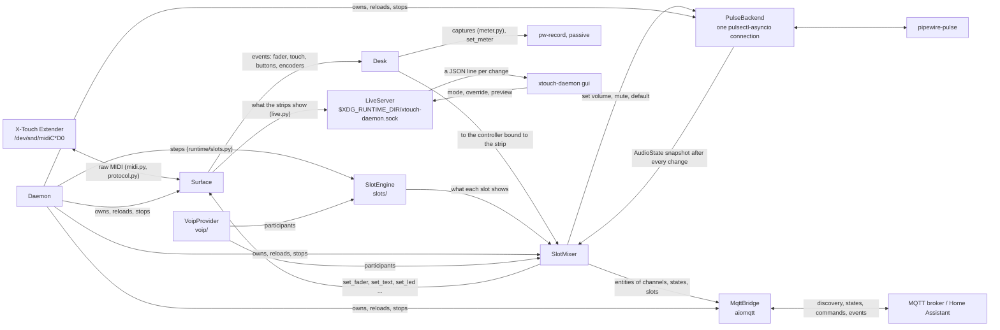

# Architecture

How the daemon works inside, for developers. To set up the project and run the tests, see
[Contributing](https://github.com/markusressel/xtouch-daemon/blob/main/CONTRIBUTING.md).

## Modules

The packages of `src/xtouch_daemon/`, from the device up. Tests mirror them: `tests/<package>/test_<module>.py`.

| Module | Role |
|---|---|
| `hardware/protocol.py` | The Mackie Control codec: decodes the device's MIDI messages into events, builds the messages that drive it. Pure functions. |
| `hardware/midi.py` | Finds the device's sound card in `/proc/asound/cards` and reads and writes its raw MIDI device without blocking. |
| `hardware/strip.py` | `Strip`: what a strip of the device shows, sending only what changed; its motor fader glides to its target and stays still while touched. `VirtualStrip`: a strip that waits off the device. |
| `hardware/transport.py` | How the `Surface` reaches the device: a `Port` finds and opens it, `AlsaPort` the raw MIDI device of its sound card, `SocketPort` the virtual device's Unix socket. |
| `hardware/surface.py` | `Surface`: the connection to the device (connects again after it was unplugged), its events, touches, and the startup and shutdown sequences. Shows everything again after a reconnect. Keeps a `SimulatedDevice` as the mirror of the device (what it sent, what the device reported), which the live view shows. |
| `hardware/selftest.py` | `xtouch-daemon test`: lights up the device and echoes what happens on it. |
| `audio/model.py` | `AudioState`: an immutable snapshot of the outputs, inputs, application streams and defaults. |
| `audio/backend.py` | `AudioBackend`: the interface the strips use (snapshots, volume, mute, default). |
| `audio/pulse.py` | `PulseBackend`: one connection to the sound server that follows it by events and carries out the commands. |
| `audio/meter.py` | `Meter`: audio levels from passive `pw-record` captures. |
| `audio/media.py` | The media players of the session (MPRIS), for `encoder = "media"`. |
| `config/` | The TOML configuration, validated with pydantic: `files` (reading it, its errors), `model` (`Config`), `sections`, `slots` (the channels, states and slots, with the strip of every candidate), the types of the channels' strips (`strip`, `strips`, `audio_strips`, `voip_strips`), `values`, `names` (lists with presets) and `presets` (`@browsers`, `@steam-games`, ..., expanded when the configuration is validated, see [Design: presets](design/presets.md)). |
| `strips/` | The strip controllers: `DeviceStrip` (and `ChoiceStrip` for `choices`), `AppGroupStrip`, `AutoStrip` (the application of an `auto` slot), `VoipStrip` (a person), `HomeAssistantStrip`, `EmptyStrip`, and the shared `VolumeStrip` base. A controller gets its `Identity` (the ids and names of its entities in Home Assistant, its name in the log) and its `Look` (label, color, meter, LEDs) from outside: the binder makes them per channel and candidate (`look_of()`). |
| `slots/` | [Design: channels, states and slots](design/channels-states-slots.md) without the device: the model (`model`), conditions (`expressions`), presence (`inputs`), the delays (`timing`), the states and modes (`states`), the resolver (`resolver`), the slots over time (`simulation`), the distinct outcomes (`outcomes`), recorded observations (`recording`) and their replay (`replay`). Pure but for the recorder; the daemon drives it through the `SlotEngine`, `simulate` and `observe` too. |
| `mqtt.py` | `MqttBridge`: the connection to the MQTT broker for `homeassistant` channels and controls. Announces their entities (haad-mqtt-autodiscovery), restores the retained states, passes commands on, publishes availability. |
| `runtime/daemon.py` | `Daemon`: the lifecycle (signals, reload, shutdown, systemd notifications), stepping the slots and the requests for modes and overrides. |
| `runtime/desk.py` | `Desk`: the strips of the device for as long as the daemon runs. Hands each event to the controller (`Presenter`) bound to its strip, a release to whoever got the press, follows the hands on the device and the chord of Solo buttons. Its meters (one per strip of the device) capture what the controllers bound now show, so a capture goes on when another slot shows the same. A claim (`claim()`, the `[controls]` of a slot) takes the controls it names: their events go to it, and the `VirtualStrip` of the presenter leaves their fader, ring and LEDs to it (`mask()`). |
| `runtime/controls.py` | `Controls`: the `[controls]` of the slots, built once per configuration with their entities in Home Assistant (`number.<ns>_slot_<n>_fader`, ..., or the `id` instead of `slot_<n>`). After each step the first entry of a slot whose `when` holds is its claim on the `Desk` (a slot under a finger keeps its claim until it is let go); it shows what it takes and launches, picks modes (`SlotEngine.choose_mode()`, `cycle_modes()`), toggles states and modes (`toggle()`), or sends events to Home Assistant. |
| `runtime/homeassistant.py` | `SlotEntities`: with `[mqtt]`, the mode select, a binary sensor, override select and (`homeassistant = true`) input switch per state, whether each channel is shown, and what each slot shows. Published after each step when they changed (all of them again after the broker was away); choices in Home Assistant go to the `SlotEngine`, inputs into its observation. |
| `runtime/slots.py`, `runtime/binder.py` | The slots on the device. `config/slots` builds and checks the strip of every candidate when the file is loaded; the `SlotEngine` steps a `Simulation` 0.1 s after a change (the audio, the voice chat, a finger let go), at the deadlines of its delays and every 2 s for the processes; it takes the requests (a mode, an override, the pick and pin of a slot's `pick` encoder) and hands out the applications of the `auto` strips, keeps overrides, the mode picked (`slots.json`) and the people (`people.json`) across restarts (`runtime/slot_files.py`), and carries its state over a reload by id. The `SlotMixer` (`runtime/binder.py`) has a controller per channel for as long as the configuration, one per application of `auto` and per person without a channel while they are members, and an empty one per slot; after each step it binds to the `Desk` only the slots whose result changed (the others keep their controller, texts, fader and LEDs) and gives a controller the look, encoder and volume range of the candidate it is on. |
| `simulator/` | The virtual device: `device` (`SimulatedDevice`, the model of the device without IO: what the host sets, a hand on it, the motors and meters over time, a broken touch sensor, switching it off and on) and `server` (it on a Unix socket for `virtual-device`). The GUI hosts it with Qt (`gui/qt/virtual_device.py`). See [Design: device simulator](design/device-simulator.md). |
| `system/processes.py` | The processes that run, from `/proc`, for the `processes` of states and `launch`. |
| `system/launch.py` | `Launcher`: starts the command of a `launch` (of a channel or a control) detached from the daemon (a transient systemd user service); `LaunchButton`: when Select launches, and its LED. See [Design: launching applications](design/launch.md). |
| `system/instance.py` | The running daemon for other processes: its runtime file (process, configuration file) and where its live view is served. |
| `system/systemd.py` | systemd integration: notify, journal log levels, the unit file, controlling the user service. |
| `live/` | The live view for the GUI over a Unix socket: `messages` (snapshots, requests, replies), `codec` (lines of JSON), `server` (`LiveServer`). See [Live view](#live-view). |
| `voip/` | `VoipProvider`: the people of a voice chat, with `DemoProvider` and `BridgeProvider` (a client plugin on a Unix socket). |
| `voip/mumble.py`, `integrations/mumble/` | The Mumble plugin (C): its sources, building its bundle with CMake, finding it and copying it into Mumble's plugin directory. See [Mumble](integrations/mumble.md). |
| `cli/` | The command line: one module per topic (`daemon`, `configuration`, `sound`, `modes`, `slots`, `mumble`, `service`, `editor`, `simulator`), put together by `main` in `cli/__init__.py`. |
| `gui/domain/` | The configuration editor without a toolkit: the editable document (`slots_document`, `history`, `changes`), the options of the models (`schema`), the stacks of the slots (`slot_stacks`), the look of the strips (`looks`), suggestions from the sound server (`sources`), where a problem is shown (`problems`), applying a saved file (`apply`). See [GUI](#gui). |
| `gui/qt/` | The widgets of `xtouch-daemon gui` (the `gui` extra): `window/` (the main window, its rail, the window Device, the service, the filter of the keys and the wheel), `preview/` (the drawing of the device), `pages/` (a module per page; the cards of the page Slots in `slot_cards`), `fields/`, `theme/`. |

## Data flow

1. `PulseBackend` subscribes to sink, source, sink input and server events. After a burst of events it takes one
   snapshot (`AudioState`) and hands it to the mixer.
2. The `SlotEngine` resolves the slots (0.1 s after a change); the `SlotMixer` binds the slots whose result changed
   and calls `update(state)` on every controller. A controller shows the state on its `Strip`: color, LCD lines, LEDs, ring and fader.
3. The `Surface` sends only what changed. A fader target starts a glide that moves the motor every 10 ms.
4. An event from the device goes from the `Surface` to the `Desk`, which hands it to the controller bound to its strip. A
   controller turns it into commands to the backend. These run as tasks: nothing blocks the event loop.
5. The sound server reports the result as a new snapshot, which goes through step 2 again.

A `homeassistant` channel ignores the snapshots. Its entities work as in haad: Home Assistant sends a command, the
entity publishes it as its state (retained), and the copy that comes back from the broker changes the entity; the
bridge then tells the strip, which shows it. The device's events go the other way: a fader or encoder publishes its
number (a fader moved by hand at most every 100 ms), buttons publish events, which are not retained.

## Lifecycle

- **Start:** the daemon starts the surface, the backend and the mixer as tasks and tells systemd `READY=1`. The device
  and the sound server do not need to be there: both are connected (again) when they appear.
- **Reload (SIGHUP):** the configuration is read again. A file with errors is logged and the current configuration
  stays. Otherwise a new `SlotMixer` takes over the same surface and backend and gets the current state right away; the
  `SlotEngine` carries its states, picks and people over by id, so slots that show the same keep it. systemd learns about it through `RELOADING=1` and `READY=1`.
- **Preview:** a configuration of the GUI (see [Live preview](#live-preview)) takes over like a reload, from memory
  instead of the file. A reload ends it: the file runs, or the configuration of the file before when the file can't
  be used.
- **Stop (SIGTERM, SIGINT):** the daemon tells systemd `STOPPING=1`, closes the mixer, turns every strip dark and
  moves the faders down, waits for the faders (at most 2 s), sends what is still queued and closes the device. A dark
  surface shows that nothing drives it anymore.
- **Stop, in this order:** first everything stops that could show something (the sound server connection, MQTT, the
  mixer, the device's events), then the strips are reset, and only then the surface closes. A snapshot that arrived
  during the reset would otherwise paint the strips again.
- **MQTT:** the bridge connects (again) on its own, like the backend. On every connect it publishes the discovery
  configurations, subscribes, and waits for the retained states with a ping on its own sync topic: the broker sends
  retained messages before later ones. Entities without a retained state then get their defaults. A reload hands the
  bridge the entities of the new channels; entities of removed channels are removed from Home Assistant (not by a
  preview, see [Live preview](#live-preview)). A changed `[mqtt]` section needs a restart.
- **Status:** `systemctl --user status xtouch-daemon` shows whether the device, the sound server and (with `[mqtt]`)
  the broker are connected.

## Design decisions

- **One snapshot for all strips.** Every strip sees the same consistent state, and one connection serves eight
  strips. The strips derive everything from the snapshot instead of keeping their own copies.
- **Coalesced volume commands.** A fader sends many positions per second. A strip sets only the latest one when the
  previous command finished, and shows the new value at once, so the display does not lag behind the hand.
- **Passive, native captures for the meters.** The meters use `pw-record` with `node.passive = true`: a capture never
  wakes a device, never lights the microphone indicator, and never switches Bluetooth headphones into headset mode. They
  are native PipeWire streams on purpose: WirePlumber 0.5.18 (PipeWire 1.6.10) restores captures of PulseAudio clients
  (`parec`, peak detection streams) at 0 % volume, so those would only get silence. `state.restore-props = false`
  keeps WirePlumber from saving the captures at all. `node.dont-reconnect = true` keeps a capture with its device or
  stream: WirePlumber makes a stream whose target is the default when it is linked follow the default (like
  PulseAudio), so without it the meter of the default output would show the next default output after Select.
  `pw-record` runs under `stdbuf -o0` (coreutils): its buffered output comes in blocks of 4096 bytes (64 ms at
  8 kHz), so the meters lagged, and two meters of the same audio differed by up to that much. Unbuffered, it writes
  every cycle of the graph; the daemon takes the peak of every 20 ms.
- **Meter points from the volume.** Measured with PipeWire 1.6.10 (a tone into a null sink, the volume and Mute of
  the test stream and sink set with `pw-cli set-param`): a playback stream and an input apply their volume and Mute
  in their own node, in audioconvert's channel mixer, before their output ports, so every capture of them is after
  both. audioconvert has monitor ports only on nodes with input ports (outputs, capture streams), not on playback
  streams or inputs, so there is no tap before the volume to link to; `node.passive` changes only the scheduling.
  The monitor of an output is before its volume and Mute (`monitorVolumes` and `monitorMute`, both untouched, unless
  `monitor.channel-volumes` is on). pipewire-pulse turns a PulseAudio volume v into the linear channel volume v³ (50 %
  is 0.125). So the meters capture what they can and scale it with the volume the sound server tells
  (`meter.scale_of()`): pre-fader divides the audio of a stream or input by v³, post-fader multiplies the monitor of
  an output by it (0 while muted). The audio of a muted stream or input is gone, its pre-fader level with it. The
  volume news is ahead of the captured audio, so after a change the division uses the loudest of the volumes of the
  last 0.3 s (`GAIN_SETTLE`): a fader pulled down must not light the clip LED. Reference:
  `spa/plugins/audioconvert/audioconvert.c` (monitor ports in `reconfigure_mode()` only for
  `SPA_DIRECTION_INPUT`; the monitor volume in `impl_node_process()`).
- **Stall restart.** WirePlumber links a passive capture only once and gives up when that fails, e.g. while Bluetooth
  headphones disappear and streams move. A capture that gets no audio for 3 s while its device or stream plays is
  started again.
- **The default device follows by name.** A strip without `device` looks up the default in every snapshot, so it
  follows a switch of the default device, including its meter.
- **One owner per strip.** A strip belongs to PipeWire or to Home Assistant, chosen by its `type`. Mixing both on one
  fader would make two sources fight over the motor.
- **Availability follows the device.** The entities are available while the daemon runs and the device is connected,
  so Home Assistant greys out controls that would do nothing. A last will covers a crash.
- **haad-mqtt-autodiscovery as a path dependency.** The entities are the same as haad's, used from a checkout next
  to this one (like haad does), which also sets the Python version to 3.14.
- **No volume restore in the daemon.** The sound server keeps the volumes. The daemon remembers only the volume of an
  idle application strip, for its next stream, and only while it runs.

## GUI

`xtouch-daemon gui` is an optional editor for the configuration file, in the subpackage `gui` and the extra of the same
name, like the GUI of [openhasp-config-manager](https://github.com/markusressel/openhasp-config-manager). The daemon
itself does not import it.

- **Toolkit-free domain, thin widgets.** `gui/domain` decides everything: `SlotsDocument` holds the file as plain
  values, validates it with `parse_config()` (the same messages as `check-config`), and saves it. `slot_stacks` turns
  the stacks of the slots into rows to edit, `simulate` and the `outcomes` of the slots what other modes and states
  would show, `looks` how the live view draws each strip, `status` whether the device runs the saved file, `sources`
  turns sound server snapshots into suggestions, `problems` which page shows a problem, `apply()` decides between
  reload, restart and "the daemon does not run". `gui/qt` only shows that and passes edits back.
- **Pages by what they edit.** A rail on the left of the window Configuration (`gui/qt/window/rail.py`) has the pages: Slots (a card per slot with its stack, an inspector
  for the candidate picked, why it shows, Simulate), Channels, States and Settings (`[device]`,
  `[behavior]`, `[aliases]`, `[mqtt]` as "Home Assistant", `[voip]`). Slots, Channels and States are two panes with a
  `PaneSplitter` (`gui/qt/window/splitter.py`) between them, which keeps its share in `QSettings`.
- **The device on every page.** The drawing of the device (`DeviceView`, `gui/qt/window/device_view.py`) and the
  pages with their rail (the window Configuration) are `QDockWidget`s: one above the other at first, at any side, or
  windows of their own; `QMainWindow.saveState()` keeps where they are. The central widget is an empty placeholder,
  so the docks have all the room. The header and the footer are fixed `QToolBar`s, so they reach across the window
  and the docks sit between them. A click on a strip of the drawing picks its slot on the page Slots. The menus hold what is
  used now and then (the theme, the zoom) and the keys of the window.
- **Previews of the controls.** `gui/domain/demos.py` groups the options of a channel by the part of the strip they
  are about and makes a short scene for each part from the values in the form (frames of a `StripState` with a
  caption). `PartPreview` (`gui/qt/preview/part_view.py`) shows its steps (‹ and ›) in the same `StripView` as the window Device, cut to
  the part; a `StripView` is drawn in any `StripHost`. See [Design: previews of the controls](design/control-previews.md).
- **Undo instead of questions.** `History` (`gui/domain/history.py`) keeps the states of the document before every
  edit, so removing a channel or reverting the file asks nothing and Ctrl+Z brings it back. Typing into one option is one
  step. Ctrl+Z undoes in the document also while a text field has the focus (`gui/qt/window/input_filter.py`, which also
  keeps the wheel from changing a field under the mouse).
- **Forms from the models.** `gui/domain/schema.py` reads the options of every section and channel type from the pydantic models:
  the type picks the widget (switch, number, choice, color swatches, list chips, masked secret, file), the attribute
  docstrings become the help, `Field` constraints the ranges, and `Meanings` next to a choice (`config/values.py`, e.g.
  `INDICATORS`) say what each value does; `Presets` on a list of names (`StreamNames`) makes it
  suggest the presets of its kind. A new option or channel type needs no GUI code; a test fails for an option
  without help or a value without a meaning. `gui/domain/docs.py` holds the "Learn more" links into this site, and a
  test checks each against the headings of `docs/`.
- **The comments stay.** Saving writes the changes into the TOML document with tomlkit: unchanged values keep their
  place, their comments and their form (a stack as a string, a list or tables), and a renamed channel keeps its table.
  The file is written in place, so a symlinked configuration stays one.
- **The daemon is found, not guessed.** `xtouch-daemon run` writes `$XDG_RUNTIME_DIR/xtouch-daemon.json` (its process
  id, its configuration file, whether systemd started it) while it runs (`system/instance.py`), so the GUI finds it wherever
  it was started, and a second daemon names the one that has the device. A saved file is reloaded (SIGHUP) only when
  the daemon reads that file; a changed `[device] name` or `[mqtt]` needs a restart, since a reload does not take them. The
  GUI restarts only the service: `systemd.Service` (shared with `install-service`) reads the state of the unit, and
  installs, starts and restarts it.
- **PyQt6, QtAwesome and qt-themes.** The same as openhasp-config-manager, so the tools look and work alike. The wheels
  carry Qt itself, so `uv tool install` needs no system packages (GTK 4 through PyGObject needs the system libraries
  and a compiler), Qt paints the strip preview with `QPainter` and does drag and drop, and pytest-qt runs the widgets
  offscreen.
- **One visual system.** `qt/theme/` holds the design tokens: the colors of the dark and the light theme (text at
  4.5:1 or more and the outlines of controls at 3:1 or more on every surface, WCAG 2.2 AA, checked by the tests), a
  4 px spacing scale, radii, the height of controls and a type scale relative to the desktop font, and the colors of
  the device for the drawing, the same in both themes. Widgets set style roles (`theme.set_role`) and take their sizes
  from the tokens instead of styling themselves. The drawing decides what a strip shows (a `StripFace`: LCD, ring,
  LEDs, meter, fader) apart from painting it.
- **One source of truth: the `Editor`.** `qt/editor.py` holds the document, its history and its validation. Views
  read from it and change the document only through it, so nothing keeps a copy that could go stale. Its signal
  `changed(Change)` comes once per edit, after the document was validated once.
- **Changes say what changed.** A `Change` (`gui/domain/changes.py`) has a `Scope` and, for some scopes, a path:
  - `VALUE`: a value in place; the field that made the change shows it already.
  - `CHANNELS`, `STATES`: a channel or state was added, removed, renamed or duplicated.
  - `SLOTS`: a candidate of a stack was added, removed, moved or changed.
  - `SECTION`: a section was added or removed.
  - `ALIASES`: the list of aliases.
  - `DOCUMENT`: anything (undo, redo, revert).
  - `FILE`: the file was written, so the document is the same.
  Each page's `show_document(change)` updates only what that scope touches.
- **Built once, updated in place.** The pages build their widgets once, and showing the document loads the values
  into them (`OptionRow.load()`); no page is cleared and built again. A part that comes and goes (a section that is
  absent, the form of each channel type) is a page of a `Stack` that is sized to its current part, not a widget that is
  shown and hidden.
- **No layout for what stays the same.** Showing the document again, or a live update 20 times a second, changes no
  geometry when nothing differs:
  - `set_text` and the tab texts are set only when they differ.
  - `theme.set_role` restyles only for another role.
  - The list chips stay while their values are the same.
  Icons are kept with their name and color (`theme.set_icon`), so switching the theme draws them again
  (`theme.refresh_icons`) without building a page.
- **The options in the order of the device.** A channel's form lists its options from top to bottom like its strip:
  1. what it controls (`device`, `match`, `profiles`, the `id` of a Home Assistant strip)
  2. the encoder and its ring
  3. the LCD
  4. the meter
  5. the Rec, Solo, Mute and Select buttons
  6. the fader and the range of the volume
  7. the `id`
  This is `STRIP_OPTION_ORDER` in `gui/domain/schema.py`, apart from the order of the fields in `config/`. A test fails for an
  option without a place in it.

## Live view

The GUI shows the strips as the device shows them right now, which only the daemon knows. `xtouch-daemon run` serves
that on the Unix socket `$XDG_RUNTIME_DIR/xtouch-daemon.sock` (mode 0600, next to the runtime file of `system/instance.py`)
for as long as it runs:

- **Whole states, one JSON line each.** A client gets the whole state when it connects and again whenever something
  changed, checked 20 times a second (`live.INTERVAL`): the LCD lines and backlight, the LEDs, the ring, where the
  fader is and whether it is touched, the meter level, whether the device, the sound server and the broker are
  connected, whether the device is the virtual one, and the `fingerprint()` of the configuration in use. The strips
  are the `Surface`'s mirror of the device (a `SimulatedDevice`, see `hardware/surface.py`): what reached it, with
  the motors and meters moving as on the device. A line is about 2 KB; a state rather than changes means a client
  that connects late or misses one needs nothing else. `version` changes when a line means something else.
- **Requests of the user only.** A client may send requests, a line of JSON each: the [live preview](#live-preview),
  a mode and an override (see below). The daemon takes them only from processes of its own user (`SO_PEERCRED`: root can connect to a socket of mode
  0600), and a line of at most `MAX_REQUEST` (1 MiB): a longer one ends the connection. Otherwise the GUI changes the
  daemon through the configuration file and a reload.
- **Channels, states and slots.** The state has `slots` (`SlotsState`): the mode
  and the one picked by hand, per slot the candidate, channel, pool, member and why, per state its value, `since`,
  `source` and override, and per pool the members that wait. `{"request": "mode", "mode": "gaming"}` (or `auto`,
  `"+1"`) picks a mode, `{"request": "override", "state": "call", "value": "on"}` (`auto`, `on`, `off`) overrides a
  state. `features` has `mode` and `override`.
- **A hand from the GUI.** `{"request": "play", "event": "fader_moved", "strip": 2, "value": 8000}` (also
  `fader_touched` with `touched`, `button_pressed` with `button` (its note) and `pressed`, `encoder_turned` with
  `steps`, `encoder_pressed` with `pressed`) is taken by the `Surface` as if the device sent it (`Surface.play()`),
  while a device is connected. No answer. `features` has `play`.
- **Never in the way.** Clients get only non-blocking writes. One that falls behind by more than `MAX_BUFFER` is
  dropped (it can connect again), and a socket that can't be made is logged: the daemon runs on without the live view.
  The server is not one of the parts of the daemon whose end stops it.
- **Applied or not.** The fingerprint is a hash of the whole configuration (secrets included). The GUI compares it
  with the one of the saved file, so it can say whether the daemon took the file, instead of assuming a reload worked
  (it keeps the old configuration when the new one has errors or a changed `[mqtt]`).

The GUI reads the socket with a `QLocalSocket`, without a thread, and connects again while the daemon runs. Without a
daemon it shows what the file would show, and says so.

## Live preview

The GUI can make the daemon run the configuration in its editor before it is saved (`gui/qt/live_preview.py`, the
daemon side in `Daemon.preview()`):

- **The whole text, over the live view.** `StartPreview` carries the TOML text the GUI would save
  (`SlotsDocument.render()`). The daemon reads it with `parse_config()`, the parser of the file, so the errors are the
  same as those of `check-config`, and runs it like a reload: a new mixer on the same surface, sound server and
  broker. The file is never written. A text with errors, or a changed `[mqtt]` (the bridge would need a new
  connection), is answered with the reason, and what runs keeps running. The GUI sends 300 ms after the last edit,
  and only a document without problems.
- **Replies the old GUI ignores, features the new one checks.** The daemon answers with lines without `version`
  (`{"reply": "preview", "ok": ..., "message": ...}`), which a GUI from before skips like lines of another version.
  Snapshots tell `preview` (the daemon runs a preview, and `config` is its fingerprint) and `features` (`preview`, …);
  a daemon from before tells none and ignores requests, so the GUI keeps the switch off for it.
- **Always back to the file.** The preview ends with `EndPreview`, when the connection of its client ends (the window
  closed or crashed), without a request for `PREVIEW_TIMEOUT` (10 s; the GUI sends `KeepPreview` every 3 s, so a
  window that hangs with its connection open ends it too), and when the file is loaded: on a reload (saving in the GUI
  sends one), and when the file changes on disk (checked every second during a preview). The client is told why
  (`{"reply": "ended", ...}`). The configuration of the file is kept in memory (`Daemon.file_config`), so a file that
  became unusable meanwhile does not keep the preview running.
- **One preview at a time.** A second client takes it over, and the first one is told: the window someone works in
  wins over one that was left open.
- **Visible.** The status line of systemd ends with "previewing unsaved changes of the GUI", the log tells when a
  preview starts and ends and why, and the GUI shows a pill.
- **Home Assistant entities survive a preview.** A reload removes the entities of removed channels from Home
  Assistant (an empty retained discovery message), which also deletes them from its entity registry. A preview
  doesn't: `MqttBridge.set_entities(..., preview=True)` only stops driving the entities it does not have, which stay
  in Home Assistant with their retained states, so the file restores them as they were. The next configuration that
  is no preview removes what it does not have, like a reload; entities that only a preview had also lose the
  retained state they left on the broker, so a preview leaves nothing behind.
- **Secrets stay with the user.** The text carries the secrets of the file. The GUI sends it only to a daemon of its
  own user (`SO_PEERCRED` on its end of the socket), and the runtime directory is the user's own (`$XDG_RUNTIME_DIR`,
  or a directory of mode 0700 in the temporary directory).
- **States and modes too.** A preview is a whole configuration: the daemon runs it like a reload, carrying the
  states, overrides and the mode picked over by id, and the mode select in Home Assistant gets the modes of the
  preview.
- **A situation too.** `StartPreview` may carry a `situation` (the what-if of Simulate, `slots.outcomes.Situation`),
  and its `config` may be None (the file's). The `SlotEngine` runs it in a second `Simulation` (`what_if`) that starts
  where the real one is: the states are overrides, the mode is picked, and the sound server and voice chat seen are
  made for it (`Situation.observation`: real stand-ins first, made-up ones for the rest). `engine.active` is what the
  mixer and the live view use; the real `Simulation` waits, takes the requests (the chord, Home Assistant, overrides),
  and is what Home Assistant sees: its slot sensors are not updated during a situation. Nothing of it is written
  (`slots.json`, `people.json`). Snapshots tell `simulated`; the feature is `situation`. It ends with the preview. See
  [Design: try changes and situations on the device](design/try-and-simulate.md).

## Channels, states and slots

The daemon runs a configuration of channels, states and slots ([design](design/channels-states-slots.md)).

- **One controller per channel, as long as the configuration.** The `SlotMixer` (`runtime/binder.py`) builds a
  controller with its own `VirtualStrip` for every channel, and one for each application of `auto` and each person
  without a channel while they are members. After each step it binds to the `Desk` only the slots whose result
  changed: the others keep their controller, texts, fader and LEDs, and their meter capture goes on.
- **The engine decides, the mixer shows.** The `SlotEngine` (`runtime/slots.py`) is the only one that hands out
  applications and people; the `pick` encoder and pins are requests to it (`EngineSlot`). It keeps the overrides, the
  mode picked and the order of people in the state directory (`slots.json`, `people.json`).
- **Under a finger nothing changes.** Slots held on the `Desk` are fixed inputs of the resolver: a slot keeps what it
  shows, and its claims, until it is let go.
- **Feedback.** A slot that shows something else flashes its label and why for `switching.banner` seconds; a new mode
  shows its banner across the LCDs instead.

## Testing

The unit tests run without hardware and without a sound server:

- the protocol codec and the MIDI parser with captured messages,
- the raw MIDI device against a FIFO,
- the surface with a recording `send`, and end to end against the `SimulatedDevice` in memory (`tests/support/simulator.py`,
  on the fake clock of the test) and over its socket,
- the strips, the mixer and the daemon with a fake `AudioBackend`,
- `PulseBackend` with a fake pulsectl connection,
- the meters with a fake `pw-record` script,
- the MQTT bridge and the `homeassistant` strips with an in-memory broker (`tests/support/mqtt.py`): retained messages,
  subscriptions, last wills, lost connections,
- the live view with a real Unix socket in a short temporary directory: clients that read, that don't read, and that
  go away, requests of the user, of other users and that are too long, and the live preview through the daemon,
- the live preview of the GUI against a fake live view (a `QLocalServer`) that answers like the daemon,
- the Mumble plugin built with CMake and loaded into a fake Mumble (`integrations/mumble/test/fake_mumble.c`), which
  calls its callbacks as a script says, against a real `BridgeProvider` (skipped without cmake and a C compiler),
- the GUI domain with configuration files in a temporary directory and a fake `systemctl`, and the GUI widgets with
  pytest-qt on the offscreen platform, with a fake sound server and the dialogs answered by the tests.

The tests mirror the packages of the source (`tests/config/`, `tests/strips/`, `tests/gui/qt/`, ...). Fixtures are in
the `conftest.py` files: `tests/conftest.py` has the guards every test gets (no processes left behind, nothing of the
machine touched, no programs started) and the common fakes, the packages have their own (e.g. the window in
`tests/gui/qt/conftest.py`). What tests import, fakes and helpers, is in `tests/support/`, never in a `conftest.py` or
another test module.

`just coverage` fails below 90 % line and branch coverage.
