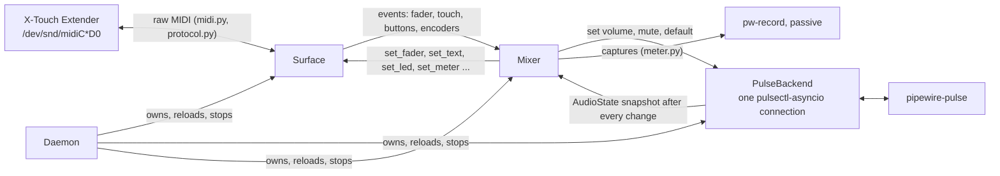

# Architecture

## Modules

| Module | Role |
|---|---|
| `protocol.py` | The Mackie Control codec: decodes the device's MIDI messages into events, builds the messages that drive it. Pure functions. |
| `midi.py` | Finds the device's sound card in `/proc/asound/cards` and reads and writes its raw MIDI device without blocking. |
| `surface.py` | `Surface`: the connection to the device (connects again after it was unplugged), and per `Strip` what it shows. Sends only what changed, shows everything again after a reconnect, glides the motor faders and keeps them still while touched. |
| `audio/model.py` | `AudioState`: an immutable snapshot of the outputs, inputs, application streams and defaults. |
| `audio/backend.py` | `AudioBackend`: the interface the strips use (snapshots, volume, mute, default). |
| `audio/pulse.py` | `PulseBackend`: one connection to the sound server that follows it by events and carries out the commands. |
| `audio/meter.py` | `Meter`: audio levels from passive `pw-record` captures. |
| `strips/` | The strip controllers: `DeviceStrip`, `AppGroupStrip`, `AutoStrip` (with `AutoAssigner`), `EmptyStrip`, and the shared `VolumeStrip` base. |
| `mixer.py` | `Mixer`: the controllers of one configuration, fed with every state and every event, and the meter ticker. |
| `daemon.py` | `Daemon`: the lifecycle (signals, reload, shutdown, systemd notifications). |
| `config.py` | The TOML configuration, validated with pydantic. |
| `cli.py`, `selftest.py`, `systemd.py` | The command line, the device self-test, systemd integration (notify, journal log levels, the unit file). |

## Data flow

1. `PulseBackend` subscribes to sink, source, sink input and server events. After a burst of events it takes one
   snapshot (`AudioState`) and hands it to the mixer.
2. The `Mixer` lets the `AutoAssigner` give the `auto` strips their applications, then calls `update(state)` on every
   controller. A controller shows the state on its `Strip`: color, LCD lines, LEDs, ring and fader.
3. The `Surface` sends only what changed. A fader target starts a glide that moves the motor every 10 ms.
4. An event from the device goes from the `Surface` to the `Mixer`, which hands it to the controller of its strip. A
   controller turns it into commands to the backend. These run as tasks: nothing blocks the event loop.
5. The sound server reports the result as a new snapshot, which goes through step 2 again.

## Lifecycle

- **Start:** the daemon starts the surface, the backend and the mixer as tasks and tells systemd `READY=1`. The device
  and the sound server do not need to be there: both are connected (again) when they appear.
- **Reload (SIGHUP):** the configuration is read again. A file with errors is logged and the current configuration
  stays. Otherwise the old mixer is closed, a new one takes over the same surface and backend, and gets the current
  state right away. systemd learns about it through `RELOADING=1` and `READY=1`.
- **Stop (SIGTERM, SIGINT):** the daemon tells systemd `STOPPING=1`, closes the mixer, turns every strip dark and
  moves the faders down, waits for the faders (at most 2 s), sends what is still queued and closes the device. A dark
  surface shows that nothing drives it anymore.
- **Status:** `systemctl --user status xtouch-daemon` shows whether the device and the sound server are connected.

## Design decisions

- **One snapshot for all strips.** Every strip sees the same consistent state, and one connection serves eight
  strips. The strips derive everything from the snapshot instead of keeping their own copies.
- **Coalesced volume commands.** A fader sends many positions per second. A strip sets only the latest one when the
  previous command finished, and shows the new value at once, so the display does not lag behind the hand.
- **Passive, native captures for the meters.** The meters use `pw-record` with `node.passive = true`: a capture never
  wakes a device, never lights the microphone indicator, and never switches Bluetooth headphones into headset mode. They
  are native PipeWire streams on purpose: WirePlumber 0.5.18 (PipeWire 1.6.10) restores captures of PulseAudio clients
  (`parec`, peak detection streams) at 0 % volume, so those would only get silence. `state.restore-props = false`
  keeps WirePlumber from saving the captures at all.
- **Stall restart.** WirePlumber links a passive capture only once and gives up when that fails, e.g. while Bluetooth
  headphones disappear and streams move. A capture that gets no audio for 3 s while its device or stream plays is
  started again.
- **The default device follows by name.** A strip without `device` looks up the default in every snapshot, so it
  follows a switch of the default device, including its meter.
- **No volume restore in the daemon.** The sound server keeps the volumes. The daemon remembers only the volume of an
  idle application strip, for its next stream, and only while it runs.

## Testing

The unit tests run without hardware and without a sound server:

- the protocol codec and the MIDI parser with captured messages,
- the raw MIDI device against a FIFO,
- the surface with a recording `send`,
- the strips, the mixer and the daemon with a fake `AudioBackend`,
- `PulseBackend` with a fake pulsectl connection,
- the meters with a fake `pw-record` script.

`just coverage` fails below 90 % line and branch coverage.
