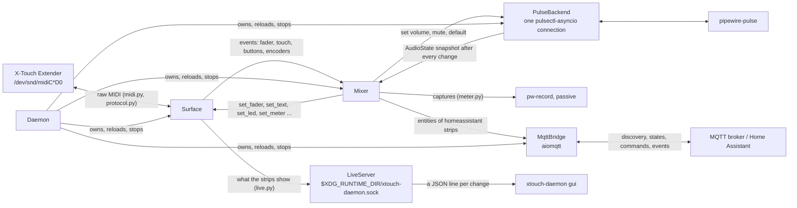

# Architecture

How the daemon works inside, for developers. To set up the project and run the tests, see
[Contributing](https://github.com/markusressel/xtouch-daemon/blob/main/CONTRIBUTING.md).

## Modules

| Module | Role |
|---|---|
| `protocol.py` | The Mackie Control codec: decodes the device's MIDI messages into events, builds the messages that drive it. Pure functions. |
| `midi.py` | Finds the device's sound card in `/proc/asound/cards` and reads and writes its raw MIDI device without blocking. |
| `surface.py` | `Surface`: the connection to the device (connects again after it was unplugged), and per `Strip` what it shows. Sends only what changed, shows everything again after a reconnect, glides the motor faders and keeps them still while touched. |
| `audio/model.py` | `AudioState`: an immutable snapshot of the outputs, inputs, application streams and defaults. |
| `audio/backend.py` | `AudioBackend`: the interface the strips use (snapshots, volume, mute, default). |
| `audio/pulse.py` | `PulseBackend`: one connection to the sound server that follows it by events and carries out the commands. |
| `audio/meter.py` | `Meter`: audio levels from passive `pw-record` captures. |
| `strips/` | The strip controllers: `DeviceStrip`, `AppGroupStrip`, `AutoStrip` (with `AutoAssigner`), `HomeAssistantStrip`, `EmptyStrip`, and the shared `VolumeStrip` base. |
| `mqtt.py` | `MqttBridge`: the connection to the MQTT broker for `homeassistant` strips. Announces their entities (haad-mqtt-autodiscovery), restores the retained states, passes commands on, publishes availability. |
| `mixer.py` | `Mixer`: the controllers of one configuration, fed with every state and every event, and the meter ticker. |
| `daemon.py` | `Daemon`: the lifecycle (signals, reload, shutdown, systemd notifications). |
| `instance.py` | The running daemon for other processes: its runtime file (process, configuration file) and where its live view is served. |
| `live.py` | `LiveServer`: what the device shows right now, for the GUI, over a Unix socket. See [Live view](#live-view). |
| `config.py` | The TOML configuration, validated with pydantic. |
| `cli.py`, `selftest.py`, `systemd.py` | The command line, the device self-test, systemd integration (notify, journal log levels, the unit file, controlling the user service). |
| `gui/domain/` | The configuration editor without a toolkit: the editable document, the options of the models, the look of the strips, suggestions from the sound server, applying a saved file. See [GUI](#gui). |
| `gui/qt/` | The widgets of `xtouch-daemon gui` (the `gui` extra). |

## Data flow

1. `PulseBackend` subscribes to sink, source, sink input and server events. After a burst of events it takes one
   snapshot (`AudioState`) and hands it to the mixer.
2. The `Mixer` lets the `AutoAssigner` give the `auto` strips their applications, then calls `update(state)` on every
   controller. A controller shows the state on its `Strip`: color, LCD lines, LEDs, ring and fader.
3. The `Surface` sends only what changed. A fader target starts a glide that moves the motor every 10 ms.
4. An event from the device goes from the `Surface` to the `Mixer`, which hands it to the controller of its strip. A
   controller turns it into commands to the backend. These run as tasks: nothing blocks the event loop.
5. The sound server reports the result as a new snapshot, which goes through step 2 again.

A `homeassistant` strip ignores the snapshots. Its entities work as in haad: Home Assistant sends a command, the
entity publishes it as its state (retained), and the copy that comes back from the broker changes the entity; the
bridge then tells the strip, which shows it. The device's events go the other way: a fader or encoder publishes its
number (a fader moved by hand at most every 100 ms), buttons publish events, which are not retained.

## Lifecycle

- **Start:** the daemon starts the surface, the backend and the mixer as tasks and tells systemd `READY=1`. The device
  and the sound server do not need to be there: both are connected (again) when they appear.
- **Reload (SIGHUP):** the configuration is read again. A file with errors is logged and the current configuration
  stays. Otherwise the old mixer is closed, a new one takes over the same surface and backend, and gets the current
  state right away. systemd learns about it through `RELOADING=1` and `READY=1`.
- **Stop (SIGTERM, SIGINT):** the daemon tells systemd `STOPPING=1`, closes the mixer, turns every strip dark and
  moves the faders down, waits for the faders (at most 2 s), sends what is still queued and closes the device. A dark
  surface shows that nothing drives it anymore.
- **Stop, in this order:** first everything stops that could show something (the sound server connection, MQTT, the
  mixer, the device's events), then the strips are reset, and only then the surface closes. A snapshot that arrived
  during the reset would otherwise paint the strips again.
- **MQTT:** the bridge connects (again) on its own, like the backend. On every connect it publishes the discovery
  configurations, subscribes, and waits for the retained states with a ping on its own sync topic: the broker sends
  retained messages before later ones. Entities without a retained state then get their defaults. A reload hands the
  bridge the entities of the new strips; entities of removed strips are removed from Home Assistant. A changed
  `[mqtt]` section needs a restart.
- **Status:** `systemctl --user status xtouch-daemon` shows whether the device, the sound server and (with `[mqtt]`)
  the broker are connected.

## Design decisions

- **One snapshot for all strips.** Every strip sees the same consistent state, and one connection serves eight
  strips. The strips derive everything from the snapshot instead of keeping their own copies.
- **Coalesced volume commands.** A fader sends many positions per second. A strip sets only the latest one when the
  previous command finished, and shows the new value at once, so the display does not lag behind the hand.
- **Passive, native captures for the meters.** The meters use `pw-record` with `node.passive = true`: a capture never
  wakes a device, never lights the microphone indicator, and never switches Bluetooth headphones into headset mode. They
  are native PipeWire streams on purpose: WirePlumber 0.5.18 (PipeWire 1.6.10) restores captures of PulseAudio clients
  (`parec`, peak detection streams) at 0 % volume, so those would only get silence. `state.restore-props = false`
  keeps WirePlumber from saving the captures at all. `node.dont-reconnect = true` keeps a capture with its device or
  stream: WirePlumber makes a stream whose target is the default when it is linked follow the default (like
  PulseAudio), so without it the meter of the default output would show the next default output after Select.
  `pw-record` runs under `stdbuf -o0` (coreutils): its buffered output comes in blocks of 4096 bytes (64 ms at
  8 kHz), so the meters lagged, and two meters of the same audio differed by up to that much. Unbuffered, it writes
  every cycle of the graph; the daemon takes the peak of every 20 ms.
- **Stall restart.** WirePlumber links a passive capture only once and gives up when that fails, e.g. while Bluetooth
  headphones disappear and streams move. A capture that gets no audio for 3 s while its device or stream plays is
  started again.
- **The default device follows by name.** A strip without `device` looks up the default in every snapshot, so it
  follows a switch of the default device, including its meter.
- **One owner per strip.** A strip belongs to PipeWire or to Home Assistant, chosen by its `type`. Mixing both on one
  fader would make two sources fight over the motor.
- **Availability follows the device.** The entities are available while the daemon runs and the device is connected,
  so Home Assistant greys out controls that would do nothing. A last will covers a crash.
- **haad-mqtt-autodiscovery as a path dependency.** The entities are the same as haad's, used from a checkout next
  to this one (like haad does), which also sets the Python version to 3.14.
- **No volume restore in the daemon.** The sound server keeps the volumes. The daemon remembers only the volume of an
  idle application strip, for its next stream, and only while it runs.

## GUI

`xtouch-daemon gui` is an optional editor for the configuration file, in the subpackage `gui` and the extra of the same
name, like the GUI of [openhasp-config-manager](https://github.com/markusressel/openhasp-config-manager). The daemon
itself does not import it.

- **Toolkit-free domain, thin widgets.** `gui/domain` decides everything: `ConfigDocument` holds the file as plain
  values, validates it with the pydantic models (the same messages as `check-config`), and saves it. `looks()` says
  how each strip appears on the device and `faces()` whether the preview shows it live or from the file, `status`
  whether the device runs the saved file, `sources` turns sound server snapshots into suggestions, `apply()` decides
  between reload, restart and "the daemon does not run". `gui/qt` only shows that and passes edits back.
- **What applies where.** The strips on top show the device (see [Live view](#live-view)) and are how a strip is
  picked: a click, the arrow keys, dragging (Escape cancels) or Ctrl+arrows to move it, a context menu. Below them one
  tab holds the options of the selected strip and another the global settings (`[behavior]`, `[aliases]`, `[mqtt]` as
  "Home Assistant", `[device]`), so a global setting never looks like one of the selected strip. A strip with unsaved
  changes shows how it will look (marked with a dot), the others stay live.
- **Undo instead of questions.** `History` (`gui/domain/history.py`) keeps the states of the document before every
  edit, so removing a strip or reverting the file asks nothing and Ctrl+Z brings it back. Typing into one option is one
  step. Ctrl+Z undoes in the document also while a text field has the focus.
- **Forms from the models.** `schema.py` reads the options of every section and strip type from the pydantic models:
  the type picks the widget (switch, number, choice, color swatches, list chips, masked secret, file), the attribute
  docstrings become the help, `Field` constraints the ranges, and `Meanings` next to a choice (`config.py`, e.g.
  `INDICATORS`) say what each value does. A new option or strip type needs no GUI code; a test fails for an option
  without help or a value without a meaning. `gui/domain/docs.py` holds the "Learn more" links into this site, and a
  test checks each against the headings of `docs/`.
- **The comments stay.** Saving edits the TOML document with tomlkit: unchanged values keep their place and their
  comments, and moved strips take theirs along. The file is written in place, so a symlinked configuration stays one.
- **The daemon is found, not guessed.** `xtouch-daemon run` writes `$XDG_RUNTIME_DIR/xtouch-daemon.json` (its process
  id, its configuration file, whether systemd started it) while it runs (`instance.py`), so the GUI finds it wherever
  it was started, and a second daemon names the one that has the device. A saved file is reloaded (SIGHUP) only when
  the daemon reads that file; a changed `[device] name` or `[mqtt]` needs a restart, since a reload does not take them. The
  GUI restarts only the service: `systemd.Service` (shared with `install-service`) reads the state of the unit, and
  installs, starts and restarts it.
- **PyQt6, QtAwesome and qt-themes.** The same as openhasp-config-manager, so the tools look and work alike. The wheels
  carry Qt itself, so `uv tool install` needs no system packages (GTK 4 through PyGObject needs the system libraries
  and a compiler), Qt paints the strip preview with `QPainter` and does drag and drop, and pytest-qt runs the widgets
  offscreen.
- **One visual system.** `qt/theme.py` holds the design tokens: the colors of the dark and the light theme (text at
  4.5:1 or more and the outlines of controls at 3:1 or more on every surface, WCAG 2.2 AA, checked by the tests), a
  4 px spacing scale, radii, the height of controls and a type scale relative to the desktop font, and the colors of
  the device for the preview, the same in both themes. Widgets set style roles (`theme.set_role`) and take their sizes
  from the tokens instead of styling themselves. The preview decides what a strip shows (a `Face`: LCD, ring, LEDs,
  meter, fader) apart from drawing it.

## Live view

The GUI shows the strips as the device shows them right now, which only the daemon knows. `xtouch-daemon run` serves
that on the Unix socket `$XDG_RUNTIME_DIR/xtouch-daemon.sock` (mode 0600, next to the runtime file of `instance.py`)
for as long as it runs:

- **Whole states, one JSON line each.** A client gets the whole state when it connects and again whenever something
  changed, checked 20 times a second (`live.INTERVAL`): the LCD lines and backlight, the LEDs, the ring, where the
  fader is and whether it is touched, the meter level (falling like on the device, see `METER_FALL`), whether the
  device, the sound server and the broker are connected, and the `fingerprint()` of the configuration in use. A line
  is about 2 KB; a state rather than changes means a client that connects late or misses one needs nothing else.
  `version` changes when a line means something else.
- **Read only.** What a client sends is ignored: the GUI changes the daemon only through the configuration file and
  a reload.
- **Never in the way.** Clients get only non-blocking writes. One that falls behind by more than `MAX_BUFFER` is
  dropped (it can connect again), and a socket that can't be made is logged: the daemon runs on without the live view.
  The server is not one of the parts of the daemon whose end stops it.
- **Applied or not.** The fingerprint is a hash of the whole configuration (secrets included). The GUI compares it
  with the one of the saved file, so it can say whether the daemon took the file, instead of assuming a reload worked
  (it keeps the old configuration when the new one has errors or a changed `[mqtt]`).

The GUI reads the socket with a `QLocalSocket`, without a thread, and connects again while the daemon runs. Without a
daemon it shows what the file would show, and says so.

## Testing

The unit tests run without hardware and without a sound server:

- the protocol codec and the MIDI parser with captured messages,
- the raw MIDI device against a FIFO,
- the surface with a recording `send`,
- the strips, the mixer and the daemon with a fake `AudioBackend`,
- `PulseBackend` with a fake pulsectl connection,
- the meters with a fake `pw-record` script,
- the MQTT bridge and the `homeassistant` strips with an in-memory broker (`tests/fake_mqtt.py`): retained messages,
  subscriptions, last wills, lost connections,
- the live view with a real Unix socket in a short temporary directory: clients that read, that don't read, and that
  go away,
- the GUI domain with configuration files in a temporary directory and a fake `systemctl`, and the GUI widgets with
  pytest-qt on the offscreen platform, with a fake sound server and the dialogs answered by the tests.

`just coverage` fails below 90 % line and branch coverage.
