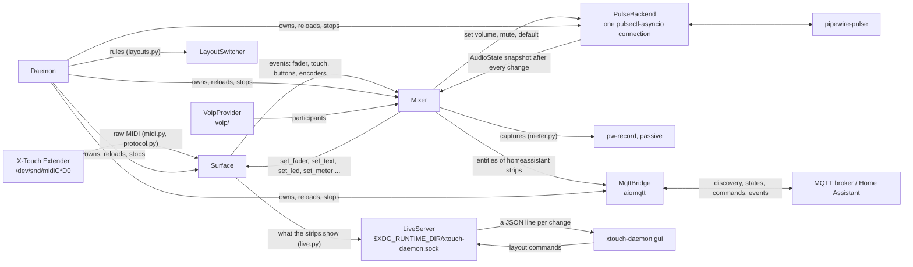

# Architecture

How the daemon works inside, for developers. To set up the project and run the tests, see
[Contributing](https://github.com/markusressel/xtouch-daemon/blob/main/CONTRIBUTING.md).

## Modules

| Module | Role |
|---|---|
| `protocol.py` | The Mackie Control codec: decodes the device's MIDI messages into events, builds the messages that drive it. Pure functions. |
| `midi.py` | Finds the device's sound card in `/proc/asound/cards` and reads and writes its raw MIDI device without blocking. |
| `surface.py` | `Surface`: the connection to the device (connects again after it was unplugged), and per `Strip` what it shows. Sends only what changed, shows everything again after a reconnect, glides the motor faders and keeps them still while touched. |
| `audio/model.py` | `AudioState`: an immutable snapshot of the outputs, inputs, application streams and defaults. |
| `audio/backend.py` | `AudioBackend`: the interface the strips use (snapshots, volume, mute, default). |
| `audio/pulse.py` | `PulseBackend`: one connection to the sound server that follows it by events and carries out the commands. |
| `audio/meter.py` | `Meter`: audio levels from passive `pw-record` captures. |
| `strips/` | The strip controllers: `DeviceStrip` (and `ChoiceStrip` for `choices`), `AppGroupStrip`, `AutoStrip` (with `AutoAssigner`), `HomeAssistantStrip`, `EmptyStrip`, and the shared `VolumeStrip` base. |
| `mqtt.py` | `MqttBridge`: the connection to the MQTT broker for `homeassistant` strips. Announces their entities (haad-mqtt-autodiscovery), restores the retained states, passes commands on, publishes availability. |
| `mixer.py` | `Mixer`: the controllers of one layout of a configuration, fed with every state and every event, and the meter ticker. |
| `placement.py` | `place()` and `Flow`: which strip of the configuration each strip of the device shows, for strips that collapse. See [Collapsing strips](#collapsing-strips). |
| `layouts.py` | `LayoutSwitcher`: which layout the device shows, chosen by hand or by the rules (`apps`, `processes`, `hold`); the running processes from `/proc`. |
| `launch.py` | `Launcher`: starts the command of a strip's `launch` detached from the daemon (a transient systemd user service); `LaunchButton`: when Select launches, and its LED. See [Design: launching applications](design/launch.md). |
| `voip/` | `VoipProvider`: the participants of a voice chat for `voip` strips, with `DemoProvider` and `BridgeProvider` (a client plugin on a Unix socket). |
| `mumble.py`, `integrations/mumble/` | The Mumble plugin (C): its sources, building its bundle with CMake, finding it and handing it to Mumble's installer. See [Mumble](integrations/mumble.md). |
| `daemon.py` | `Daemon`: the lifecycle (signals, reload, shutdown, systemd notifications) and switching layouts. |
| `instance.py` | The running daemon for other processes: its runtime file (process, configuration file) and where its live view is served. |
| `live.py` | `LiveServer`: what the device shows right now, for the GUI, over a Unix socket. See [Live view](#live-view). |
| `config.py` | The TOML configuration, validated with pydantic. |
| `cli.py`, `selftest.py`, `systemd.py` | The command line, the device self-test, systemd integration (notify, journal log levels, the unit file, controlling the user service). |
| `gui/domain/` | The configuration editor without a toolkit: the editable document, the options of the models, the look of the strips, suggestions from the sound server, applying a saved file. See [GUI](#gui). |
| `gui/qt/` | The widgets of `xtouch-daemon gui` (the `gui` extra). |

## Data flow

1. `PulseBackend` subscribes to sink, source, sink input and server events. After a burst of events it takes one
   snapshot (`AudioState`) and hands it to the mixer.
2. The `Mixer` lets the `AutoAssigner` give the `auto` strips their applications, then calls `update(state)` on every
   controller. A controller shows the state on its `Strip`: color, LCD lines, LEDs, ring and fader.
3. The `Surface` sends only what changed. A fader target starts a glide that moves the motor every 10 ms.
4. An event from the device goes from the `Surface` to the `Mixer`, which hands it to the controller of its strip. A
   controller turns it into commands to the backend. These run as tasks: nothing blocks the event loop.
5. The sound server reports the result as a new snapshot, which goes through step 2 again.

A `homeassistant` strip ignores the snapshots. Its entities work as in haad: Home Assistant sends a command, the
entity publishes it as its state (retained), and the copy that comes back from the broker changes the entity; the
bridge then tells the strip, which shows it. The device's events go the other way: a fader or encoder publishes its
number (a fader moved by hand at most every 100 ms), buttons publish events, which are not retained.

## Lifecycle

- **Start:** the daemon starts the surface, the backend and the mixer as tasks and tells systemd `READY=1`. The device
  and the sound server do not need to be there: both are connected (again) when they appear.
- **Reload (SIGHUP):** the configuration is read again. A file with errors is logged and the current configuration
  stays. Otherwise the old mixer is closed, a new one takes over the same surface and backend, and gets the current
  state right away. systemd learns about it through `RELOADING=1` and `READY=1`.
- **Preview:** a configuration of the GUI (see [Live preview](#live-preview)) takes over like a reload, from memory
  instead of the file. A reload ends it: the file runs, or the configuration of the file before when the file can't
  be used.
- **Stop (SIGTERM, SIGINT):** the daemon tells systemd `STOPPING=1`, closes the mixer, turns every strip dark and
  moves the faders down, waits for the faders (at most 2 s), sends what is still queued and closes the device. A dark
  surface shows that nothing drives it anymore.
- **Stop, in this order:** first everything stops that could show something (the sound server connection, MQTT, the
  mixer, the device's events), then the strips are reset, and only then the surface closes. A snapshot that arrived
  during the reset would otherwise paint the strips again.
- **MQTT:** the bridge connects (again) on its own, like the backend. On every connect it publishes the discovery
  configurations, subscribes, and waits for the retained states with a ping on its own sync topic: the broker sends
  retained messages before later ones. Entities without a retained state then get their defaults. A reload hands the
  bridge the entities of the new strips; entities of removed strips are removed from Home Assistant (not by a
  preview, see [Live preview](#live-preview)). A changed `[mqtt]` section needs a restart.
- **Status:** `systemctl --user status xtouch-daemon` shows whether the device, the sound server and (with `[mqtt]`)
  the broker are connected.

## Design decisions

- **One snapshot for all strips.** Every strip sees the same consistent state, and one connection serves eight
  strips. The strips derive everything from the snapshot instead of keeping their own copies.
- **Coalesced volume commands.** A fader sends many positions per second. A strip sets only the latest one when the
  previous command finished, and shows the new value at once, so the display does not lag behind the hand.
- **Passive, native captures for the meters.** The meters use `pw-record` with `node.passive = true`: a capture never
  wakes a device, never lights the microphone indicator, and never switches Bluetooth headphones into headset mode. They
  are native PipeWire streams on purpose: WirePlumber 0.5.18 (PipeWire 1.6.10) restores captures of PulseAudio clients
  (`parec`, peak detection streams) at 0 % volume, so those would only get silence. `state.restore-props = false`
  keeps WirePlumber from saving the captures at all. `node.dont-reconnect = true` keeps a capture with its device or
  stream: WirePlumber makes a stream whose target is the default when it is linked follow the default (like
  PulseAudio), so without it the meter of the default output would show the next default output after Select.
  `pw-record` runs under `stdbuf -o0` (coreutils): its buffered output comes in blocks of 4096 bytes (64 ms at
  8 kHz), so the meters lagged, and two meters of the same audio differed by up to that much. Unbuffered, it writes
  every cycle of the graph; the daemon takes the peak of every 20 ms.
- **Stall restart.** WirePlumber links a passive capture only once and gives up when that fails, e.g. while Bluetooth
  headphones disappear and streams move. A capture that gets no audio for 3 s while its device or stream plays is
  started again.
- **The default device follows by name.** A strip without `device` looks up the default in every snapshot, so it
  follows a switch of the default device, including its meter.
- **One owner per strip.** A strip belongs to PipeWire or to Home Assistant, chosen by its `type`. Mixing both on one
  fader would make two sources fight over the motor.
- **Availability follows the device.** The entities are available while the daemon runs and the device is connected,
  so Home Assistant greys out controls that would do nothing. A last will covers a crash.
- **haad-mqtt-autodiscovery as a path dependency.** The entities are the same as haad's, used from a checkout next
  to this one (like haad does), which also sets the Python version to 3.14.
- **No volume restore in the daemon.** The sound server keeps the volumes. The daemon remembers only the volume of an
  idle application strip, for its next stream, and only while it runs.

## GUI

`xtouch-daemon gui` is an optional editor for the configuration file, in the subpackage `gui` and the extra of the same
name, like the GUI of [openhasp-config-manager](https://github.com/markusressel/openhasp-config-manager). The daemon
itself does not import it.

- **Toolkit-free domain, thin widgets.** `gui/domain` decides everything: `ConfigDocument` holds the file as plain
  values, validates it with the pydantic models (the same messages as `check-config`), and saves it. `looks()` says
  how each strip appears on the device and `faces()` whether the preview shows it live or from the file, `status`
  whether the device runs the saved file, `sources` turns sound server snapshots into suggestions, `apply()` decides
  between reload, restart and "the daemon does not run". `gui/qt` only shows that and passes edits back.
- **What applies where.** The strips on top show the device (see [Live view](#live-view)) and are how a strip is
  picked: a click, the arrow keys, dragging (Escape cancels) or Ctrl+arrows to move it, a context menu. Below them one
  tab holds the options of the selected strip and another the global settings (`[behavior]`, `[aliases]`, `[mqtt]` as
  "Home Assistant", `[device]`), so a global setting never looks like one of the selected strip. A strip with unsaved
  changes shows how it will look (marked with a dot), the others stay live.
- **Strips beyond the device.** The preview has the 8 strips of the device, the first 8 of the layout.
  `gui/domain/flow.py` says where every strip of the layout is, from the file or from the placement the daemon sends
  (see [Collapsing strips](#collapsing-strips)), and whether one more could ever get a place; `faces()` uses it to show
  each strip with the strip of the device it is on. `qt/strip_list.py` lists them all and selects the ones beyond 8,
  which the `Editor` allows.
- **Undo instead of questions.** `History` (`gui/domain/history.py`) keeps the states of the document before every
  edit, so removing a strip or reverting the file asks nothing and Ctrl+Z brings it back. Typing into one option is one
  step. Ctrl+Z undoes in the document also while a text field has the focus.
- **Forms from the models.** `schema.py` reads the options of every section and strip type from the pydantic models:
  the type picks the widget (switch, number, choice, color swatches, list chips, masked secret, file), the attribute
  docstrings become the help, `Field` constraints the ranges, and `Meanings` next to a choice (`config.py`, e.g.
  `INDICATORS`) say what each value does. A new option or strip type needs no GUI code; a test fails for an option
  without help or a value without a meaning. `gui/domain/docs.py` holds the "Learn more" links into this site, and a
  test checks each against the headings of `docs/`.
- **The comments stay.** Saving edits the TOML document with tomlkit: unchanged values keep their place and their
  comments, and moved strips take theirs along. The file is written in place, so a symlinked configuration stays one.
  Options that a strip's new type does not have go into a comment of its table (`StripDraft.kept`), so nothing typed
  is lost and switching back restores them, also in a later session.
- **The daemon is found, not guessed.** `xtouch-daemon run` writes `$XDG_RUNTIME_DIR/xtouch-daemon.json` (its process
  id, its configuration file, whether systemd started it) while it runs (`instance.py`), so the GUI finds it wherever
  it was started, and a second daemon names the one that has the device. A saved file is reloaded (SIGHUP) only when
  the daemon reads that file; a changed `[device] name` or `[mqtt]` needs a restart, since a reload does not take them. The
  GUI restarts only the service: `systemd.Service` (shared with `install-service`) reads the state of the unit, and
  installs, starts and restarts it.
- **PyQt6, QtAwesome and qt-themes.** The same as openhasp-config-manager, so the tools look and work alike. The wheels
  carry Qt itself, so `uv tool install` needs no system packages (GTK 4 through PyGObject needs the system libraries
  and a compiler), Qt paints the strip preview with `QPainter` and does drag and drop, and pytest-qt runs the widgets
  offscreen.
- **One visual system.** `qt/theme.py` holds the design tokens: the colors of the dark and the light theme (text at
  4.5:1 or more and the outlines of controls at 3:1 or more on every surface, WCAG 2.2 AA, checked by the tests), a
  4 px spacing scale, radii, the height of controls and a type scale relative to the desktop font, and the colors of
  the device for the preview, the same in both themes. Widgets set style roles (`theme.set_role`) and take their sizes
  from the tokens instead of styling themselves. The preview decides what a strip shows (a `Face`: LCD, ring, LEDs,
  meter, fader) apart from drawing it.
- **One source of truth: the `Editor`.** `qt/editor.py` holds the document, its history, its validation and which
  strip is selected. Views read from it and change the document only through it, so nothing keeps a copy that could
  go stale. It has two signals:
  - `changed(Change)` comes once per edit, after the document was validated once.
  - `selected(index)` comes only when another strip is selected: nothing in the document changed, so nothing is
    validated and no page is shown again. Only the strip page and the preview follow the selection.
- **Changes say what changed.** A `Change` (`gui/domain/changes.py`) has a `Scope` and, for some scopes, a path:
  - `VALUE`: a value in place; the field that made the change shows it already.
  - `STRIPS`: strips were added, moved, removed or given another type.
  - `SECTION`: a section was added or removed.
  - `ALIASES`, `LAYOUTS`: the list of aliases, or the layouts.
  - `DOCUMENT`: anything (undo, redo, revert).
  - `FILE`: the file was written, so the document is the same.
  Each page's `show_document(change)` updates only what that scope touches.
- **Built once, updated in place.** The pages build their widgets once, and showing the document loads the values
  into them (`OptionRow.load()`); no page is cleared and built again. A part that comes and goes (a section that is
  absent, the strip form of each type) is a page of a `Stack` that is sized to its current part, not a widget that is
  shown and hidden. The strip page builds a `StripForm` for a strip type the first time it shows one, and keeps it.
- **No layout for what stays the same.** Showing the document again, or a live update 20 times a second, changes no
  geometry when nothing differs:
  - `set_text` and the tab texts are set only when they differ.
  - `theme.set_role` restyles only for another role.
  - The list chips stay while their values are the same.
  - The layout tabs are filled again only when the layouts or the edited one change.
  Icons are kept with their name and color (`theme.set_icon`), so switching the theme draws them again
  (`theme.refresh_icons`) without building a page. The tests count it: selecting a strip changes the geometry of the
  window once, creates no widget and does not resize the window, and a live update that changes nothing lays out
  nothing (`LayoutPasses` in `tests/test_gui_qt.py`).
- **The options in the order of the device.** A strip form lists its options from top to bottom like the strip:
  1. what it controls (`device`, `match`, `profiles`, the `id` of a Home Assistant strip)
  2. the encoder and its ring
  3. the LCD
  4. the meter
  5. the Rec, Solo, Mute and Select buttons
  6. the fader and the range of the volume
  7. the `id`
  This is `STRIP_OPTION_ORDER` in `schema.py`, apart from the order of the fields in `config.py`. A test fails for an
  option without a place in it.

## Live view

The GUI shows the strips as the device shows them right now, which only the daemon knows. `xtouch-daemon run` serves
that on the Unix socket `$XDG_RUNTIME_DIR/xtouch-daemon.sock` (mode 0600, next to the runtime file of `instance.py`)
for as long as it runs:

- **Whole states, one JSON line each.** A client gets the whole state when it connects and again whenever something
  changed, checked 20 times a second (`live.INTERVAL`): the LCD lines and backlight, the LEDs, the ring, where the
  fader is and whether it is touched, the meter level (falling like on the device, see `METER_FALL`), whether the
  device, the sound server and the broker are connected, and the `fingerprint()` of the configuration in use. A line
  is about 2 KB; a state rather than changes means a client that connects late or misses one needs nothing else.
  `placement` tells which strip of the layout each strip of the device shows (see
  [Collapsing strips](#collapsing-strips)).
  `version` changes when a line means something else.
- **Requests of the user only.** A client may send requests, a line of JSON each: the [live preview](#live-preview)
  and `{"request": "layout", "layout": "gaming"}` (or `"+1"`, `"-1"`) to switch the layout, which
  `xtouch-daemon layout` and "Show on the device" in the GUI send (the reply tells whether there is such a layout).
  The daemon takes them only from processes of its own user (`SO_PEERCRED`: root can connect to a socket of mode
  0600), and a line of at most `MAX_REQUEST` (1 MiB): a longer one ends the connection. Otherwise the GUI changes the
  daemon through the configuration file and a reload. The state tells the `layout` shown and the `layouts` there are.
- **Never in the way.** Clients get only non-blocking writes. One that falls behind by more than `MAX_BUFFER` is
  dropped (it can connect again), and a socket that can't be made is logged: the daemon runs on without the live view.
  The server is not one of the parts of the daemon whose end stops it.
- **Applied or not.** The fingerprint is a hash of the whole configuration (secrets included). The GUI compares it
  with the one of the saved file, so it can say whether the daemon took the file, instead of assuming a reload worked
  (it keeps the old configuration when the new one has errors or a changed `[mqtt]`).

The GUI reads the socket with a `QLocalSocket`, without a thread, and connects again while the daemon runs. Without a
daemon it shows what the file would show, and says so.

## Live preview

The GUI can make the daemon run the configuration in its editor before it is saved (`gui/qt/live_preview.py`, the
daemon side in `Daemon.preview()`):

- **The whole text, over the live view.** `StartPreview` carries the TOML text the GUI would save
  (`ConfigDocument.render()`). The daemon reads it with `parse_config()`, the parser of the file, so the errors are the
  same as those of `check-config`, and runs it like a reload: a new mixer on the same surface, sound server and
  broker. The file is never written. A text with errors, or a changed `[mqtt]` (the bridge would need a new
  connection), is answered with the reason, and what runs keeps running. The GUI sends 300 ms after the last edit,
  and only a document without problems.
- **Replies the old GUI ignores, features the new one checks.** The daemon answers with lines without `version`
  (`{"reply": "preview", "ok": ..., "message": ...}`), which a GUI from before skips like lines of another version.
  Snapshots tell `preview` (the daemon runs a preview, and `config` is its fingerprint) and `features` (`["preview"]`);
  a daemon from before tells none and ignores requests, so the GUI keeps the switch off for it.
- **Always back to the file.** The preview ends with `EndPreview`, when the connection of its client ends (the window
  closed or crashed), without a request for `PREVIEW_TIMEOUT` (10 s; the GUI sends `KeepPreview` every 3 s, so a
  window that hangs with its connection open ends it too), and when the file is loaded: on a reload (saving in the GUI
  sends one), and when the file changes on disk (checked every second during a preview). The client is told why
  (`{"reply": "ended", ...}`). The configuration of the file is kept in memory (`Daemon.file_config`), so a file that
  became unusable meanwhile does not keep the preview running.
- **One preview at a time.** A second client takes it over, and the first one is told: the window someone works in
  wins over one that was left open.
- **Visible.** The status line of systemd ends with "previewing unsaved changes of the GUI", the log tells when a
  preview starts and ends and why, and the GUI shows a pill.
- **Home Assistant entities survive a preview.** A reload removes the entities of removed strips from Home
  Assistant (an empty retained discovery message), which also deletes them from its entity registry. A preview
  doesn't: `MqttBridge.set_entities(..., preview=True)` only stops driving the entities it does not have, which stay
  in Home Assistant with their retained states, so the file restores them as they were. The next configuration that
  is no preview removes what it does not have, like a reload; entities that only a preview had also lose the
  retained state they left on the broker, so a preview leaves nothing behind.
- **Secrets stay with the user.** The text carries the secrets of the file. The GUI sends it only to a daemon of its
  own user (`SO_PEERCRED` on its end of the socket), and the runtime directory is the user's own (`$XDG_RUNTIME_DIR`,
  or a directory of mode 0700 in the temporary directory).
- **Layouts too.** A preview is a whole configuration, layouts included: the daemon runs it like a reload, keeps the
  layout shown if the preview has it, and the layout select in Home Assistant gets the layouts of the preview. "Show
  on the device" switches to a layout of the preview.

## Layouts

A layout is a whole set of strips, so switching one is a reload without reading the file: the daemon closes the
`Mixer` and makes one for the other layout, on the same `Surface`, backend and MQTT bridge. The strips show the new
layout at once, from the last `AudioState`; the `Surface` sends only what changed. An overlay of the LCDs
(`Surface.banner`) shows the label of the layout across the strips for `switching.banner` seconds.

- **Who switches.** `LayoutSwitcher` holds the layout shown. Manual choices (CLI, GUI, Home Assistant's select, the
  Solo chord) switch at once. The rules are checked after every new `AudioState` and every 2 s (for `processes`). They
  are edge triggered: they switch only when the layout they want changes, so a manual choice stays until then.
- **Remembered.** The daemon keeps the layout shown in its state directory (`instance.layout_file()`), unless a rule
  put it there (`LayoutSwitcher.by_rule`), and starts with it. Rules that match at the start still switch, since they
  start from "wanting" `default`. Home Assistant's select only takes commands: a retained state (maybe of a rule of
  the last run) is put right once the bridge is ready, instead of switching.
- **Entities of all layouts.** The MQTT bridge keeps the entities of the `homeassistant` strips of every layout
  (`keep`), so automations don't see them come and go on every switch; the layout select belongs to the daemon.
- **VoIP strips.** A `voip` strip with `count = N` takes N places. The `Mixer` makes one `VoipGroup` of them, which
  pages through the participants of the `VoipProvider`; the provider runs in the daemon, not in the mixer, so it stays
  connected across switches and reloads. No voice chat client gives other programs a stream per participant, so the
  participants come from a plugin in the client (`BridgeProvider`), not from PipeWire.
- **The Mumble plugin** (`integrations/mumble/plugin.c`) is that plugin for Mumble. Mumble calls its callbacks in
  its main and audio threads; a thread of its own does the socket and never calls Mumble (Mumble's API calls block
  until its main thread runs them, which would deadlock the shutdown of the plugin). So the volume and the mute are
  applied by the plugin itself, to each voice in `mumble_onAudioSourceFetched`, rather than through Mumble's local
  volume (which the API can't set). The live view tells the GUI whether a plugin is connected (`Snapshot.voip`).

The design and its research are in [Design: layouts](design/layouts.md).

## Collapsing strips

With `collapse`, the strips of the configuration are not the strips of the device: a layout may have up to 32
places, and the device shows the first 8 that take one (see [Collapsing strips](configuration/collapsing.md)).

- **A strip of its own for every controller.** The `Mixer` gives each controller a `VirtualStrip` (`surface.py`)
  instead of a strip of the device. It keeps what the controller shows, like a `Strip` does, and passes it on to the
  strip of the device it is on (`target`), if any. Moving a controller is `bind()`: the new strip of the device shows
  everything the virtual one keeps, and only what changed is sent; the motor glides to the new value. So nothing of
  a controller (its auto application, a pending volume or switch) knows where it is, and its `index` (and with it
  the default `id` in Home Assistant) is its place in the configuration.
- **A pure placement.** `place(collapse, absent)` takes the first 8 strips that don't collapse. `Flow` keeps the
  state around it in one typed record per strip (`_Absence`: since when absent, collapsed or not), so the hold time
  (`behavior.collapse_hold`) and coming back at once are one rule. The mixer asks it after every state (one placement
  per state) and every meter tick, for hold times that end without a new state.
- **Not under a finger.** The mixer follows touches, held buttons and encoder pushes from the events of the device,
  and a fader moved without a touch (`Strip.held`); while any of them is there, `Flow.update()` is told it is busy and
  nothing moves. The release places what waited. Events of a dark strip of the device go nowhere.
- **From scratch.** A new mixer (a reload, a layout switch, the start) places from scratch with its first state: a
  strip that has nothing to control collapses at once. Hold times are not carried from one mixer to the next.
- **Meters follow.** Only controllers on the device get captures, so a strip that waits or collapsed runs no
  `pw-record`.
- **The live view** tells the placement (`Snapshot.placement`, an optional field: an older GUI ignores it, an older
  daemon does not send it and its strips are where they are configured).

`ChoiceStrip` (`strips/device.py`) switches between `choices` with Select. A press is a `_Choosing` (the choice, the
profile still to switch to, whether the default was asked for): the label shows at once, the card switches first,
and once its device is there it becomes the default. A failure goes back to the choice shown before, and a press
during a switch goes on from its target. With `[mqtt]` it has a select in Home Assistant.

The design is in [Design: choices and collapsing strips](design/dynamic-strips.md).

## Testing

The unit tests run without hardware and without a sound server:

- the protocol codec and the MIDI parser with captured messages,
- the raw MIDI device against a FIFO,
- the surface with a recording `send`,
- the strips, the mixer and the daemon with a fake `AudioBackend`,
- `PulseBackend` with a fake pulsectl connection,
- the meters with a fake `pw-record` script,
- the MQTT bridge and the `homeassistant` strips with an in-memory broker (`tests/fake_mqtt.py`): retained messages,
  subscriptions, last wills, lost connections,
- the live view with a real Unix socket in a short temporary directory: clients that read, that don't read, and that
  go away, requests of the user, of other users and that are too long, and the live preview through the daemon,
- the live preview of the GUI against a fake live view (a `QLocalServer`) that answers like the daemon,
- the Mumble plugin built with CMake and loaded into a fake Mumble (`integrations/mumble/test/fake_mumble.c`), which
  calls its callbacks as a script says, against a real `BridgeProvider` (skipped without cmake and a C compiler),
- the GUI domain with configuration files in a temporary directory and a fake `systemctl`, and the GUI widgets with
  pytest-qt on the offscreen platform, with a fake sound server and the dialogs answered by the tests.

`just coverage` fails below 90 % line and branch coverage.
