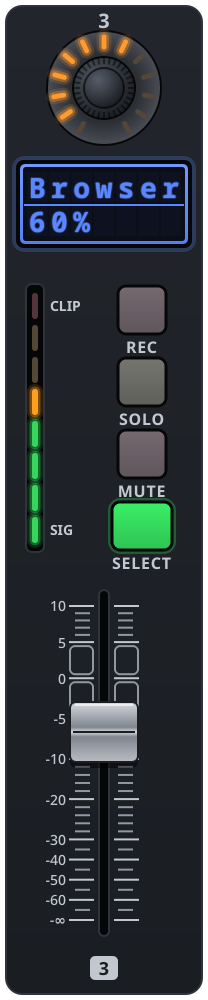
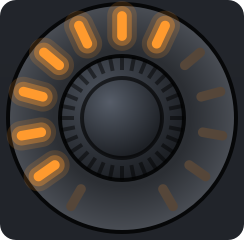
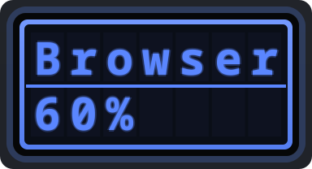
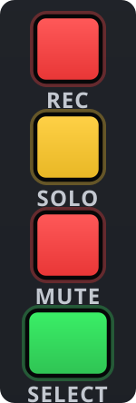
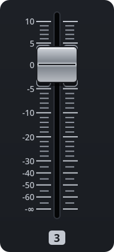

# Concepts

The ideas the configuration is built from, and the words that look alike. The
[Setup tour](getting-started/tour.md) puts them to work.

## The model in one example

```toml
[channel.buds]                    # a channel: what a strip controls
type = "output"
device = "bluez_output.*"         # your Bluetooth headphones; with two pairs, Select switches
label = "Buds"

[channel.game]
type = "apps"                     # another channel: all streams of some applications
match = ["@steam-games"]
label = "Game"

[state.gaming]                    # a state: when something matters
mode = true                       # a mode: one of these at a time
processes = ["@steam-games"]

[slots]                           # a slot: what one strip of the X-Touch shows, top candidate first
1 = ["buds if present", "auto"]   # the buds while they are connected, else the next application or person
2 = ["game if gaming", "auto"]    # the game while the mode gaming is on, else the next application or person
```

Strips 3 to 8 have no entry, so each shows `auto` (see [Pools](#pools)). `@steam-games` is a [preset](#more-words).
Everything else in this documentation refines one of these parts.

## Strips and slots

{ .xt-part width="88" }

The X-Touch Extender has 8 **strips**. A strip is hardware. Each has, from the top:

<div class="grid cards" markdown>

-   { .xt-icon }
    **Encoder**

    ---

    Turns and pushes, with a ring of LEDs. See [Encoders](configuration/strip/encoders.md).

-   { .xt-icon }
    **Display (LCD)**

    ---

    Two lines of 7 characters, with a colored backlight.

-   { .xt-icon }
    **Meter and buttons**

    ---

    The meter, and Rec, Solo, Mute and Select with their LEDs. See [Buttons and LEDs](configuration/strip/leds.md).

-   { .xt-icon }
    **Fader**

    ---

    A motor fader with a touch sensor, next to a dB scale.

</div>

A **slot** is the entry of the configuration for one strip, numbered 1 to 8 from the left.

## Channels

A **channel** is a thing you define in the file and give one strip. Its `type` says what it controls:

| `type` | The strip controls |
|---|---|
| `output`, `input` | One output (headphones) or input (microphone) at a time: one you name, one of several (a list, a wildcard or `choices`; Select switches), or the default one. |
| `apps` | All playback streams of a group of applications at once: one fader sets all of them. |
| `person` | One person of the voice chat. |
| `homeassistant` | Nothing by itself: its parts are entities in [Home Assistant](guides/home-assistant.md). |
| `custom` | Something other than audio, e.g. screen brightness, with your own commands. See [Custom channels](configuration/channels/custom.md). |

`auto` and `-` are not channel types: `auto` is a pool and `-` is a dark strip. A channel has an id (`buds`, `game`)
that names it in slots and conditions. It takes a strip only when a slot names it. An `apps` channel sets the volume
of what an application plays, not of what it records.

## Slots

A slot is a list of **candidates**, top first. It shows the first candidate whose condition holds:

```toml
[slots]
3 = ["game if gaming", "auto"]    # the game in the mode gaming, else the next application or person
4 = "mic"                         # a single candidate: always the microphone
5 = ["game if gaming", "-"]       # the game in the mode gaming, else a dark strip
```

A candidate is a channel or pool name, optionally followed by `if` and a **condition**. A slot without an entry is
`auto`.

## States and modes

A **state** is on or off. You define it in a `[state.<name>]` section and list its sources, such as `apps`,
`recording`, `voice_chat`, `processes`, `devices`, `homeassistant` or `command` (a program of your own). It is on
while any of its sources is. Slots ask about states in their conditions.

A **mode** is a state with `mode = true`. States are independent: `gaming` and `call` can be on together. Only one
mode is on at a time: the one with the highest `priority` wins, or `default` (which you don't define) when none has
a source on. A new mode shows its name on all displays for a moment. You can also pick a mode by hand: see
[Slots](configuration/slots.md#states-and-modes).

## Conditions

A condition is the text after `if`: names of states and modes joined with `and`, `or`, `not` and parentheses, plus
`present`. A channel is **present** while it has something to control: an application of an `apps` channel plays, its
output or input is there, the person is in the voice chat. `"buds if present"` shows the buds only while they are
connected.

## Pools

A **pool** supplies members that you don't list one by one. Each slot that names the pool gets one member, so one
pool can fill several strips. A channel takes exactly one strip.

- `apps`: the applications that play, one per slot. An application with a channel named in a slot stays on that slot.
- `people`: the people of the voice chat.
- `auto`: people and applications together. People fill the slots from the right, applications from the left.
- `devices`: the outputs and inputs that no channel has (a USB headset).
- `[pool.<id>]`: your own list of channels, applications or people. See
  [Pools of channels](configuration/slots.md#pools-of-channels).

A candidate with nothing to show hands the slot to the one below it.

## The same word, different things

These words mean different things in different places.

| Word | Where it means what |
|---|---|
| `apps` | A channel type, the pool of applications on free slots, `[pool.apps]` (its settings), and the source `apps` of a state (an application plays). |
| `auto` | The pool of people and applications; what a slot without an entry shows; the value of an override or of the mode pick in Home Assistant that means "the sources decide". |
| `device` | The section `[device]` (the control surface), and the option `device = "..."` of an `output` or `input` channel. The pool `devices` hands out outputs and inputs. |
| `select` | The Select button, the option `select` of an `output` or `input` channel, and the Home Assistant entity type `select`. |
| `controls` | The section `[controls]` (actions of a slot's buttons, fader or encoder), and in general what a strip controls. |
| voice chat | The people of the voice chat (`[voip]`, the pool `people`, `person` channels), the state source `voice_chat`, and the preset `@voip`. |

## More words

- **Place:** the options of a candidate in its slot, written as a table, e.g.
  `4 = [{ show = "auto", color = "blue" }]`. See [Places](configuration/slots.md#places).
- **Preset:** a name for a group of well-known applications, written with an `@` (`@browsers`). They come with the
  daemon. See [Presets](configuration/presets.md).
- **Choices:** the outputs or inputs Select switches between on one `output` or `input` channel. A **profile** is a
  setting of a sound card (analog or digital output) that a choice may switch to. See
  [Devices](configuration/channels/devices.md#choices).
- **Override:** you set a state `on` or `off` by hand, whatever its sources say, until the sources change. The value
  `auto` means no override.
- **Chord:** two Solo buttons that you pick, held together: it cycles the modes. See
  [Controls and the chord](configuration/slots.md#controls-and-the-chord).
- **Hold, `delay_off` and `absent_after`:** three waiting times, each for a different thing: how long an
  application, output or input that stopped keeps its slot (`hold` of a pool), how long a state stays on after its
  sources went off (`delay_off`), and how long a channel with nothing to control still counts as `present`
  (`absent_after`). Their options are in [Channels, states and slots](configuration/slots.md).

## Where to go next

[Channels, states and slots](configuration/slots.md) has every option of the model above. The
[channel types](configuration/channels/index.md) have a page each.
