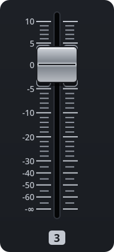
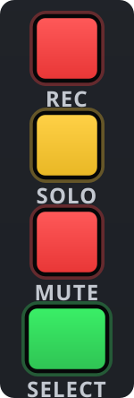

# Custom channels

A `custom` channel is a strip that controls something other than audio. You connect each part of the strip (fader,
encoder, LCD, meter, buttons) to a program of your own, or to Home Assistant. For example, a fader can set the
brightness of a screen. The examples on this page use [system-control](https://github.com/markusressel/system-control)
(`sysctrl`), a command line tool for screen brightness. You can replace it with any command that sets and prints a
number.

Other channel types have built-in behavior: the fader of an `output` channel sets the volume. A `custom` channel
has no built-in behavior. A part that you [bind](../strip/bindings.md) works. Binding means connecting it to a program or to Home Assistant. A part that you leave
out is dark and does nothing. The only exceptions are the encoder and the LCD, which follow the fader (see the table).
A slot names the channel, as for every other type.

This channel puts the brightness of the left screen on a fader. `set` is the command that changes the brightness,
and `{value}` in it is the new value. `watch` is a command that prints the brightness each time it changes, so the
fader follows changes made elsewhere:

```toml
[channel.screen_left]
type = "custom"
label = "Left"
fader = { set = "sysctrl display redshift brightness -d DisplayPort-1 -b {value}", watch = "sysctrl display redshift brightness -d DisplayPort-1 --watch", min = 0.1, max = 1.0, format = "{value:.0%}" }

[slots]
7 = "screen_left"    # strip 7 controls it
```

`min` and `max` are the values with the fader at the bottom and at the top. `format` says how the LCD shows the value
(`60%`).

The options of a `custom` channel:

| Option | Default | Meaning |
|---|---|---|
| `label` | The id of the channel, or the name of the target | The top line of the LCD. |
| `color` | `"white"` | The backlight of the LCD: a color name (`"red"`, `"green"`, ..., the names are the same as on every channel), `"homeassistant"`, or `{ watch = "command" }` or `{ poll = "command", every = 5 }` (the newest line the program prints is the color name). |
| `fader` | none: the fader stays down | A value (below), or `"homeassistant"`. |
| `encoder` | Without one, a turn changes the value of the fader by `step` | A value of its own (below), or `"homeassistant"`; see [Encoders](../strip/encoders.md). Without a fader and an encoder, the ring is dark. |
| `lcd` | The value of the fader, else of the encoder, shown as the `format` of that value says | The second line of the LCD: `"homeassistant"`, or `{ watch }` or `{ poll, every }` (the newest line the program prints is the text). |
| `meter` | none: the meter is dark | `"homeassistant"`, or `{ watch, min, max }` or `{ poll, every, min, max }` (the program prints a number on each line, from `min` to `max`). |
| `select`, `rec`, `solo`, `mute` | nothing | `press`, `hold` and `led` of the button (below). |
| `present` | always present | `{ watch }` or `{ poll, every }`: a line with text makes the channel present, an empty line absent (see [Present](#present)). `{ entity }`: present unless the entity is `unavailable` or `unknown`. |
| `targets` | none | The things the strip controls one at a time (below). |
| `together` | `false` | A move sets every target at once (below). |

## A value

{ .xt-part width="80" }

A value (`fader = { ... }`, `encoder = { ... }`) takes these options; only the encoder has a `push`:

| Option | Default | Meaning |
|---|---|---|
| `set` | | A program and its arguments, in one string (`"sysctrl ... -b {value}"`) or as a list; `{value}` in an argument is the new value, e.g. `0.55`. It runs without a shell ([Commands](../strip/bindings.md#commands)). |
| `watch` | none | A program that runs all the time and prints the value, one line per change. The first number of a line counts. The fader, the ring and the LCD follow it. |
| `poll` | none | Instead of `watch`: a program that runs to its end every `every` seconds and prints the value. The first number of its last line counts. |
| `every` | `10` | Seconds from one run of `poll` to the next ([Watch or poll](../strip/bindings.md#watch-or-poll)). |
| `min`, `max` | `0`, `100` | The value with the fader at the bottom and at the top, the ring empty and full. |
| `step` | `behavior.encoder_step` percent of `max - min` | How much one click of the encoder changes the value, in the unit of the value. `behavior.encoder_step` is 1 by default ([`[behavior]`](../behavior.md#behavior)), so with `min = 0` and `max = 100` one click is 1. Put `step` in the `encoder` table, for example `encoder = { set = "...", step = 5 }`. |
| `push` | none | The value that pushing the encoder sets. Without it, a push does nothing. |
| `format` | `{value:g}` | How the LCD shows the value, in the [format of Python](https://docs.python.org/3/library/string.html#formatspec). |

How `set` runs
:   The fader, the ring and the LCD show a change at once. The program runs with the newest value only: turns and
    moves that come while it runs wait for it, and only the last of them runs next. A program that fails or takes
    longer than 10 seconds is logged as a warning.

Without `watch` or `poll`
:   The daemon knows only the values it set itself. Until the first one, the ring is dark and the fader stays where it
    is. Until a value is known, a turn of the encoder starts at `push` if the encoder has one, else at `min`.

With `watch` or `poll`
:   While you touch the fader or while `set` runs, new lines of `watch` and `poll` don't move the value. A `watch`
    that ends or can't start runs again after 5 seconds. A `watch` or a `poll` starts when the daemon loads the
    configuration and keeps running, also while no slot shows the channel.

!!! note "No shell"

    Every program here runs without a shell: pipes and redirects belong in a script of your own (see
    [Commands](../strip/bindings.md#commands)).

## Buttons

{ .xt-part width="64" }

Select, Rec, Solo and Mute do nothing until you give them a `press`, and if you want one, a `hold`, which fires
when the button has been down for 0.5 seconds. Each button takes a table, as the example below shows. These are
the actions:

| Action | What it does |
|---|---|
| `off` | Nothing. |
| `{ run = "..." }` | Runs a program to its end. `{value}` in it is the value of the fader, else of the encoder. |
| `next` | Switches to the next target. It needs two targets or more, and not `together`. |
| `cycle_modes`, `mode:<id>`, `toggle:<id>` | As on the other channels ([Buttons](../strip/leds.md#buttons)). |
| `homeassistant` | Sends an event to Home Assistant for each press and each release. Use it as `press` only; there is no `hold` then. |

`led` takes:

| `led` | The LED |
|---|---|
| `off` | Stays dark. |
| `press` | Lit while the action of `press` is going on: <br>- while the program of `run` runs, <br>- while `next` has switched to another target than the first, <br>- while the mode or state of `mode:<id>` or `toggle:<id>` is on. |
| `homeassistant` | Home Assistant sets it. |
| `{ watch }` or `{ poll, every }` | `on`, `1`, `true`, `yes` light it, `flash` flashes it, anything else turns it off. |

```toml
[channel.night]
type = "custom"
fader = { set = "sysctrl display redshift brightness -d DisplayPort-1 -b {value}", watch = "sysctrl display redshift brightness -d DisplayPort-1 --watch", min = 0.1, max = 1.0 }
# Select sets the full brightness; its LED is lit while the screen is dimmed
select = { press = { run = "sysctrl display redshift brightness reset -d DisplayPort-1" }, led = { watch = "/home/me/bin/screen-dimmed" } }
mute = { press = { run = "notify-send 'Brightness {value}'" }, led = "press" }
```

`/home/me/bin/screen-dimmed` is a script of your own. It prints `on` while the screen is dimmed, `off` at full
brightness:

```sh
#!/bin/sh
sysctrl display redshift brightness -d DisplayPort-1 --watch | awk '{ print ($1 < 1 ? "on" : "off"); fflush() }'
```

## Present

With `present`, the channel is a candidate of the slots only while it is there, e.g. a screen that is plugged in:
a line with text makes it present, an empty line absent. Until the first line, it counts as present. A `poll` that
prints no text makes it absent; a run that fails changes nothing. With `{target}` in it (see [Targets](#targets)), one watch or poll runs per target, and the channel is present while any of its targets is. With `{ entity = "..." }`
(see [An entity of Home Assistant](../strip/bindings.md#an-entity-of-home-assistant)), it is present unless the entity
is `unavailable` or `unknown`, or Home Assistant does not have it; while the daemon is not connected to Home Assistant
it is absent. Before the daemon has tried to connect for the first time, it counts as present.

## Targets

`targets` are the things the strip controls one at a time, e.g. two screens. Each has a `name` (7 characters at most,
for the LCD) and a `value`; `{target}` in a program is replaced by the `value` of the target that the strip controls now (not the value of the fader). Every target has its own values, watches and polls. A program without `{target}` is the same for every target and runs once.

```toml
[channel.screens]
type = "custom"
targets = [{ name = "Left", value = "DisplayPort-1" }, { name = "Right", value = "DisplayPort-2" }]
fader = { set = "sysctrl display redshift brightness -d {target} -b {value}", watch = "sysctrl display redshift brightness -d {target} --watch", min = 0.1, max = 1.0, format = "{value:.0%}" }
select = { press = "next", led = "press" }
```

Select switches between the screens. Without a `label`, the top line of the LCD names the target. With a `label`, the top line stays the label, so
the second line shows the name of the new target for 2 seconds after a switch, then its value again (touching the strip shows the value
at once). `{target}` without `targets` is an error, and so are targets that no program uses.

With `together = true`, a move sets every target at once, and the strip shows the first one, e.g. both screens at
the same brightness.

## Two screens

Three ways to set the brightness of two screens. `sysctrl ... --watch` prints the brightness, e.g. `0.60`, at each
change; the range is 0.1 to 1.0.

As two channels, each a strip of its own, e.g. on slots 7 and 8:

```toml
[channel.screen_left]
type = "custom"
label = "Left"
fader = { set = "sysctrl display redshift brightness -d DisplayPort-1 -b {value}", watch = "sysctrl display redshift brightness -d DisplayPort-1 --watch", min = 0.1, max = 1.0, format = "{value:.0%}" }

[channel.screen_right]
type = "custom"
label = "Right"
fader = { set = "sysctrl display redshift brightness -d DisplayPort-2 -b {value}", watch = "sysctrl display redshift brightness -d DisplayPort-2 --watch", min = 0.1, max = 1.0, format = "{value:.0%}" }

[slots]
7 = "screen_left"
8 = "screen_right"
```

As one strip with two targets: Select switches between the screens, its LED is lit on the second one. This is the
example of [Targets](#targets).

As one strip for both screens at once: with `together`, a move sets both, and the strip shows the left screen.

```toml
[channel.screens]
type = "custom"
label = "Screens"
targets = [{ name = "Left", value = "DisplayPort-1" }, { name = "Right", value = "DisplayPort-2" }]
together = true
fader = { set = "sysctrl display redshift brightness -d {target} -b {value}", watch = "sysctrl display redshift brightness -d {target} --watch", min = 0.1, max = 1.0, format = "{value:.0%}" }
```

## Home Assistant

A part set to `"homeassistant"` is the entity of that part in Home Assistant, as on a
[`homeassistant` channel](../../guides/home-assistant.md#homeassistant-channels); it needs `[mqtt]`. With `[mqtt]`,
a fader or an encoder bound to a value is also a number in Home Assistant (`number.<ns>_<id>_fader`,
`number.<ns>_<id>_encoder`, where `<ns>` is the `namespace` of `[mqtt]`, "xtouch" by default, and `<id>` the id of the channel), from `min` to `max`: it shows the value, and a change there runs `set`. See
[Entities](../../guides/home-assistant.md#entities).

## On another slot

Without a slot of its own, you can still use the value of a custom channel on a strip that shows something else.
`[controls]` gives the fader or the encoder of any slot to the value of a custom channel. A fader sets the value
of the channel's fader. An encoder sets the value of the channel's own encoder, else that of its fader. The slot keeps showing what it shows, for example the encoder of a strip that shows
the speaker sets the brightness of the screen, so you keep the speaker's volume on that strip's fader. With targets, the slot controls the target that the channel controls now.

```toml
[controls]
1 = { encoder = { channel = "screen_left" } }   # the encoder of strip 1 sets the value of the channel screen_left
```

See [Controls and the chord](../slots.md#controls-and-the-chord).

## Simulate

Simulate in the GUI and `xtouch-daemon simulate` run the `watch` and `poll` programs too, but never `set` or `run`:
a move there changes only the simulation. Until the first line of `watch` or `poll`, a value is in the middle of its range. Whether a
channel with `present` is there comes from the situation you simulate, not from its watch.
