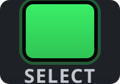
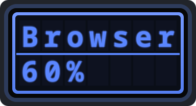

# Channels

A channel is one thing a strip can control, such as a sound device or a group of applications. You define it in the
[configuration file](../index.md) and give it a name. A strip of the device controls it when a [slot](../slots.md#slots) names it. You write one `[channel.<id>]` section per channel. The id is lower case letters,
digits and `_`. Slots, conditions and the entities in Home Assistant use it to name the channel.

```toml
[channel.mic]          # the id is "mic"
type = "input"         # it controls a microphone
label = "Mic"          # the top line of the LCD
color = "red"          # the backlight

[slots]
4 = "mic"              # strip 4 controls it
```

`type` says what the channel controls:

| `type` | The channel controls | Page |
|---|---|---|
| `output`, `input` | A sound device | [Devices](devices.md) |
| `apps` | All streams of a group of applications | [Applications](applications.md) |
| `person` | A person of the voice chat | [People and the voice chat](people.md) |
| `homeassistant` | Whatever Home Assistant says | [Home Assistant](../../guides/home-assistant.md) |
| `custom` | A value that your own programs read and set | [Custom channels](custom.md) |

The `auto` strips (they show the next application that plays) and the empty slots (`-`) are not channels. You write
them in the [slots](../slots.md#slots).

## Options for slots

Three options of a channel are not about its strip but about how slots use it:

- `tags` is a list of words that group channels, for example `tags = ["outs"]`. A [pool of your own](../slots.md#pools-of-channels)
  lists them all with `"#outs"` (the `#` marks a tag; it is not a comment).
- `in_pool` is `true` by default. It matters only for an `apps` or `person` channel that no slot names. Say you have
  `[channel.game]` with `match = ["steam"]`, and no slot names `game`. When Steam plays, a slot that shows `auto` or
  `apps` still takes it, with all its streams on one strip. The same goes for a `person`
  channel and the pools `people` and `auto`. `in_pool = false` stops this: the channel shows up only on a slot that
  names it.
- `absent_after` is a number of seconds (3 by default). When the channel has nothing to control any more, it still
  counts as present for that long. This stops `if present` from flickering when a device or an application goes
  away for a moment.

## Options of every audio channel

The options in this table apply to `output`, `input` and `apps` channels. A value in quotes is a TOML string and must
be written with the quotes: `color = "red"`.

| Option | Default | Meaning |
|---|---|---|
| `label` | see [Labels](#labels) | The top line of the LCD. `apps` channels need one. |
| `color` | `"white"` | The LCD backlight: `"off"` (no backlight), `"red"`, `"green"`, `"yellow"`, `"blue"`, `"magenta"`, `"cyan"` or `"white"`. Also `"homeassistant"`, `{ watch = "command" }` or `{ poll = "command" }`. These take the color from Home Assistant or from a program of your own that prints it: `watch` keeps the program running, `poll` runs it every few seconds ([Bindings](../strip/bindings.md)). The backlight is dark while the strip has nothing to control, unless `lit_when_idle` is on. |
| `lit_when_idle` | `false` | `true` keeps the backlight on while the strip has nothing to control. That is the case when no application of an `apps` channel plays, when the device is not there, and when an `auto` strip has no application. The fader still goes to the bottom. |
| `meter` | `true` | `false` turns the LED meter of this strip off. The meter works only if `behavior.meters` is on. Instead of a boolean you can write `"homeassistant"`, `{ watch, min, max }` or `{ poll, min, max }`: the meter then shows a level from Home Assistant or a program, see [Bindings](../strip/bindings.md). |
| `meter_point` | `behavior.meter_point` | Where the meter takes the level: `"pre_fader"` before the volume and Mute of the strip, `"post_fader"` after them. See [Meters](#meters). |
| `rec` | `"recording"` | What the Rec button does and what its LED shows. A single word (`"recording"`, `"playing"`, `"default"`, `"muted"` or `"off"`) sets only the LED. To set what a press does, write a table such as `rec = { press = "default" }`. See [Buttons and LEDs](../strip/leds.md). |
| `solo` | `"off"` | The same for the Solo button. |
| `select` | What the type does (on a device strip: makes the device the default) | The same for the Select button, see [Elements of a strip](#elements-of-a-strip) and [Buttons](../strip/leds.md#buttons). |
| `min_volume` | `0` | The volume of the fader at the bottom, 0 to 200 percent. |
| `max_volume` | `behavior.max_volume` (130) | The volume of the fader at the top, 0 to 200 percent. |
| `encoder` | `"balance"` on device strips, `"media"` on `apps` strips | What the encoder does: a mode, or a value of your own, see [Encoders](../strip/encoders.md). |
| `fader` | `"volume"` | `"homeassistant"` gives the fader to Home Assistant, see [Encoders](../strip/encoders.md#fader-homeassistant). A value of your own (`{ set, watch, ... }`) binds it to programs, see [Bindings](../strip/bindings.md). With either, the encoder sets the volume instead. |
| `lcd` | What the type shows | The second line of the LCD: `"homeassistant"`, `{ watch }` or `{ poll }`, see [Bindings](../strip/bindings.md). |

The defaults named `behavior.*` come from the [`[behavior]` section](../behavior.md#behavior). `behavior.meters` (on by
default) turns all meters on or off. `behavior.max_volume` is 130 by default.

### Where else the options work

- **Pools and candidates.** The look options (`color`, `lit_when_idle`, `meter`, `meter_point`, `rec`, `solo`) also
  work in the built-in pools (`[pool.apps]`, `[pool.auto]`, `[pool.devices]`), where they apply to every strip the
  pool fills. They also work in a candidate of a slot, where they apply to that slot only:
  `{ show = "mic", color = "blue" }` (see [Places](../slots.md#places)). A candidate that shows the pool `apps`,
  `auto` or `devices` also takes `encoder`, `min_volume` and `max_volume`. The other options (`label`, `select`, `fader`, `lcd`) can only
  be set on the channel itself.
- **`homeassistant` channels** take only `label` and `color`. Everything else on such a strip is an entity in Home
  Assistant, see the [Home Assistant guide](../../guides/home-assistant.md).
- **`person` channels** have options of their own, see [People](people.md#the-strips-of-people).

## Labels

A label is the top line of the LCD: at most 7 characters of ASCII, which is what fits. The bottom line shows the
volume, or the state of the strip (`muted`, `idle`, `off`).

What the label shows depends on the strip. Where a row lists several sources, the first one that exists wins, in the order of the row. Your own `label` comes last on device strips because a choice or a profile is more exact:

| Strip | Label |
|---|---|
| `output`, `input` | The label of the [choice](devices.md#choices) shown, or of the active [profile](devices.md#profiles), else `label`. Without any of these: the start of the device's description if the channel has `device`, else `"Output"` or `"Input"`. |
| `apps` | `label` (required). |
| Pools `apps` and `auto` in a slot | The alias of the application from [`[aliases]`](../behavior.md#aliases), or its name. If the application belongs to an `apps` channel, the strip keeps the `label` of that channel. |
| Pool `devices` in a slot | The start of the device's description. |
| `person` | `label`, else the first name of `person`. People that the pools `people` and `auto` hand out show their name. |
| `homeassistant` | What Home Assistant sets, until then `label`. |

## Volume range

The fader covers `min_volume` at the bottom to `max_volume` at the top (see [below](#100-at-the-0-db-mark) for how the travel maps to the volume in between). The encoder stays in that range too. Without
them, the range is 0 % to `behavior.max_volume` (130 % by default). For example, speakers that need amplification:

```toml
[channel.desk]
type = "output"
device = "alsa_output.usb-Generic_USB_Audio-00.analog-stereo"
label = "Desk"
min_volume = 50
max_volume = 200
```

- Above 100 % the sound server amplifies the audio in software.
- `min_volume` must be below `max_volume`. The daemon rejects a file where it is not.
- [Profiles](devices.md#profiles) and [choices](devices.md#choices) of a device can have a range of their own.
- `homeassistant` channels have no range: Home Assistant decides what their fader means.

### 100 % at the 0 dB mark

The scale next to the faders of the X-Touch Extender marks 0 dB at about 77 % of the travel. The daemon does this by itself for a strip whose range goes
above 100 %: it puts 100 % volume at that mark. Below the mark the fader covers `min_volume` to 100 %, above the mark
100 % to `max_volume`. Each part is linear. `behavior.unity_at` (default `77`) moves the mark.

```toml
[behavior]
max_volume = 200   # the top 23 % of the travel amplify by up to 100 %
```

The table compares the two ways to map the travel of the fader to a volume, for `min_volume = 0` and
`max_volume = 200`.

| Fader position | One linear scale, 0 to 200 % | Two parts, as the daemon does it |
|---|---|---|
| bottom | 0 % | 0 % |
| half way | 100 % | 65 % |
| 0 dB mark (77 %) | 154 % | 100 % |
| top | 200 % | 200 % |

With the default `max_volume = 130` the two parts have about the same slope, so the fader is linear from 0 % to 130 %
with 100 % at the mark. A strip whose range ends at 100 % (`max_volume = 100`) is not affected: its 100 % is at the
top. The GUI shows `unity_at` under Settings, Behavior.

## Elements of a strip

| Element | What it does on an audio strip |
|---|---|
| { .xt-icon } Fader | Sets the volume. Follows changes made elsewhere. Only a touched fader changes the volume. |
| { .xt-icon } Encoder | What `encoder` says, see [Encoders](../strip/encoders.md). |
| { .xt-icon } Mute | Toggles mute. Its LED is on while muted. |
| { .xt-icon } Rec, Solo | Their LEDs show things such as "an application records" ([indicators](../strip/leds.md#indicators)). By default a press does nothing, except Rec on a device with [profiles](devices.md#profiles). `rec` and `solo` can change that. |
| { .xt-icon } Select | On device strips: makes the device the default, or with [`choices`](devices.md#choices) goes to the next one. On application strips with [`launch`](applications.md#launching-the-application): starts the application. Without `launch`, it does nothing on application strips. |
| { .xt-icon } LCD | Top: the label. Bottom: the volume, or `muted`, `idle`, `off`. The backlight in `color`, dark while the strip has nothing to control. |
| Ring | The LEDs around the encoder show the position of the value the encoder sets. |
| { .xt-icon } Meter | The level of what the strip controls, see [Meters](#meters). |

!!! tip "Other actions"

    Every channel can give Rec, Solo and Select other actions, for a press and a hold: see
    [Buttons](../strip/leds.md#buttons). [`[controls]`](../slots.md#controls-and-the-chord) gives the buttons of a slot
    an action whatever it shows.

A strip with nothing to control (a device that is gone, an application that ended) goes dark, and its fader glides
slowly to the very bottom. When it is back, the fader goes up to its volume again.

## Meters

{ .xt-part width="56" }

The LED meter has seven LEDs for the level (green, then orange) and a red LED at the top. It shows the peak level of
what the strip controls, 10 times a second. The lowest LED lights at -60 dB. The seventh LED lights just below full
scale. A peak at full scale also lights the red LED, for half a second. When no new level arrives, the device lets the
meter fall by itself. The device takes levels in steps of 5 dB, about two steps per LED (see
[Hardware](../../reference/hardware.md)).

`meter_point` says where the level is taken, like the pre-fader and post-fader meters of a hardware mixer:

| `meter_point` | What the meter shows |
|---|---|
| `"pre_fader"` (default) | The level before the strip's volume and Mute. The meter keeps showing the audio while the fader is down. Mute is an exception for applications and inputs, see the table below. The Mute LED tells you whether the sound is cut. |
| `"post_fader"` | The level after the volume and Mute: what you hear of an application, what goes out of the output, what applications get from the input. Dark while muted. |

What each strip type shows at each point:

| Strip | `"pre_fader"` | `"post_fader"` |
|---|---|---|
| `output` | Before its volume and Mute, as PipeWire's monitor of the output has it. | Its monitor level multiplied by its volume, nothing while muted. |
| `apps`, `auto` | The audio of the streams with their volume taken out again, so the fader doesn't move the meter. **While muted the meter stays dark:** PipeWire applies the volume and Mute inside the stream, before anything else can listen, so the audio of a muted stream is gone. | The streams as they play. |
| `input` | The input with its volume taken out again. Dark while muted, as above. | The input as applications get it. |
| `person`, people | The voice before the participant's volume (the plugin's fader). Muted, Mumble doesn't fetch their voice: the meter lights while they talk, without a level. If the voice chat plugin sends no level from before the volume, the meter shows the one from after it. | The voice after their volume, dark while muted. |
| `homeassistant` | The meter entity, see [Home Assistant](../../guides/home-assistant.md). | |

Three places can set `meter_point`. The first one that sets it wins: the candidate in the slot, then the channel (or
the pool, for a strip that a pool fills), then `behavior.meter_point`.

```toml
[behavior]
meter_point = "pre_fader"     # every strip ...

[channel.out]
type = "output"
meter_point = "post_fader"    # ... but this one: what goes out of the speakers
```

Taking the volume out again (the "volume taken out again" of the table above) is exact while the volume stays the same. While you move the fader, the audio follows
the new volume a few hundredths of a second late. Without a fix, pulling the fader down would show a loud peak and
light the red LED. So for 0.3 s after a change, the meter uses the loudest volume of that time. The meter then shows
too low for a moment instead.

## Empty slots

```toml
[slots]
4 = ["game if gaming", "-"]   # dark while not gaming
```

`-` in a slot is a dark strip that does nothing. Its fader stays at the bottom.
