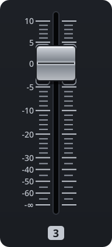
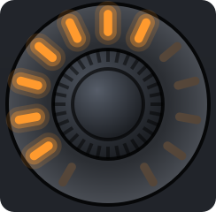
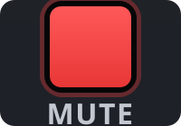
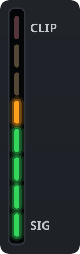

# Channels

A channel is what one strip controls, such as your speakers or all your browsers together. You write one
`[channel.<id>]` section per channel in the [configuration file](../index.md). The id (lower case letters, digits and
`_`) is how slots, conditions and Home Assistant name it. A strip controls the channel when a
[slot](../slots.md#slots) names it.

```toml
[channel.mic]          # the id is "mic"
type = "input"         # it controls a microphone
label = "Mic"          # the top line of the LCD
color = "red"          # the backlight

[slots]
4 = "mic"              # strip 4 controls it
```

`type` says what the channel controls:

| `type` | The channel controls | Page |
|---|---|---|
| `output`, `input` | A sound device | [Devices](devices.md) |
| `apps` | All streams of a group of applications | [Applications](applications.md) |
| `person` | A person of the voice chat | [People and the voice chat](people.md) |
| `homeassistant` | Whatever Home Assistant says | [Home Assistant](../../guides/home-assistant.md) |
| `custom` | A value that your own programs read and set | [Custom channels](custom.md) |

The `auto` strips and the empty slots (`-`) are not channels: see [slots](../slots.md#slots).

## Options for slots

Three options of a channel are not about its strip but about how slots use it:

- `tags` is a list of words that group channels, for example `tags = ["outs"]`. A
  [pool of your own](../slots.md#pools-of-channels) lists them with `"#outs"`.
- `in_pool` is `true` by default. It matters only for an `apps` or `person` channel that no slot names: the pools
  `apps`, `people` and `auto` still hand it out, with all its streams on one strip. `in_pool = false` keeps it
  out, so it shows up only on a slot that names it.
- `absent_after` is a number of seconds (3 by default). A channel with nothing to control any more still counts as
  present for that long, so `if present` doesn't flicker when your Bluetooth headphones go away for a moment.

## Options of every audio channel

These options apply to `output`, `input` and `apps` channels. Strings need their quotes: `color = "red"`.

| Option | Default | Meaning |
|---|---|---|
| `label` | see [Labels](#labels) | The top line of the LCD. `apps` channels need one. |
| `color` | `"white"` | The LCD backlight: `"off"`, `"red"`, `"green"`, `"yellow"`, `"blue"`, `"magenta"`, `"cyan"` or `"white"`. Also `"homeassistant"`, `{ watch = "command" }` or `{ poll = "command" }`: the color comes from Home Assistant or from a program of your own ([Bindings](../strip/bindings.md)). The backlight is dark while the strip has nothing to control, unless `lit_when_idle` is on. |
| `lit_when_idle` | `false` | `true` keeps the backlight on while the strip has nothing to control (no application plays, the output is not there). The fader still goes to the bottom. |
| `meter` | `true` | `false` turns the LED meter of this strip off. It works only if `behavior.meters` is on. `"homeassistant"`, `{ watch, min, max }` or `{ poll, min, max }` show a level from Home Assistant or a program, see [Bindings](../strip/bindings.md). |
| `meter_point` | `behavior.meter_point` | Where the meter takes the level: `"pre_fader"` before the volume and Mute of the strip, `"post_fader"` after them. See [Meters](#meters). |
| `rec` | `"recording"` | What the Rec button does and what its LED shows. A word (`"recording"`, `"playing"`, `"default"`, `"muted"` or `"off"`) sets only the LED; a table such as `rec = { press = "default" }` sets what a press does. See [Buttons and LEDs](../strip/leds.md). |
| `solo` | `"off"` | The same for the Solo button. |
| `select` | What the type does | The same for the Select button, see [Elements of a strip](#elements-of-a-strip) and [Buttons](../strip/leds.md#buttons). |
| `min_volume` | `0` | The volume of the fader at the bottom, 0 to 200 percent. |
| `max_volume` | `behavior.max_volume` (130) | The volume of the fader at the top, 0 to 200 percent. |
| `encoder` | `"balance"` on `output` and `input` strips, `"media"` on `apps` strips | What the encoder does: a mode, or a value of your own, see [Encoders](../strip/encoders.md). |
| `fader` | `"volume"` | `"homeassistant"` gives the fader to Home Assistant ([Encoders](../strip/encoders.md#fader-homeassistant)); `{ set, watch, ... }` binds it to programs ([Bindings](../strip/bindings.md)). With either, the encoder sets the volume. |
| `lcd` | What the type shows | The second line of the LCD: `"homeassistant"`, `{ watch }` or `{ poll }`, see [Bindings](../strip/bindings.md). |

The `behavior.*` defaults come from the [`[behavior]` section](../behavior.md#behavior).

### Where else the options work

- **Pools and places.** The look options (`color`, `lit_when_idle`, `meter`, `meter_point`, `rec`, `solo`) also
  work in the built-in pools (`[pool.apps]`, `[pool.auto]`, `[pool.devices]`) for every strip they fill, and in a
  place of a slot for that slot only: `{ show = "mic", color = "blue" }` (see [Places](../slots.md#places)). A place
  of `apps`, `auto` or `devices` also takes `encoder`, `min_volume` and `max_volume`. `label`, `select`, `fader` and
  `lcd` only work on the channel itself.
- **`homeassistant` channels** take only `label` and `color`; the rest is an entity in Home Assistant, see the
  [Home Assistant guide](../../guides/home-assistant.md). **`person` channels** have
  [options of their own](people.md#the-strips-of-people).

## Labels

A label is the top line of the LCD: at most 7 ASCII characters. The bottom line shows the volume, or the state of
the strip (`muted`, `idle`, `off`). Where a row lists several sources, the first one that exists wins:

| Strip | Label |
|---|---|
| `output`, `input` | The label of the [choice](devices.md#choices) shown, or of the active [profile](devices.md#profiles), else `label`, else the start of the description of the sound device (`"Output"` or `"Input"` without `device`). |
| `apps` | `label`. |
| Pools `apps` and `auto` in a slot | The alias of the application from [`[aliases]`](../behavior.md#aliases), or its name. An application of an `apps` channel keeps the `label` of that channel. |
| Pool `devices` in a slot | The start of the description of the output or input. |
| `person` | `label`, else the first name of `person`. People from a pool show their name. |
| `homeassistant` | What Home Assistant sets, until then `label`. |

## Volume range

The fader and the encoder cover `min_volume` at the bottom to `max_volume` at the top (the travel in between is
mapped [below](#100-at-the-0-db-mark)). Without them the range is 0 % to `behavior.max_volume` (130 % by default).
For example, speakers that need amplification:

```toml
[channel.desk]
type = "output"
device = "alsa_output.usb-Generic_USB_Audio-00.analog-stereo"
label = "Desk"
min_volume = 50
max_volume = 200
```

- Above 100 % the sound server amplifies the audio in software.
- `min_volume` must be below `max_volume`.
- [Profiles](devices.md#profiles) and [choices](devices.md#choices) can have a range of their own.
- `homeassistant` channels have no range: Home Assistant decides what their fader means.

### 100 % at the 0 dB mark

On a strip whose range goes above 100 %, the daemon puts 100 % volume at the 0 dB mark of the scale next to the
faders (77 % of the travel by default), see [the volume scale](../behavior.md#the-volume-scale).

With `max_volume = 200` (the top 23 % of the travel amplify) and `min_volume = 0`:

| Fader position | One linear scale, 0 to 200 % | Two parts, as the daemon does it |
|---|---|---|
| bottom | 0 % | 0 % |
| half way | 100 % | 65 % |
| 0 dB mark (77 %) | 154 % | 100 % |
| top | 200 % | 200 % |

## Elements of a strip

| Element | What it does on an audio strip |
|---|---|
| { .xt-icon } Fader | Sets the volume while you touch it, and follows changes made elsewhere. The LCD, ring and [meter](#meters) show the volume, the encoder's value and the level. |
| { .xt-icon } Encoder | What `encoder` says, see [Encoders](../strip/encoders.md). |
| { .xt-icon } Mute | Toggles mute. Its LED is on while muted. |
| { .xt-icon } Rec, Solo | Their LEDs are [indicators](../strip/leds.md#indicators), such as "an application records". A press does nothing, except Rec on an output with [profiles](devices.md#profiles) and Solo on the strips of the [chord](../slots.md#controls-and-the-chord). |
| { .xt-icon } Select | On `output` and `input` strips: makes the sound device the default, or with [`choices`](devices.md#choices) goes to the next one. On application strips: starts the application if there is a [`launch`](applications.md#launching-the-application), else nothing. |

!!! tip "Other actions"

    Every channel can give Rec, Solo and Select other actions for a press and a hold: see
    [Buttons](../strip/leds.md#buttons). [`[controls]`](../slots.md#controls-and-the-chord) does it for a slot,
    whatever it shows.

A strip with nothing to control goes dark and its fader glides to the bottom. When the output or application is
back, the fader goes up to its volume again.

## Meters

{ .xt-part width="56" }

The LED meter has seven LEDs for the level (green, then orange) and a red one at the top. It shows the peak level of
what the strip controls, 10 times a second: the lowest LED lights at -60 dB, the seventh just below full scale, and
a peak at full scale also lights the red LED for half a second.

`meter_point` says where the level is taken, like the pre-fader and post-fader meters of a hardware mixer.
`"pre_fader"` (the default) takes it before the strip's volume and Mute, so the meter keeps showing the audio while
the fader is down. `"post_fader"` takes it after them: what you hear, dark while muted.

What each strip type shows:

| Strip | `"pre_fader"` | `"post_fader"` |
|---|---|---|
| `output` | PipeWire's monitor of the output, before its volume and Mute. | The monitor level times its volume, nothing while muted. |
| `apps`, `auto` | The audio of the streams with their volume taken out again, so the fader doesn't move the meter. **While muted the meter stays dark:** PipeWire applies Mute inside the stream, so the audio is gone. | The streams as they play. |
| `input` | The input with its volume taken out again. Dark while muted. | The input as applications get it. |
| `person`, people | The voice before the person's volume (see the [bridge](../../reference/voice-chat-bridge.md)). | The voice after their volume, dark while muted. |
| `homeassistant` | The meter entity, see [Home Assistant](../../guides/home-assistant.md). | |

The first that sets `meter_point` wins: the place in the slot, the channel (or the pool that fills the strip),
`behavior.meter_point`. For example, `meter_point = "post_fader"` on `[channel.out]` shows what goes out of the
speakers.

Taking the volume out is exact while the volume stays the same. The audio follows a moved fader a few hundredths of
a second late, which would show a loud peak and the red LED. So for 0.3 s after a change the meter takes out the
highest volume of that time and shows too low for a moment instead.

## Empty slots

```toml
[slots]
4 = ["game if gaming", "-"]   # dark while not gaming
```

`-` is a dark strip that does nothing. Its fader stays at the bottom.
