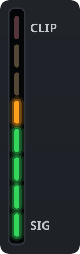
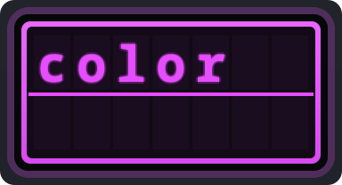
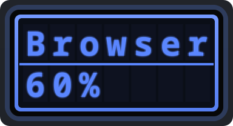
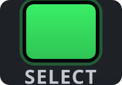

# Channels, states and slots

This page decides what each of the 8 strips shows. Its four main parts build on each other:

1. **Channels** are what a strip can control (an output, a group of applications, a person). You define them.
2. Each strip has a **slot**, numbered 1 to 8 from the left, with a list of candidates: the channels and pools it can show, best first.
3. **States** (in a call, gaming) are on or off. A condition in the list asks about them.
4. **Controls** add button, fader or encoder actions to a slot.

All of it goes into the [configuration file](index.md). A strip you are touching keeps what it shows until you let
go. The [design](../development/design/slots/index.md) has every detail;
[`check-config`, `why` and `simulate`](../reference/commands.md) show what each slot shows and why.

## Channels

A channel is something a strip controls, with the options of its type (see [Channels](channels/index.md)):

```toml
[channel.out]
type = "output"             # or "input": an output (your headphones); see Channels for choices and the default
label = "Speaker"

[channel.voip]
type = "apps"               # the streams of a group of applications
match = ["@voip"]
label = "VoIP"

[channel.ann]
type = "person"             # someone of the voice chat
person = ["Ann", "ann-phone"]   # names of the same person in the voice chat
```

The id (`out`, `voip`) names the channel in slots, conditions and the entities in Home Assistant.

## Slots

```toml
[slots]
1 = "out"                                   # always the output
2 = ["voip if call", "auto"]                # VoIP in a call, else the next application or person
3 = ["game if gaming", "-"]                 # the game in the mode gaming, else dark
4 = [{ show = "auto", color = "blue" }]     # options of the place
5 = ["people", "apps"]                      # a person of the voice chat, else the next application
```

- A slot shows the first candidate whose condition (after `if`) holds. Conditions name states and modes, with
  `and`, `or`, `not`, parentheses and `present` (the channel has something to control); see
  [Conditions](#conditions).
- `apps`, `people`, `auto` and `devices` are pools: not channels that you define, but suppliers of members. See the
  table below.
- A channel shows on one strip at a time. When several slots could show it, the slot that lists it higher gets it
  (on a tie, the left one), and the others go on to their next candidate.
- A slot without an entry is `auto`, and so is a slot whose candidates all don't hold. `-` is nothing: the slot is
  dark.
- The table form `{ show = ..., when = ..., ... }` takes options of the look at this place, see [Places](#places).
- When a slot shows something else, its LCD flashes the new label and why (`gaming`, `not call`) for
  `switching.banner` seconds.
- To see why a slot shows what it shows, use [`why`](../reference/commands.md#why); the
  [GUI](../guides/gui.md)'s page Slots simulates other modes and states.

Four pools are built in:

| Pool | Members | Options |
|---|---|---|
| `apps` | Applications, see [Applications](channels/applications.md#apps-and-auto). | `[pool.apps]`: `from`, `hold` and `exclude`. |
| `people` | The people of the voice chat, see [People](channels/people.md#where-people-sit). | `[pool.people]`: `from`, `order` and the look of the strips of people. |
| `auto` | Both: the people first, from the right, and the applications from the left. | `[pool.auto]`: the look (color, meters, LEDs) of the applications on `auto` slots. |
| `devices` | The outputs and inputs no channel has, see [Devices](channels/devices.md#devices-without-a-channel). | `[pool.devices]`: `from`, `hold`, `exclude` and the look of the strips of outputs and inputs. |

Use `auto` when you do not care, `apps` when only applications should appear, `people` for the voice chat alone.

A pool that has no member for a slot hands it to the candidate right below it, a pool or `-`: `["people", "apps"]` is
a person for as long as there is one, else an application. When two pools could fill a slot, the one listed higher
wins it, so a pool of channels goes above the built-in pools: `["outs", "auto"]`.

### Places

A candidate in the table form takes options of the look at this place. The built-in pools (`[pool.apps]`,
`[pool.auto]`, `[pool.devices]`, `[pool.people]`) take the same for all their places.

| Candidate | Options |
|---|---|
| a channel | `color`, `lit_when_idle` (keep the LCD lit while the strip has nothing to control), `rec`, `solo` (what the LEDs of these buttons show), `meter`, `meter_point`, `label` |
| `apps`, `auto` | `color`, `lit_when_idle`, `rec`, `solo`, `meter`, `meter_point` (no `label`: the strip shows the application's name), and `encoder`, `min_volume`, `max_volume` |
| `devices` | those of `apps`, and `select = false` (Select does not make the output the default) |
| `people` | `color`, `meter`, `meter_point` |
| a pool of channels | none: each channel brings its own look |

`rec` and `solo` at a place set what the LED shows; what a press does stays the channel's. `encoder` of `apps` and `auto` is `pick` by default: the encoder picks which application the strip shows (see [Encoders](strip/encoders.md#pick)).

Three levels decide what the parts of a strip do and show. The more specific one wins. A plain value is a word or
number like `color = "red"`; a [binding](strip/bindings.md) takes the value from a program or from Home Assistant:

- The channel (`[channel.out]`, or the pool) decides what each part does and how it looks, in every slot. It takes
  plain values and bindings.
- The place decides the look in this slot only. It takes plain values, no bindings.
- [`[controls]`](#controls-and-the-chord) decide parts of the slot, whatever it shows, while their `when` holds. They
  take plain values and bindings.

A control for Home Assistant, or one that starts an application (`{ launch = [...] }`), is a control of the slot,
not a place option: see [`[controls]`](#controls-and-the-chord).

### Pools of channels

A pool of your own hands out channels. The first channel of its list that is present goes to the first slot that
names the pool, the next present channel to the next such slot, and so on. Use it for things of which only some are
there at a time, e.g. several outputs:

```toml
[channel.speaker]
type = "output"
device = "alsa_output.pci-0000_11_00.4.analog-stereo"

[channel.phones]
type = "output"
device = "alsa_output.usb-headset*"
tags = ["outs"]

[channel.buds]
type = "output"
device = "bluez_output.*"
tags = ["outs"]

[pool.outs]
channels = ["speaker", "#outs"]   # channel ids, or "#tag" for every channel with that tag

[slots]
1 = "outs"
2 = "outs"
```

- A channel that a slot of its own shows (`3 = "buds"`) is not handed out by the pool.
- Unlike `apps`, a pool of channels fills by its order every time: when an earlier channel comes back, the ones after
  it move one slot on. To keep a strip, give the channel a slot of its own (`["buds if present", "auto"]`).
- It has no look of its own: its channels bring theirs.

### Pools of applications and of people

`kind = "apps"` makes a pool of your own hand out the applications that play and match, `kind = "people"` listed
people of the voice chat, each on a strip of its own. Use them to split what `apps` and `people` hand out in one
piece:

```toml
[pool.music]
kind = "apps"
match = ["@music"]            # parts of names or program files, and presets, as in an `apps` channel
exclude = ["spotify-ads"]     # optional: never these, though they match
from = "left"                 # the side it fills its slots from (default)
hold = 5                      # seconds a slot keeps an application after it stopped (default)
color = "green"               # the look of its strips

[pool.friends]
kind = "people"
people = ["Alice", "Bob"]     # names in the voice chat; this is their order
from = "right"                # the default of a pool of people
talking_color = "green"

[slots]
5 = ["music", "apps"]         # a music player if one plays, else the next other application
6 = "apps"
7 = ["friends", "people"]     # the first of Alice and Bob who is in the call, else anyone else in the call
8 = ["friends", "people"]     # the second of them, else anyone else in the call
```

| Option | `kind = "apps"` | `kind = "people"` |
|---|---|---|
| `match` | Required. | Not allowed. |
| `exclude` | Optional. | Not allowed. |
| `people` | Not allowed. | Required: names as in `person` of a channel, ignoring case. |
| `from` | `left` | `right` |
| `hold` | Seconds, default 5. | Not allowed: a person stays `absent_after` seconds after they left. |
| Look | As the `apps` places above, but the `encoder` is not [`pick`](strip/encoders.md#pick). | As the `people` places above, plus `talking_color`, `rec`, `solo` and `lit_when_idle`. |

- A pool of your own takes its members first: a music player goes to `music`, not to `apps` or `auto`. An `apps`
  channel or a `person` channel that has a slot keeps its application or person.
- It takes them **only while a slot names it**. A pool that no slot names takes nothing, so a forgotten
  `[pool.music]` can't make the players disappear from the strips; `check-config` says "pool music is on no slot".
- A member that finds no slot waits in its pool. With a third friend in the example, that friend has no strip until
  a slot of `friends` is free, and does not move on to `people`.
- Like `apps`, an application keeps its slot while it plays; a pool of people fills by the order of its list.

## States and modes

```toml
[state.call]
voice_chat = true           # in a channel of the voice chat (needs a voice chat provider, see People)
recording = ["discord"]     # or: Discord records
delay_off = 5               # seconds

[state.gaming]
mode = true                 # one mode at a time; without one, "default"
label = "Gaming"            # the banner across the LCDs
processes = ["@steam-games"]
```

Sources
:   A state is on while any of its sources is: `apps` (playing), `recording`, `voice_chat`, `processes`, `devices`,
    `channels`, `homeassistant` (a switch in Home Assistant) or `when` (a [condition](#conditions)).

Delays
:   `delay_on` (default 0) and `delay_off` (default 3 seconds, 10 for a mode) smooth it: the state changes only after
    its sources held the new value that long. A state with `when` has no delays by
    default: it follows the states it names, which have theirs already. A delay you give it comes on top.

Modes
:   Modes are states with `mode = true`: the one with the highest `priority` whose sources are on is the mode, else
    `default`. When the mode changes, the LCDs show its `label` across the strips for `switching.banner` seconds.

`apps` and `processes` take parts of names, ignoring case, and [presets](presets.md).

??? tip "Games from Steam and Proton"

    `processes = ["@steam-games"]` is on while any game runs, native or with Proton: Steam starts every game through
    its `reaper` process, which is what the preset stands for. Proton games play as `<Game>.exe` (e.g. "Planet
    Crafter.exe"), which `apps = ["@games"]` catches once they make a sound. Don't use `steam` (the client runs all
    the time) or `.exe` (Wine's helpers run for other Windows programs too) in `processes`.

    `ps -eo comm,args` while a game runs shows the names to use for others.

Every state can be overridden (`on`, `off`, `auto`) from Home Assistant, the GUI's live view or a button; `auto`
means the sources decide again. An override lasts until the sources of the state turn it on or off by themselves
(`persist = true`: until you set it back). A mode picked by hand (the [chord](#controls-and-the-chord), Home
Assistant, [`xtouch-daemon mode gaming`](../reference/commands.md#mode)) lasts until the sources of the modes would
pick another one.

## Conditions

A condition says when something applies: a candidate of a slot (after `if`, or `when` in the table form), a state
(`when`) or controls (`when`). It holds or not at any moment, and the slot follows at once. All the parts in the
table work in all three places, except `present` and `present(...)`: only candidates of slots may use them. A state
asks about channels with its `channels` source instead.

| Part | Holds while | Example |
|---|---|---|
| a state or mode | it is on | `call`, `gaming` |
| `default` | no other mode is on | `default` |
| `present` | the channel or pool of the candidate has something to control | `browser if present` |
| `present(<channel or pool>)` | that channel or pool has something to control | `present(game)` |
| `not <part>` | the part does not hold | `not call` |
| `<part> and <part>` | both hold | `call and not gaming` |
| `<part> or <part>` | either holds | `call or present(voip)` |
| `( ... )` | what is inside holds | `(call or gaming) and present` |

- `not` binds closest, then `and`, then `or`: `not call and gaming or present` is `((not call) and gaming) or
  present`. Parentheses say otherwise.
- The words are lowercase. Names are those of the file (`[state.<name>]`, `[channel.<name>]`, `[pool.<name>]`) and
  the built-in pools.
- A candidate without a condition always holds, so the candidates below it never show. The exceptions are a pool
  without a member for the slot and a channel that another slot shows: the slot goes on to the candidate below it.
- Present means it has something to control: an `apps` channel while its application plays, an `output` or `input`
  channel while an output or input that its `device` names is there (always without `device`), a `person` channel while the person is in
  the voice chat, a `homeassistant` channel always. A channel stays present `absent_after` seconds (3 by default)
  after that ended. A pool is present while it has a member: `auto` while an application or a person is there, a
  pool of channels while one of its channels is present.
- `check-config` and the GUI (which underlines them in the field When) name the mistakes: an unknown name, a word
  where none fits, a condition that ends too early.

## Controls and the chord

`[controls]` claims parts of a slot, whatever the slot shows: while `when` holds, the part does what the claim says
instead of what the shown channel does.

```toml
[controls]
2 = { select = { launch = ["mumble"] }, when = "not call" }    # Select starts Mumble while not in a call
5 = { select = "toggle:call", solo = "mode:gaming" }
6 = { fader = "homeassistant", id = "desk" }                    # the fader is number.xtouch_desk_fader
```

`when` takes a [condition](#conditions) of states and modes. Actions: `homeassistant`, `cycle_modes`, `mode:<id>`, `toggle:<state or mode>`, and these tables:

- `{ launch = [...] }` starts an application (see
  [Launching the application](channels/applications.md#launching-the-application)).
- `{ run = [...] }` starts a program of your own and waits for it to end. Write it as a list or as one string split
  at the spaces: `run = ["notify-send", "hi"]` or `run = "notify-send hi"`. No shell runs it.
- `{ service = "...", entity = "..." }` calls a service of Home Assistant (needs `[homeassistant]`).

A fader or an [encoder](strip/encoders.md) takes one of these:

- `homeassistant`: a number entity in Home Assistant.
- The value of a [custom channel](channels/custom.md): `7 = { encoder = { channel = "screen_left" } }` makes the
  encoder of slot 7 set the value that `screen_left` controls. For a fader, the channel needs a `fader` that is a
  value; an encoder uses the `encoder` of the channel, else its `fader`. With `targets`, the claim follows the
  target the channel controls.
- A value of its own, as in [Bindings](strip/bindings.md): `{ set, watch, min, max, step, push, format }`. A fader
  has no `push`.
- A value of an entity of Home Assistant: `{ entity, attribute, min, max, step, push, format, service, data }`, see
  [An entity of Home Assistant](strip/bindings.md#an-entity-of-home-assistant). Needs `[homeassistant]`.

The slot keeps showing what it shows, and the [LED](strip/leds.md) ring shows the value. `{value}` in a `run` is the
value of the fader of the controls, else of their encoder, which must be a value or a `{ channel }`. Until the value
is known, the program does not run; the log says so.

```toml
[controls]
7 = { encoder = { set = "brightnessctl set {value}%", min = 1, max = 100 }, solo = { run = "notify-send {value}" } }
```

`[controls]` can also claim what a slot shows: the meter, the color, the second line of the LCD and the LEDs of
Select, Rec and Solo. They take the same [bindings](strip/bindings.md) as on a channel (a program prints the number,
color or line; an entity gives its value):

| Part | Takes |
|---|---|
| { .xt-icon } `meter` | `homeassistant` (`number.<ns>_<id>_meter`, 0..100), `{ watch, min, max }`, `{ poll, every, min, max }` or `{ entity, attribute, min, max }`. |
| { .xt-icon } `color` | A color, `homeassistant` (`select.<ns>_<id>_color`), `{ watch }`, `{ poll, every }` or `{ entity, attribute }`. |
| { .xt-icon } `lcd` | `homeassistant` (`text.<ns>_<id>_bottom`), `{ watch }`, `{ poll, every }` or `{ entity, attribute }`. |
| { .xt-icon } `select`, `rec`, `solo` | An action as above, or a table `{ press = <action>, led = <LED> }`. |

`<id>` is the `id` of the controls, else `slot_<n>`. `<ns>` is `namespace` of `[mqtt]` (`xtouch` by default).

A button takes an action, or a table with `press` (what a press does) and `led` (what the LED shows). `led` alone
claims the LED only, and a press does what the slot would do. `press` alone is the action without a table. `led` takes
one of these:

- `off`.
- `press`: lit as the press says.
- `homeassistant`: the entity `select.<ns>_<id>_<button>_led`.
- `{ watch }` or `{ poll, every }`: a program prints a line: `on`, `1`, `true` or `yes` lights the LED, `flash`
  flashes it.
- `{ entity, attribute }`: lit while the entity is `on`, `open`, `playing` or `home`.

```toml
[controls]
8 = { meter = { watch = "/home/me/bin/cpu-load" }, rec = { led = { poll = "/home/me/bin/syncthing-running", every = 5 } } }
3 = { color = "red", lcd = { poll = "date +%H:%M", every = 10 }, when = "call" }
4 = { encoder = { entity = "media_player.kitchen" }, solo = { service = "media_player.media_play_pause", entity = "media_player.kitchen" } }
```

- Slot 8: the meter shows the CPU load, and the Rec LED is lit while Syncthing runs, whatever the slot shows. Both are
  scripts of your own: `cpu-load` prints a number, `syncthing-running` prints `on` (see
  [Bindings](strip/bindings.md) and [what the LED shows](strip/leds.md#what-the-led-shows)).
- Slot 3: during a call, the strip is red and its LCD shows the time.
- Slot 4: the encoder sets the volume of the kitchen speaker in Home Assistant, and Solo plays or pauses it.

How a claim behaves:

- After `when` stops holding, the slot shows its own part again.
- Watches and polls run as long as the configuration, so a claim that comes back shows their newest lines at once.
  Until the first line, a color is white, a line is empty, an LED is dark and the meter rests.
- On the slots of the chord, `[controls]` can claim the LED of Solo, but not its press.

`[switching]` has two options: the chord changes the mode from the control surface, the banner is the text on the LCDs when
a mode changes:

| Option of `[switching]` | Default | Meaning |
|---|---|---|
| `chord` | `[1, 8]` | The slots (from 1 on the left) whose Solo buttons, held together, cycle the modes; `[]` for no chord. `chord = { strips = [1, 8], action = "toggle:call" }` does another action. |
| `banner` | `1.5` | Seconds the LCDs show the label of a new mode, and a slot that shows something else its new label and why; `0` for none. |

## Home Assistant

With `[mqtt]`, modes, states, channels and slots show up as entities in Home Assistant, and you can override states
and pick the mode there. The entities are listed in [Home Assistant](../guides/home-assistant.md).

Next: [Channels](channels/index.md) say what each type takes; [Presets](presets.md) the `@` names.
