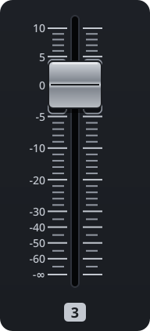
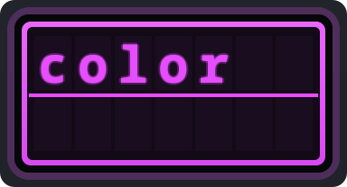
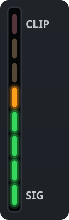

# Bindings

A strip has parts: the fader, the encoder, the LCD, the backlight color, the meter, and the buttons Select, Rec and
Solo. Each part does what the type of its [channel](../channels/index.md) says: the fader of an `output` channel sets
the volume. A **binding** replaces that for one part. A part without a binding keeps its default (`"volume"` or
`true` are no bindings). A binding is one of three things:

- A **program of your own** (`{ watch = "..." }`, `{ set = "..." }`, `{ run = "..." }`). The daemon starts it and
  uses what it prints, or tells it what you did.
- An **entity of Home Assistant** (`{ entity = "..." }`). The part shows the entity, or sets it, see
  [An entity of Home Assistant](#an-entity-of-home-assistant).
- The word `"homeassistant"`. The daemon creates a new entity for the part in Home Assistant, and an automation of
  yours decides what it does. See [Home Assistant](#home-assistant).

A [custom channel](../channels/custom.md) has no defaults: every part it uses is bound. Design:
[Bindings and custom channels](../../development/design/bindings.md).

```toml
[channel.out]
type = "output"
meter = { watch = "/home/me/bin/cpu-load" }       # a program of your own: the meter shows the CPU load, the fader stays the volume
color = "homeassistant"                           # the word: Home Assistant sets the color
lcd = { entity = "sensor.outside_temperature" }   # an entity: the second line of the LCD shows its state
```

`/home/me/bin/cpu-load` is a script of your own (executable, see [Commands](#commands)). It prints the CPU load in
percent, once a second; the meter shows a level from 0 to 100:

```sh
#!/bin/sh
vmstat -n 1 | awk 'NR > 2 { print 100 - $15; fflush() }'
```

## The parts and what they take

The table is for the `output`, `input` and `apps` channels, and for the strips that the `auto` pool fills with
applications. The columns say what a part does without a binding, and what a program or an entity can do for it. Everywhere a
program says `watch`, it can say `poll` and `every` instead ([Watch or poll](#watch-or-poll)).

| Part | Default | A program | An entity |
|---|---|---|---|
| { .xt-icon } `fader` | The volume (`"volume"`). | A value: `{ set, watch, min, max, step, format }`. | `{ entity, attribute, min, max, step, format, service, data }`: shows the entity and sets it. |
| { .xt-icon } `encoder` | The type's modes ([Encoders](encoders.md)). | A value: `{ set, watch, min, max, step, push, format }`. | The same as the fader, plus `push`. |
| { .xt-icon } `lcd` | What the type shows on the second line. | `{ watch }`: each line is the text. | `{ entity, attribute }`: its state or attribute. |
| { .xt-icon } `color` | A color name. | `{ watch }`: each line is a color name. | `{ entity, attribute }`: its color. |
| { .xt-icon } `meter` | The level of the audio (`true`), or dark (`false`). | `{ watch, min, max }`: each line is a level. | `{ entity, attribute, min, max }`: its number. |
| { .xt-icon } `select`, `rec`, `solo`: `press` and `hold` | The type's actions ([Buttons and LEDs](leds.md)). | `{ run }`: the program runs once to its end. | `{ service, entity, data }`: calls a service of Home Assistant. |
| { .xt-icon } `select`, `rec`, `solo`: `led` | The type's indicators. | `{ watch }`: the line `on`, `1`, `true` or `yes` lights the LED, `flash` flashes it. | `{ entity, attribute }`: lit while the state is `on`, `open`, `playing` or `home`. |

Each part also takes the word `"homeassistant"` (a button takes it as `press`, the LED as `led`), see
[Home Assistant](#home-assistant). On `output`, `input` and `apps` channels the Mute button has no binding; a custom
channel can bind it.

The [`[controls]`](../slots.md#controls-and-the-chord) section takes the same bindings for a slot, whatever the slot
shows. A **place** (an entry of a slot like `{ show = "auto", color = "blue" }`) takes plain words only, no binding
and no button action, `press`, `hold` or `led` lists included: bind the part in the channel, or in `[controls]` for a
slot that shows pool strips (`auto`).

What the options do:

- `set` runs with the new value in place of `{value}`. [A value](../channels/custom.md#a-value) explains `min`,
  `max`, `step`, `push` and `format`.
- <a id="value-in-run"></a>`{value}` in the `run` of a button is, in this order:
    1. the value of the fader of the strip, if you bound it to a program of your own;
    2. else the value of the encoder, if you bound that;
    3. else the volume in percent. (`{target}` is for custom channels with `targets`, see
       [Custom channels](../channels/custom.md).)

    Such a fader has no value until its program prints the first line (or, without `watch` and `poll`, until you
    move it once). Until then a `run` that uses `{value}` does not start, and the log says so.
- When the fader is bound to something other than the volume, the encoder sets the volume, and you can't bind the
  encoder of an `output`, `input` or `apps` channel to something else. A custom channel binds both separately.
- A bound meter shows its level whatever [`behavior.meters`](../behavior.md) says.

## Commands

`set`, `watch`, `poll` and `run` each take a command: a program and its arguments, run without a shell. A string is
split at spaces, and quotes keep an argument together: `"notify-send 'Volume {value}'"`. A list gives each argument
as it is: `["notify-send", "Volume {value}"]`.

Nothing else is expanded: no `~`, `$HOME`, `*`, `|`, `>` or `&&`. Give a program by its name (the daemon looks in its
own `PATH`, which can differ from your shell's when it runs as a systemd service) or by its full path. Pipes,
redirects and loops belong in a script of your own: make it executable (`chmod +x`) and give its full path, e.g.
`watch = "/home/me/bin/cpu-load"`.

## Watch or poll

A part that shows what a program prints takes one of two:

| Option | The program | The part shows | E.g. |
|---|---|---|---|
| `watch` | Runs all the time and prints a line per change. | Each new line. | `watch = "playerctl status --follow"` |
| `poll` | Runs to its end every `every` seconds (10 by default). | The last line of each run (empty if it printed nothing). | `poll = "date +%H:%M", every = 10` |

Take `watch` for a program that tells each change by itself, `poll` for one that prints the current value once and
ends. A part takes `watch` or `poll`, not both; `every` is for `poll` only (above 0).

## The options of a binding

A value (`fader`, `encoder`) has `set`, `watch`, `min`, `max`, `step`, `push` and `format`: see
[A value](../channels/custom.md#a-value). Set `step` (how much one click changes the value) on the encoder; a fader
takes it for Home Assistant. The other bindings:

| Binding | For | Option | Default | Meaning |
|---|---|---|---|---|
| A watch or a poll | `lcd`, `color`, a button's `led`, `present` of a custom channel | `watch`, `poll`, `every` | `every`: `10` | As [above](#watch-or-poll). The part shows the newest line. |
| A level | `meter` | `watch`, `poll`, `every`, `min`, `max` | `0`, `100` | Each line is a number; `min` is the meter dark, `max` full. |
| A program to run | a button's `press`, `hold` | `run` | | The program and its arguments; `{value}` is the value (above). |

`{value}` is only for `set` and `run`, in an argument after the program. `min` must be below `max`, `push` between
them, and `step` above 0. `format` must show a number, e.g. `{value:.0%}`.

## Values and watches

- The fader, the ring and the LCD show a move at once. `set` runs with the newest value only: moves that come while
  it runs wait, and only the last of them runs next.
- `set` and `run` that fail, or take longer than 10 seconds, are logged as warnings.
- A `watch` or `poll` runs for as long as the configuration, also while no slot shows the channel. A `watch` that
  ends or can't start runs again after 5 seconds. A `poll` runs when the configuration is loaded, then every `every`
  seconds, one run at a time; a run that takes longer than `every` is stopped, and the next starts at once.
- A run of `poll` that fails (an exit status other than 0), can't start or is stopped gives no line: the part keeps
  the line before, and the log has a warning. A run that ends well but prints no text gives an empty line.
- While a value is set, or its fader is under a finger, the lines of `watch` and `poll` don't move it.

## Example: the brightness of a screen

The encoder of the speakers sets the brightness of a screen with
[system-control](https://github.com/markusressel/system-control) (`sysctrl`, a separate tool: adapt the commands to
yours). The fader stays the volume. A push sets the full brightness, and Solo resets the whole redshift of the screen (also its
color temperature). `watch` prints the brightness, e.g. `0.60`.

```toml
[channel.out]
type = "output"
label = "Speaker"
encoder = { set = "sysctrl display redshift brightness -d DisplayPort-1 -b {value}", watch = "sysctrl display redshift brightness -d DisplayPort-1 --watch", min = 0.1, max = 1.0, push = 1.0, format = "{value:.0%}" }
solo = { press = { run = "sysctrl display redshift reset -d DisplayPort-1" } }
```

A strip of its own for the screen is a [custom channel](../channels/custom.md#two-screens).

## The second line of the LCD

The second line of the LCD (7 characters) shows, from the most important to the least: a notice (e.g. the name of a
choice), the volume while it is being set, the line of a bound `lcd`, then what the type shows. While Home Assistant
is not there, a part set to `"homeassistant"` shows `offline`.

## An entity of Home Assistant

A part can show any entity of Home Assistant, and a fader or an encoder can set one, without an automation in
between. It needs the [`[homeassistant]`](../../guides/home-assistant.md#homeassistant) section (the address and a
token; see the guide for the goal from start to end). `[mqtt]` is not needed for entities, only for the word
`"homeassistant"`.

| Option | For | Default | Meaning |
|---|---|---|---|
| `entity` | every part | required | The entity ID, e.g. `sensor.cpu_temp`. |
| `min`, `max` | `meter` | `0`, `100` | The number with the meter dark, and full. |
| `attribute` | every part | the state | An attribute of the entity instead of its state, e.g. `media_title` of a `media_player`. For a value, the one of its domain (below). |
| `min`, `max` | `fader`, `encoder` | the entity's, else its domain's, else `0`, `100` | The value with the fader at the bottom and at the top. A `number` tells its own range. |
| `step`, `push`, `format` | `fader`, `encoder` | as for [a value](../channels/custom.md#a-value) | One step of the encoder, the value a push sets (the encoder only), how the LCD shows the value. |
| `service` | `fader`, `encoder` | the one of its domain | The service a move calls, with the entity as its target, e.g. `script.set_level`. |
| `data` | `fader`, `encoder` | the value of its domain | The data of `service`: `{value}` in it is the new value, e.g. `{ level = "{value}" }`. |

What a part makes of the entity:

| Part | Shows |
|---|---|
| `lcd` | The state, a number shortened to fit, with its unit (`21.5°C`, `45%`, `3.2 kW`); or the attribute. |
| `color` | A light: the nearest of the colors of the LCD to its color (`rgb_color`, else `hs_color`); dark while it is off; white for a light without a color. Another entity: its state as a color name (an `input_select` with `red`, `blue`, ...). An attribute: a color name, or a list of red, green and blue. |
| `meter` | The number of the state (or the attribute), from `min` to `max`. |
| A button's `led` | Lit while the state is `on`, `open`, `playing` or `home` (and `1`, `true`, `yes`, as for a watch); flashing on `flash`; else dark. |
| `present` of a custom channel | Present unless the entity is `unavailable`, `unknown` or missing in Home Assistant. |

A fader or an encoder follows the value of the entity and sets it with a service (the newest value only, as `set`
does). These domains need no `service`:

| Domain | Value | Range | Service |
|---|---|---|---|
| `light` | `brightness` (`0` while off) | 0..255 | `light.turn_on` with `brightness` |
| `number`, `input_number` | the state | the entity's `min`..`max` | `number.set_value`, `input_number.set_value` with `value` |
| `media_player` | `volume_level` | 0..1 | `media_player.volume_set` with `volume_level` |
| `cover` | `current_position` | 0..100 | `cover.set_cover_position` with `position` |
| `fan` | `percentage` (`0` while off) | 0..100 | `fan.set_percentage` with `percentage` |

Any other entity, or another attribute, needs `service` and `data` with `{value}`. In `data`, a value that is only
`"{value}"` becomes a number (`0.6`); `{value}` within a longer text becomes part of the text (`"level {value}"`
becomes `level 0.6`). A press or a hold of a button calls a service with `{ service, entity, data }`. A button has no
new value, so it sends `data` as it is, and `{value}` in it is an error.

```toml
[channel.lamp]
type = "custom"
label = "Lamp"
fader = { entity = "light.desk" }                         # the brightness
encoder = { entity = "light.desk", attribute = "color_temp_kelvin", service = "light.turn_on", data = { color_temp_kelvin = "{value}" }, min = 2700, max = 6500, step = 100 }
color = { entity = "light.desk" }
select = { press = { service = "light.toggle", entity = "light.desk" }, led = { entity = "light.desk" } }
present = { entity = "light.desk" }                       # dark while the lamp is unavailable

[channel.out]
type = "output"
meter = { entity = "sensor.cpu_temperature", min = 30, max = 90 }   # the meter shows a temperature
solo = { press = { service = "scene.turn_on", entity = "scene.movie" } }
```

- While the daemon is not connected to Home Assistant, the LCD shows nothing, the meter rests, an LED is dark, a
  color stays as it was, and a fader or an encoder has no value. It connects again by itself.
- An entity that Home Assistant does not have is a warning in the log, once per connection, not an error: it may
  come later.
- A service that fails is a warning in the log, and the fader or the encoder goes back to the value of the entity.
  After a call that works, it stays where you put it until the entity reports.

## Home Assistant

A part set to `"homeassistant"` needs the [`[mqtt]`](../../guides/home-assistant.md#mqtt) section. The daemon
creates an entity for it in Home Assistant; an automation of yours decides what the entity does. The entity of each
part (e.g. `number.xtouch_desk_fader`), what it holds and what it starts with are in
[Entities](../../guides/home-assistant.md#entities).

With `[mqtt]`, a fader or an encoder bound to a value is a number too (`number.<ns>_<id>_fader`,
`number.<ns>_<id>_encoder`): from the binding's `min` to its `max`, in steps of its `step`, else in fine steps of the
range. It has no state until the value is known; a change in Home Assistant runs `set`.

Only the channel itself has these entities, not the applications, outputs and inputs that a place shows. A
[place](../slots.md#places) that sets a part to `"homeassistant"` does nothing (the log says so): set the part in
the channel. A fader or an encoder bound to an entity (`{ entity = "..." }`) gets no number of its own, because the
entity is already in Home Assistant.

## Simulate

Simulate (the preview of the GUI, and `xtouch-daemon simulate`) runs the `watch` and `poll` programs, but never `set`
or `run`: a move changes only the simulation. It shows the entities of Home Assistant while the daemon is connected,
but calls no services. Parts set to `"homeassistant"` look as if Home Assistant is not there.
