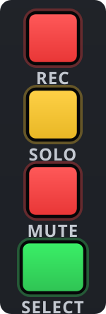
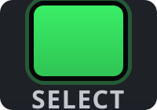
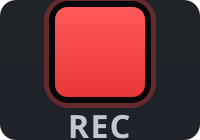

# Buttons and LEDs

{ .xt-part width="64" }

Every strip has four buttons with LEDs: Rec, Solo, Mute and Select. Mute mutes the strip, and its LED is on while
the strip is muted; on `output`, `input` and `apps` strips you cannot change that (only a
[custom channel](../channels/custom.md#buttons) can). You can change what the other three do, and what their LEDs
show. Each has a default:

| Button | By default |
|---|---|
| { .xt-icon }<br>Select | On `output` and `input` strips with `device` or `choices`: makes the output or input the default; its LED is on while it is. On application strips with `launch`: starts the application; its LED flashes while it starts and is on while it runs. Otherwise nothing. |
| { .xt-icon }<br>Rec | On strips with [profiles](../channels/devices.md#profiles): switches the sound card to the next profile; its LED is on for every profile but the first. Otherwise the button does nothing. Its LED is lit while an application records what the strip controls (`recording`). |
| { .xt-icon }<br>Solo | Nothing, except on the strips of the [chord](../slots.md#controls-and-the-chord) (1 and 8 by default): held together, their Solo buttons switch to the next mode. Its LED stays dark. |

A button can also run a program of your own, and an LED can show what Home Assistant or a program says: see
[What the LED shows](#what-the-led-shows) and [Bindings](bindings.md). On `homeassistant` strips every LED is an
entity that Home Assistant sets, see [Home Assistant](../../guides/home-assistant.md#entities).

## Buttons

Each of `select`, `rec` and `solo` takes a table. A part you leave out does what the type of the channel does by default.

```toml
[channel.main]
type = "output"
device = ["alsa_output.*", "bluez_output.*"]

[channel.main.select]
press = "default"   # makes the output shown the default
hold = "next"       # shows (and controls) the next output; the default stays
led = "shown"       # lit while the strip shows another output than the default

[channel.main.solo]
press = "mute_others"   # while held, the other strips are muted
```

| Option | Default | What it does |
|---|---|---|
| `press` | what the type does | What a press does, see [Actions](#actions). |
| `hold` | `"off"` | What holding the button for longer than half a second does. With a hold, a press acts when you let go of the button; without one, it acts at once. |
| `led` | what the type shows | What the LED shows, see [What the LED shows](#what-the-led-shows). |

Short forms: `select = true` and `select = false` are Select doing what the type does, or nothing; `rec = "playing"`
(an indicator alone) is `rec = { led = "playing" }`.

A place (an entry of `[slots]`, e.g. `{ show = "devices", rec = "playing" }`) can set what an LED shows, but not what
a button does: see [Bindings](bindings.md#the-parts-and-what-they-take). Buttons that act whatever the slot shows
are in [`[controls]`](../slots.md#controls-and-the-chord).

On the strips of the [chord](../../concepts.md#more-words), every press of Solo does its own `press`, and the mode
changes as well when all their Solo buttons are down together. Give those buttons no `press` if you only want the
chord.

### Actions

| Action | For | Does |
|---|---|---|
| `default` | output, input with `device` or `choices` | Makes the output or input shown the default. On the default one, the next one of `device` or `choices`. |
| `next` | output, input with `device` or `choices` | The strip shows (and controls) the next output or input that is there, until the default changes. The default stays as it is. |
| `profile` | output, input with `profiles` | Switches the sound card to the next of `profiles`. |
| `launch` | apps, auto with `launch` | Starts `launch`. |
| `talk` | input | Push to talk. The strip is unmuted while the button is held, and muted again when you let go. |
| `mute_others` | all | The other strips are muted while the button is held, and unmuted again when you let go. |
| `homeassistant` | all | An event in Home Assistant for each press and release (`select_pressed`, ...). Needs [`[mqtt]`](../../guides/home-assistant.md#mqtt). As `press` only. |
| `cycle_modes` | all | The next mode, as the chord picks it. |
| `mode:<id>` | all | Picks the mode. |
| `toggle:<id>` | all | Picks the mode, or sets the state to the opposite of what it is now. The next press gives control back to the sources. See [States and modes](../slots.md#states-and-modes). |
| `{ launch = [...] }` | all | Starts the program, like a launch of [`[controls]`](../slots.md#controls-and-the-chord). `launch_when_running = true` starts it also while it runs. |
| `{ run = [...] }` | all | Runs a program of your own to its end, e.g. `{ run = "notify-send hello" }`. See [Run a program](#run-a-program). |
| `{ service = "...", entity = "..." }` | all | Calls a service of Home Assistant, e.g. `{ service = "light.toggle", entity = "light.desk" }`. Needs [`[homeassistant]`](../../guides/home-assistant.md#homeassistant); see [An entity of Home Assistant](bindings.md#an-entity-of-home-assistant). |
| `off` | all | Nothing. |

`talk`, `mute_others` and `homeassistant` last while the button is held: they take no `hold`.

### What the LED shows

`led` takes an [indicator](#indicators), or:

| Value | Lit while |
|---|---|
| `press` | Lit while the result of the `press` action is true: for `default`, the output or input is the default; for `profile`, the card is in another profile than the first; for `launch`, the application runs; for `mode:` and `toggle:`, the mode or state is on; for `talk` and `mute_others`, the button is held. |
| `shown` | The strip shows another output or input than the default one (after `next`). |
| `homeassistant` | Home Assistant says so: the LED is a select entity (`off`, `on`, `flash`) of its own. Needs [`[mqtt]`](../../guides/home-assistant.md#entities). |
| `{ watch = [...] }`, `{ poll = [...], every = 10 }` | A program prints lines ([Watch or poll](bindings.md#watch-or-poll)): the newest line is `on`, `1`, `true` or `yes`; `flash` flashes the LED, any other line turns it off. Until the first line, the LED is off. |
| `{ entity = "..." }` | The entity (or its `attribute`) is `on`, `open`, `playing` or `home`, or `1`, `true`, `yes`; `flash` flashes it. See [An entity of Home Assistant](bindings.md#an-entity-of-home-assistant). |

On `output`, `input` and `apps` channels (and the strips of `auto`), `press` stays dark for a `{ run }`. On a
[custom channel](../channels/custom.md#buttons), `press` is lit while the program runs.

```toml
[channel.speaker.solo]
press = { run = "notify-send 'Volume {value}'" }
led = { poll = "/home/me/bin/syncthing-running", every = 5 }   # lit while Syncthing runs
```

`/home/me/bin/syncthing-running` is a script of your own (see [Commands](bindings.md#commands)). It prints `on` while
the user service of Syncthing runs, else `off`:

```sh
#!/bin/sh
systemctl --user is-active --quiet syncthing && echo on || echo off
```

## Run a program

`{ run = [...] }` runs a program of your own once, to its end, without a shell: see
[Commands](bindings.md#commands) and [`{value}`](bindings.md#value-in-run). [Simulate](bindings.md#simulate) never
runs it.

## Indicators

| Indicator | Lit while |
|---|---|
| `recording` | An application records: from the input, from the monitor of the output (e.g. a screen recorder), or, on `apps` and `auto` strips, from anything (e.g. Discord using a microphone). |
| `playing` | Audio flows: the output or input is active, or a stream of the applications plays. |
| `default` | The output or input is the default one. Never for applications. |
| `muted` | The strip is muted (like the Mute LED). |
| `off` | Never: the LED stays dark. |

```toml
[channel.mic]
type = "input"
label = "Mic"
rec = "recording"   # the default: lit while an application uses the microphone
solo = { press = "talk", led = "muted" }
```
