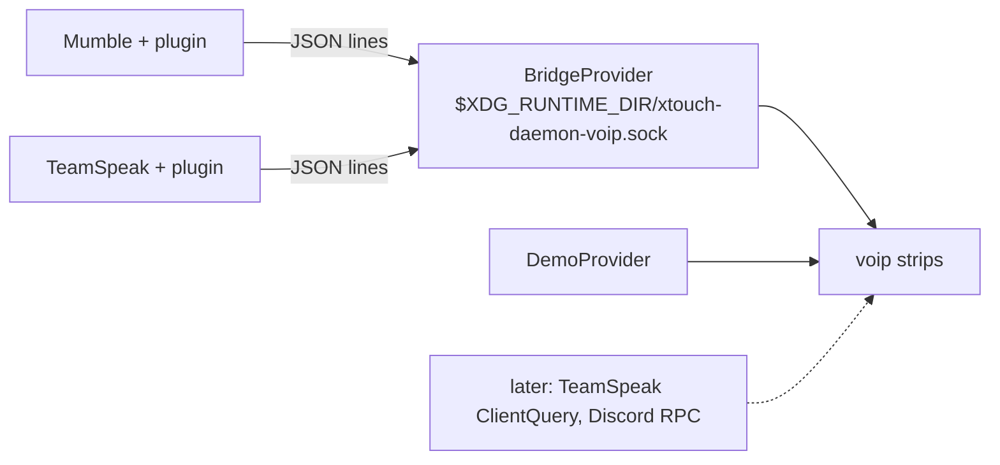

# Design: layouts

Status: proposed. See [Phasing](#phasing) for what comes first.

The idea: the configuration holds several **layouts**, each a set of up to 8 strips. A "default" layout for the
desk (outputs, browser, music), a "gaming" layout with the game, the voice chat, the microphone and one strip per
participant of the voice channel. Something switches between them: Home Assistant, an application that starts or
plays, a button combination on the device, the command line or the GUI.

## What others do

| Product | Unit | How it switches | Notes |
|---|---|---|---|
| Elgato Stream Deck | profile, with pages and folders | "Smart Profiles": the application in focus picks its profile, matched by executable; leaving it restores the previous profile. A key action switches by hand. ([Elgato][elgato]) | Automatic switching is paused while the editor is open. A manual switch by a plugin can disable the automatic one ([bug report][sd-bug]), a known pain point. |
| Loupedeck / Logitech | profile per application, with workspaces and pages | "Dynamic mode" (on by default) follows the active application; off, the chosen profile stays. A button switches workspaces. ([Loupedeck CT][loupedeck], [user guide][loupedeck-guide]) | Open-source Linux ports match by process name and window title, falling back to a default profile ([loupedeckapp][loupedeckapp]). |
| GoXLR Utility (Linux) | device and microphone profiles | UI, and `goxlr-client profiles device load <name>` for scripts and hotkeys ([wiki][goxlr]) | The profile is a whole mixer state; a "load colours only" variant exists. |
| Mackie Control DAWs (Logic, Cubase) | banks of 8 channels | Bank Left/Right moves by 8 (by the size of the surface group), Channel Left/Right by 1; the last bank is filled up to 8 rather than left half empty ([Logic][logic-banks]) | The model for "more participants than strips". |
| deej | one configuration | none; the file is reloaded on change | (From the project's README, not re-checked.) |
| Voicemeeter | settings files, macro buttons | macro buttons and the Remote API load a settings file | (From memory, not re-checked.) |
| TouchOSC | pages (tabs) of one layout | a tab bar on the surface, or OSC/MIDI messages | (From memory, not re-checked.) |

Lessons taken:

1. **One active layout, switched as a whole.** Every product swaps the complete set of controls; nobody blends two.
2. **Automatic and manual switching coexist, and the rules for that must be simple.** Stream Deck and Loupedeck make
   the automatic one win whenever the focus changes; a manual choice lasts until the next change. That is the
   model here too: rules are *edge-triggered* (see [Switching](#switching)).
3. **Focus is a desktop concept.** On Wayland there is no portable way to ask which window has the focus (KWin
   scripts, GNOME extensions, the Sway/Hyprland IPC all differ). The daemon knows something better for a mixer: which
   applications **play** (PipeWire streams), and which processes **run** (`/proc`). Focus can come later as a
   provider of the same rule engine.
4. **A command line to switch** (GoXLR) makes every other integration (hotkeys, scripts, desktop launchers) free.
5. **Banks for variable lists** (Mackie): a group of strips shows a page of a longer list, and buttons page through it.

## VoIP participants

The wish: a strip per participant of the voice channel, with the participant's level on the meter and their volume
on the fader.

### Can a mixer see the participants?

**Not through PipeWire.** Mumble, TeamSpeak and Discord mix every participant into one playback stream, so
`pw-dump` shows one node per client, never one per participant. The participants are only known inside the client.

| Client | Participants and talking | Local volume per participant | From outside on Linux |
|---|---|---|---|
| **Mumble** (1.5) | Plugin API: `getUsersInChannel`, `getUserName`, `mumble_onUserTalkingStateChanged`, `onUserAdded/Removed` | Not in the API (`requestLocalUserMute` mutes only). But `mumble_onAudioSourceFetched(pcm, …, isSpeech, userID)` gets each participant's audio before the mix, **may change it** (a plugin can apply its own gain) and can measure its peak. The built-in local volume (since 1.3) is not reachable. ([MumblePlugin.h][mumble-plugin]) | D-Bus `net.sourceforge.mumble.mumble`: `getTalkingUsers`, `getCurrentUrl`, self mute/deaf, transmit mode ([DBus.h][mumble-dbus]); `mumble rpc` the same few commands ([RPC docs][mumble-rpc]). No participant list, no per-user volume. Server side (Ice): users and channels, but no talking state and no client-local volume. |
| **TeamSpeak 3** | ClientQuery (local TCP 25639, API key): `clientlist`, `notifytalkstatuschange`, `notifycliententerview` ([client query library][ts3-cq]) | Plugin SDK only: `setClientVolumeModifier(connection, client, dB)`, and the client stores it ([forum][ts3-volume]). No ClientQuery command for it was found. | ClientQuery is reachable from another process. TeamSpeak 5/6 has no stable public API (not re-checked). |
| **Discord** | Local RPC (Unix socket `discord-ipc-N`): `GET_SELECTED_VOICE_CHANNEL`, `SPEAKING_START/STOP` events | `SET_USER_VOICE_SETTINGS` (volume 0..200, mute) ([Userdoccers][discord-rpc]) | The `rpc*` scopes are for "approved partners" only ([Discord OAuth2][discord-oauth]); projects use Discord's own StreamKit client id and token endpoint instead, without refresh tokens, and Discord restores the volumes when the app disconnects ([Noctalia Discord Voice][noctalia]). Fragile and a ToS gray area. |

So per-participant **levels** need code inside the client (a Mumble plugin, a TeamSpeak plugin). Per-participant
**volume** needs the same (Mumble: the plugin applies its own gain in `onAudioSourceFetched`; TeamSpeak:
`setClientVolumeModifier`), or Discord's restricted RPC. Participant lists and talking states alone are possible from
outside for TeamSpeak (ClientQuery) and Discord (RPC), not for Mumble.

### Recommendation: a pluggable provider, and a bridge



- `VoipProvider` (`src/xtouch_daemon/voip/provider.py`): a snapshot of `Participant`s (id, name, talking, muted,
  volume, level), `connected`, an `on_change` callback, `set_volume()`, `set_muted()`, `run()`, and what it can do
  (`Capabilities`: volume, mute, levels). The strips show only what the provider can do.
- `BridgeProvider` (implemented): the daemon serves a Unix socket; a small plugin inside the VoIP client connects and
  sends the participants as JSON lines, and gets the commands back. The protocol is the same for every client, so a
  Mumble plugin and a TeamSpeak plugin both work, and the daemon needs no client libraries. A plugin is a few hundred
  lines of C (Mumble's API is C) and its own build; it is **not** part of this phase. `xtouch-daemon voip-feed`
  (a test tool) speaks the protocol from the command line.
- `DemoProvider` (implemented): participants from the configuration, with volume and mute kept in memory and a
  talking pattern, to try layouts and the strips without a VoIP client.
- Later: `TeamSpeakQueryProvider` (participants and talking from ClientQuery, no volume), a Mumble plugin speaking
  the bridge protocol, `DiscordRpcProvider` only if the scope situation changes.

Bridge protocol (one JSON object per line, UTF-8):

```text
client -> daemon  {"client": "mumble", "participants": [{"id": "12", "name": "Alice", "talking": true,
                   "muted": false, "volume": 100, "level": 0.42}], "capabilities": ["volume", "mute", "levels"]}
daemon -> client  {"set_volume": {"id": "12", "volume": 80}}
daemon -> client  {"set_muted": {"id": "12", "muted": true}}
```

Every client message is the whole state (like the live view): a client that sends 20 times a second while someone
talks needs nothing else. `volume` is percent (0..200), `level` the peak since the last message (0..1). One client at
a time; a new connection replaces the old one. The socket is mode 0600.

## Configuration

Backward compatible: today's top-level `[[strip]]` list **is** the default layout, named `default`. A file without
`[[layout]]` behaves exactly as before.

```toml
[[strip]]                 # the default layout, as before
type = "output"

[[strip]]
type = "apps"
label = "Browser"
match = ["firefox"]

[switching]               # optional, the defaults shown
hold = 10.0               # seconds a rule must stop matching before its layout goes
chord = [1, 8]            # Solo of strips 1 and 8 together: the next layout ([] for none)
banner = 1.5              # seconds the LCDs show the name of a new layout (0 for none)

[[layout]]
name = "gaming"           # for Home Assistant and the command line: a-z, 0-9, _
label = "Gaming"          # on the banner; by default the name
apps = ["steam_app_", ".exe"]   # rule: one of these applications has a stream (plays or paused)
processes = ["mumble"]          # rule: a process with one of these names runs
priority = 0              # of several matching layouts the highest wins, then the first in the file

[[layout.strip]]
type = "inherit"          # the strip of the default layout at this place

[[layout.strip]]
type = "apps"
label = "Game"
match = ["steam_app_", ".exe"]

[[layout.strip]]
type = "apps"
label = "VoIP"
match = ["mumble"]

[[layout.strip]]
type = "input"

[[layout.strip]]
type = "voip"             # one strip per participant ...
count = 4                 # ... taking 4 places; Select pages through more

[voip]
provider = "bridge"       # or "demo"
```

- **Layouts are a list** (`[[layout]]`), their order is the order of `next` and of the Home Assistant select.
- **Strips per layout** like the top-level ones: up to 8 places, missing ones are `auto`. `type = "inherit"` takes
  the strip of the default layout at its place, so a shared output strip is written once. Inheriting from any
  layout (`inherit = "music"`) is possible later; one level keeps it obvious.
- **Rules are part of the layout** (`apps`, `processes`) rather than a separate rule list: a layout says when it
  applies. `priority` resolves overlaps.
- **Dynamic strips**: `type = "voip"` with `count = N` takes N places (validation counts them against the 8). The
  strips of one group show a page of the participants in a stable order (who joined first); Select on any of them
  shows the next page (wrapping), and the LCD tells the page for 2 s (`pg 2/3`), as the Mackie banks do. Fader:
  the local volume of the participant, Mute: local mute, meter: the level, the backlight turns `talking_color` while
  the participant talks. A place without a participant is dark.
- Validation: names unique and not `default`; `homeassistant` ids unique per layout (a strip id used in several
  layouts is the *same* entities: one desk lamp, two layouts); `voip` strips need `[voip]`.

## Switching

`LayoutSwitcher` (`src/xtouch_daemon/layouts.py`) decides; the daemon carries it out.

- **Rules, edge-triggered.** Every sound server snapshot and every 2 s (processes) the rules give a *wanted* layout:
  the matching layout with the highest priority, else `default`. When the wanted layout **changes**, the switcher
  switches to it. A layout whose rule stops matching stays for `hold` seconds (a game between two levels, a voice
  client that restarts). So the automatic switching wins when something happens, and a manual choice stays until
  then, like Stream Deck and Loupedeck. There is no "lock" mode in phase 1 (see [Open questions](#open-questions)).
- **Manual**: `xtouch-daemon layout gaming` (or `--next`, or without argument: list them), the GUI, the chord on the
  device, and Home Assistant (`select.<ns>_layout`). All are the same `switch(name, reason)`.
- **Home Assistant**: a `select` entity with the names of the layouts. The daemon publishes the active layout; a
  choice in Home Assistant switches. Its retained state is restored on connect, which switches to the layout Home
  Assistant shows (so the last manual choice survives a restart of the daemon).
- **The device**: holding Solo of the `chord` strips together switches to the next layout. Solo does nothing on audio
  strips by default; on `homeassistant` strips the presses are still sent as events.
- **The command channel**: the live view socket accepts one JSON object per line from now on
  (`{"layout": "gaming"}`, `{"layout": "+1"}`); it stays read only otherwise. The snapshot tells `layout` and
  `layouts`, so the GUI and the CLI see the result. The socket is the user's (0600), so no further authentication.

### On the device

A switch is a reload with another set of strips on the same surface: the old mixer closes, a new one takes the same
surface, the sound server state and the MQTT bridge. That gives the transitions for free: the faders glide to their
new places, dark strips park their faders. For `banner` seconds the LCDs show the label of the new layout across
the top lines of all 8 strips and the reason (`manual`, `Home Assistant`, an application) across the bottom lines;
the strips draw underneath and appear when the banner ends. The live view shows the banner as well.

Entities in Home Assistant: the entities of the active layout are announced; those of the other layouts are kept
(not removed), so automations and the entity registry don't churn on every switch. Only a reload removes entities no
layout has anymore.

## GUI

- A **layout bar** above the strips: one tab per layout (Default first), `+` adds one (a copy of the shown one, or
  empty), and the context menu renames/removes. The preview and the strip editor show the layout of the selected
  tab; everything else (paths `strip[3]`, problems, undo) works as before, for that layout.
- A **Layout** page (global tab) for the selected layout's own options (name, label, rules, priority), from the
  pydantic model like every other form. `[switching]` and `[voip]` are sections and get forms for free.
- The preview is **live only for the layout the device shows**; another layout is shown from the file, and the bar
  marks the active one. A button "Show on the device" switches the daemon to the shown layout (the command channel).
- Phase 2 for the GUI: preview of `voip` strips with demo participants.

## Phasing

Implemented now:

1. Config: `[[layout]]`, `[switching]`, `[voip]`, strip types `inherit` and `voip`, the default layout from
   `[[strip]]`, validation; `check-config` shows every layout.
2. `LayoutSwitcher`: rules (apps, processes) with priority and hold, manual switching, next.
3. The daemon: switching, the banner, the chord, the command channel, `xtouch-daemon layout`, the `select` entity.
4. `VoipProvider`, `DemoProvider`, `BridgeProvider`, the `voip` strip with paging; `xtouch-daemon voip-feed`.
5. GUI: layout bar, layout page, live preview only for the active layout, "Show on the device".

Later:

- A Mumble plugin for the bridge (C, in its own repository or `contrib/`), then TeamSpeak (plugin SDK, or ClientQuery
  without volume).
- Window focus as a rule (`focused = [...]`) through compositor-specific providers (KWin script, Sway/Hyprland IPC).
- Rules on time of day or on Home Assistant states (an automation can already set the select).
- Inheriting from other layouts than the default; per-layout `[behavior]`.
- A GUI preview of `voip` strips with participants.

## Open questions

- Should a manual choice be able to *lock* (no automatic switch until unlocked), e.g. a second option of the
  Home Assistant select or `layout --lock`?
- Is Solo of strips 1 and 8 a good default chord, or should it be off by default?
- Should the daemon remember the last layout itself (it does through Home Assistant's retained state only)?
- Which VoIP client to target first with a plugin: Mumble (full control through `onAudioSourceFetched`, open source)
  or TeamSpeak (`setClientVolumeModifier`, closed)?

[elgato]: https://www.elgato.com/us/en/explorer/products/stream-deck/smart-profiles-stream-deck/
[sd-bug]: https://github.com/Miracle4142/streamdeck-bug-report-switch-to-profile-event
[loupedeck]: https://loupedeck.com/products/loupedeck-ct/
[loupedeck-guide]: https://f.hubspotusercontent40.net/hubfs/5145542/Knowledge%20Base/Profile%20Downloads/LOUPEDECK_LIVE_USER_GUIDE_v4.2.5.pdf
[loupedeckapp]: https://github.com/ascendedent/loupedeckapp
[goxlr]: https://github.com/GoXLR-on-Linux/goxlr-utility/wiki/The-CLI-and-AutoHotkey
[logic-banks]: https://support.apple.com/guide/logicpro-css/bank-buttons-ctls72224042/mac
[mumble-plugin]: https://github.com/mumble-voip/mumble/blob/master/plugins/MumblePlugin.h
[mumble-dbus]: https://github.com/mumble-voip/mumble/blob/master/src/mumble/DBus.h
[mumble-rpc]: https://www.mumble.info/documentation/user/rpc/
[ts3-cq]: https://github.com/Nols1000/teamspeak-client-query
[ts3-volume]: https://forum.teamspeak.com/threads/76676-PLUGIN-SDK-setClientVolumeModifier
[discord-rpc]: https://docs.discord.food/topics/rpc
[discord-oauth]: https://docs.discord.com/developers/topics/oauth2
[noctalia]: https://noctalia.dev/plugins/community/discord-voice
