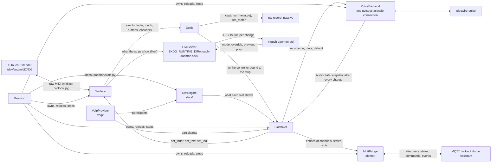

# Architecture

How the daemon works inside, for developers. To set up the project and run the tests, see
[Contributing](https://github.com/markusressel/xtouch-daemon/blob/main/CONTRIBUTING.md). The other pages of this
section: [Audio](audio.md), [Live view](live-view.md), [GUI](gui.md), [Testing](testing.md).

## Modules

The packages of `src/xtouch_daemon/`, from the device up. Tests mirror them: `tests/<package>/test_<module>.py`.

| Module | Role |
|---|---|
| `hardware/protocol.py` | The Mackie Control codec, both directions. Pure functions. |
| `hardware/midi.py` | Finds the device's sound card in `/proc/asound/cards`; reads and writes its raw MIDI device without blocking. |
| `hardware/transport.py` | How the `Surface` reaches the device: `AlsaPort` (the raw MIDI device), `SocketPort` (the virtual device's socket). |
| `hardware/strip.py` | `Strip`: what a strip shows, sending only what changed; the motor fader glides to its target and stays still while touched. `VirtualStrip`: a strip that waits off the device. |
| `hardware/surface.py` | `Surface`: the connection to the device (again after it was unplugged), its events, touches, the startup and shutdown sequences. Keeps a `SimulatedDevice` as the mirror of the device, which the live view shows. |
| `hardware/selftest.py` | The test of the device: the sweep, then the `TestBench` (every strip answers its controls), for `xtouch-daemon test` and the daemon (`StartTest`). |
| `audio/` | `model` (`AudioState`, an immutable snapshot of devices, streams and defaults), `backend` (`AudioBackend`, the interface of the strips), `pulse` (`PulseBackend`), `meter` (levels from passive `pw-record` captures, see [Audio](audio.md)), `media` (MPRIS players, for `encoder = "media"`). |
| `config/` | The TOML configuration, validated with pydantic: `files`, `model` (`Config`), `sections`, `slots` (the strip of every candidate), the strip types (`strip`, `strips`, `audio_strips`, `voip_strips`), `values`, `names` and `presets` ([Design: presets](../design/presets.md)). |
| `strips/` | The controllers of a strip: `DeviceStrip` (`ChoiceStrip` for `choices`), `AppGroupStrip`, `AutoStrip`, `VoipStrip` (a person), `HomeAssistantStrip`, `EmptyStrip`, on the base `VolumeStrip`. A controller gets its `Identity` (entity ids and names) and its `Look` (label, color, meter, LEDs) from the binder (`look_of()`). |
| `slots/` | [Channels, states and slots](../design/slots/index.md) without the device: `model`, `expressions`, `inputs` (presence), `timing`, `states`, `resolver`, `simulation`, `outcomes`, `why`, `recording` and `replay`. Pure but for the recorder. |
| `daemon/rig.py` | `Rig`: the strips of a configuration on one surface (`Desk`, `SlotEngine`, `SlotMixer`), the loop that steps the slots, the requests of modes and overrides and the chord. The `Daemon` is the rig of the device, a virtual twin (`daemon/twin.py`) one on a device that is never there. |
| `daemon/lifecycle.py` | `Daemon`: the lifecycle (signals, reload, preview, shutdown, systemd notifications) and the requests of the live view. |
| `daemon/desk.py` | `Desk`: the strips of the device for as long as the daemon runs. Hands each event to the controller (`Presenter`) bound to its strip and a release to whoever got the press; follows the hands and the chord; runs the meters of what is bound now. A claim (`[controls]`) takes the controls it names (`mask()`). |
| `daemon/slots.py`, `daemon/slot_files.py` | `SlotEngine`: steps a `Simulation` (0.1 s after a change, at the deadlines of its delays, every 2 s for the processes), takes the requests (mode, override, pick and pin), keeps overrides, the mode picked (`slots.json`) and the people (`people.json`) across restarts ([what the daemon remembers](../design/state-files.md)), and carries its state over a reload by id. |
| `daemon/binder.py` | `SlotMixer`: a controller per channel for as long as the configuration, per application of `auto` and per person without a channel while they are members. After each step it binds only the slots whose result changed. |
| `daemon/controls.py` | `Controls`: the `[controls]` of the slots and their entities; the first entry of a slot whose `when` holds claims its controls on the `Desk`. |
| `daemon/homeassistant.py` | `SlotEntities`: the entities of the mode, the states and their overrides, the channels shown and the slots, published after each step when they changed. |
| `homeassistant/` | The API of Home Assistant: `client` (`HomeAssistant`, one WebSocket connection for the daemon: it follows all entities and calls services; `fetch_entities()` once), `states` (`EntityState`), `parts` (what a part shows of an entity), `domains` (the value and service of each domain). `strips/entity.py` makes lines and values of them, next to the programs of `strips/value.py`. |
| `mqtt.py` | `MqttBridge`: announces the entities (haad-mqtt-autodiscovery), restores the retained states, passes commands on, publishes availability. |
| `simulator/` | The virtual device: `device` (`SimulatedDevice`, without IO) and `server` (on a Unix socket). See [Design: a simulated device](../design/device-simulator.md). |
| `system/` | `processes` (from `/proc`), `launch` ([Design: launching applications](../design/launch.md)), `instance` (the runtime file and sockets of the running daemon), `systemd` (notify, journal levels, the unit, the user service). |
| `live/` | The live view: `messages`, `codec` (lines of JSON), `server` (`LiveServer`), `device_test` (`xtouch-daemon test` through a running daemon), `log` (the records the GUI shows). See [Live view](live-view.md). |
| `voip/` | `VoipProvider`: the people of a voice chat, with `DemoProvider` and `BridgeProvider` (plugins of voice chat clients on a Unix socket, one per client). `voip/mumble.py` and `integrations/mumble/` build and install the Mumble plugin (C), `voip/teamspeak.py` and `integrations/teamspeak/` the TeamSpeak plugin (C). See [Design: the voice chat](../design/voice-chat.md). |
| `cli/` | The command line: a module per topic, put together by `main` in `cli/__init__.py`. |
| `gui/domain/` | The editor without a toolkit. See [GUI](gui.md). |
| `gui/qt/` | The widgets (the `gui` extra): `window/`, `preview/` (the drawing of the device), `pages/`, `fields/`, `theme/`. |

## Data flow

1. `PulseBackend` subscribes to the events of the sound server. After a burst of events it takes one snapshot
   (`AudioState`) and hands it to the mixer.
2. The `SlotEngine` resolves the slots; the `SlotMixer` binds the slots whose result changed and calls
   `update(state)` on every controller, which shows it on its `Strip`.
3. The `Surface` sends only what changed. A fader target starts a glide that moves the motor every 10 ms.
4. An event from the device goes from the `Surface` to the `Desk`, which hands it to the controller bound to its
   strip. The controller turns it into commands to the backend, run as tasks: nothing blocks the event loop.
5. The sound server reports the result as a new snapshot: back to step 2.

A `homeassistant` channel ignores the snapshots. Its entities work as in haad: Home Assistant sends a command, the
entity publishes it as its state (retained), and the copy that comes back from the broker changes the entity and the
strip. The device's events go the other way: a fader or encoder publishes its number (a fader moved by hand at most
every 100 ms), buttons publish events, which are not retained.

## Lifecycle

- **Start:** the daemon starts the surface, the backend and the mixer as tasks and tells systemd `READY=1`. The device
  and the sound server need not be there: both are connected when they appear.
- **Reload (SIGHUP, or a change of the file):** the file is read again. One with errors is logged and the current
  configuration stays. `_watch_file()` polls the file's mtime and size (`FILE_CHECK`, 1 s) and reloads once a new
  stamp was seen twice; a stamp that a reload took already (e.g. the GUI's, which reloads after saving) and a file
  that is gone are no change.
  Otherwise a new `SlotMixer` takes over the same surface and backend; the `SlotEngine` carries its states, picks and
  people over by id, so slots that show the same keep it. systemd learns of it through `RELOADING=1` and `READY=1`.
- **Preview:** a configuration of the GUI takes over like a reload, from memory instead of the file (see
  [Live view](live-view.md#live-preview)).
- **Stop (SIGTERM, SIGINT):** `STOPPING=1`; first everything stops that could show something (the sound server, MQTT,
  the mixer, the device's events), then the strips go dark and the faders down (waiting at most 2 s), and only then
  the surface closes. A snapshot arriving during the reset would otherwise paint the strips again. A dark surface
  shows that nothing drives it.
- **MQTT:** the bridge connects (again) by itself. On every connect it publishes the discovery configurations,
  subscribes, and waits for the retained states with a ping on its own sync topic (the broker sends retained messages
  before later ones); entities without one get their defaults. A reload removes the entities of removed channels from
  Home Assistant (a preview doesn't). A changed `[mqtt]` needs a restart.
- **Status:** `systemctl --user status xtouch-daemon` shows whether the device, the sound server and the broker are
  connected.

## Decisions

- **One snapshot for all strips.** Every strip sees the same consistent state, and one connection serves eight
  strips. The strips derive everything from it instead of keeping copies.
- **Coalesced volume commands.** A fader sends many positions a second. A strip sets only the latest one when the
  previous command finished, and shows it at once, so the display does not lag behind the hand.
- **The default device follows by name.** A strip without `device` looks up the default in every snapshot, so it
  and its meter follow a switch of the default.
- **One owner per strip.** A strip belongs to the sound server or to Home Assistant, by its `type`; two sources would
  fight over the motor.
- **Availability follows the device.** The entities are available while the daemon runs and the device is connected,
  so Home Assistant greys out controls that would do nothing. A last will covers a crash.
- **haad-mqtt-autodiscovery as a path dependency**, as in haad: the same entities, from a checkout next to this one
  (which also sets Python 3.14).
- **No volume restore.** The sound server keeps the volumes. The daemon remembers only the volume of an idle
  application strip, for its next stream, while it runs.
- **Channels, states and slots** ([design](../design/slots/index.md)): the `SlotEngine` alone decides what shows
  where (the `pick` encoder and pins are requests to it), the `SlotMixer` only shows it. Slots held on the `Desk` are
  fixed inputs of the resolver, so nothing changes under a finger. A slot that shows something else flashes its label
  and why for `switching.banner` seconds; a new mode shows its banner across the LCDs instead.
