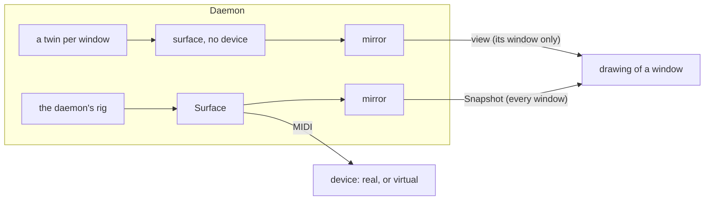

# Design: previews, on the device or only in the GUI

Status: **proposed** (2026-11-19). It replaces [Try changes and situations](try-and-simulate.md) and [The virtual
twin](virtual-twin.md), which describe what is built now; once this is built, they move to `history/`.

## Problem

Two features of the GUI show something that isn't real yet, and both grew a way to show it:

- **Unsaved edits** of the configuration reach the device with "Try on the device" (`StartPreview`).
- **Simulate** shows another situation. It reaches the device with "Try on the device" too, and otherwise runs on a
  virtual twin in the daemon (`StartTwin`).

So edits can only be tried on the device, Simulate in both places, and two protocols with their own heartbeat, timeout
and ending do the same thing for different targets. On top of that, four things all looked like "the device" in the
discussion: the real device, the `SimulatedDevice`, the twin and the drawing. This design names each of them once and
puts both features behind one preview with one switch.

## Terms

One word for one thing, in the code, the docs and here.

| Term | What it is | Where |
|---|---|---|
| **device** | The X-Touch Extender the daemon drives. It is the real one over USB MIDI, or the virtual device. Below, "the device" means either. | `hardware/` |
| **virtual device** | A device model behind a Unix socket, started by `xtouch-daemon virtual-device` or by the GUI ("Try without a device"). The daemon speaks the same MIDI bytes to it as to the real one (`SocketPort`). | `simulator/server.py`, `gui/qt/virtual_device.py` |
| **device model** | `SimulatedDevice`: what a device shows (LCD texts and colors, LEDs, rings, meters, faders, touches), pure Python, without IO or Qt. It is the one model of a device. | `simulator/device.py` |
| **mirror** | The device model in each `Surface`, fed with every byte the surface sends and receives. It shows what the device shows, or will show once it is connected. | `Surface.mirror` |
| **rig** | The strips of a configuration on one surface: the hands on them (`Desk`), the slots (`SlotEngine`), the controllers (`SlotMixer`) and the loop that steps them. | `runtime/rig.py` |
| **twin** | A second rig in the daemon, one per GUI window that asks for it. Its surface has no device, and its sound server and voice chat are made up. Its mirror is all there is of it. | `runtime/twin.py` |
| **drawing** | What the window Device of the GUI paints: always a mirror that the daemon sends, of the device or of the window's twin. | `gui/qt/window/device_view.py` |
| **preview** | What a window shows that isn't real: its unsaved edits, its situation (Simulate), or both. | |
| **situation** | A what-if of Simulate: the mode, the states on, the channels and pools present, and how many people, applications and devices. | `slots.outcomes.Situation` |



## Rules

1. **The daemon drives everything that is drawn.** The GUI computes no strips. The drawing is a mirror of the device or
   of the window's twin. Without a daemon, the strips are dark and the GUI says how to start the daemon.
2. **One model of a device.** The virtual device, every mirror and the tests use the device model.
3. **One rig, two uses.** The daemon's strips and a twin are both a `Rig`, so they behave the same: steps, delays,
   banners, controllers, meters.
4. **One preview per window**: a configuration (the editor's) and a situation (Simulate's, or the real one).
5. **One switch decides where the preview runs**: on the device, or only in the GUI. A new preview starts only in the
   GUI.
6. **Home Assistant never sees a preview.** Its entities show the file and the real situation.

## Where a preview runs

The switch is "On the device", next to Save and apply. It shows while the window has a preview. Off means "only in the
GUI"; it starts off in every window and stays as it is set until the window closes.

| The window has | Only in the GUI (switch off) | On the device (switch on) |
|---|---|---|
| Nothing (no edits, no Simulate) | No preview. The device runs the file, the drawing shows the device. | The same: the switch is gone. |
| Unsaved edits | The twin runs the edits in the situation of now (see below). The device runs the file. | The device runs the edits in the real situation. |
| Simulate | The twin runs the configuration in the situation of Simulate. The device runs the file. | The device runs the configuration in the situation of Simulate. |
| Both | The twin runs the edits in the situation of Simulate. | The device runs the edits in the situation of Simulate. |

In every row:

- **The drawing** shows where the preview runs: the twin, or the device. A frame in the accent color marks a preview,
  and the bar above the drawing says where it runs ("Only in the GUI", "On the device").
- **The cards** of the page Slots (what a slot shows, why, who waits) are the slots of what the drawing shows.
- **Play** acts on what the drawing shows: the twin's strips, or the device's.
- **The configuration** sent is the editor's document. Without edits, it is the file. The twin needs no daemon that
  reads this file; "On the device" needs one, as now.

### The twin without Simulate

Edits only in the GUI need a situation for the twin, and the user picked none. The twin then runs **the situation of
now**: the daemon takes it from its real slots at every step (the mode, the states that are on, the channels present,
how many people, applications and devices). So the twin shows what the device would show with the edits, right now,
and follows when reality changes. A state or channel that only the edits have starts as Simulate would start it (off,
present). Its sound server stays made up: the twin touches nothing real (see
[The twin](#the-twin)).

### Turning the switch

- **Off to on:** the daemon runs the preview on the device (as `StartPreview` does now), and the window's twin ends.
  The drawing shows the device.
- **On to off:** the device goes back to the file and the real situation, and a twin starts with the preview.
  The drawing shows the twin.
- **Another window turns it on:** the device runs that window's preview. The first window is told, and its preview goes
  back to its twin (its switch goes off).

### How a preview ends

- **Save and apply:** the daemon loads the file. The edits are no preview any more. Simulate stays open, so its
  situation stays a preview where it ran.
- **Revert, and Simulate closed (Esc):** nothing is left to preview. The twin ends, or the device runs the file again.
- **The window closes or stops answering** (`PREVIEW_TIMEOUT`, 10 s): the daemon ends its twin and, if it had the
  device, runs the file on it again.
- **The file changes on disk, or the daemon is reloaded:** a preview on the device ends, and the window is told why. A
  twin keeps running: it doesn't use the file.
- **The daemon stops or restarts:** the window loses its preview. Once a daemon is there again, the window asks again
  where its switch says.

### Without a device, without a daemon

- **A daemon, no device connected:** both places work. On the device, the mirror shows what the device will show once
  it is connected, and the bar says it isn't.
- **No daemon:** no preview, no Simulate, no drawing. The switch and Simulate are off and say how to start the daemon
  (`xtouch-daemon install-service --now`), or offer "Try without a device".

## The twin

A twin is a `Rig` built from a configuration and a situation, and from nothing of the daemon. It gets no reference to
the real sound server, surface, bridge, voice chat, media players or state directory. That is the guarantee, not a
check at each effect.

| Real | In a twin |
|---|---|
| `AudioBackend` (the sound server) | `TwinBackend`: an `AudioState` in memory. Commands change it and report it, like the sound server does. |
| `AudioState` | Made from the situation (`slots/world.py`). The real one is never passed on. |
| Voice chat provider | `DemoProvider` with the people of the situation. |
| Meters (`pw-record` per target) | A made-up signal, fed through the same `Meter`, scaled by the gain of the target. |
| `launch` | A launcher that starts nothing. |
| MQTT, Home Assistant, media players | None. |
| `state_dir` (choices, people) | None: no file is read or written. |
| The device | A `Surface` on `NoPort`: a port that is never there. The surface writes everything into its mirror anyway. |
| Mode and overrides | The situation's only. The chord, the controls and requests of modes and overrides change nothing (`SlotEngine.fixed`). |
| Log | `xtouch_daemon.twin`. |

### The world of a situation

`world(scene, situation, names)` makes the twin's sound server and voice chat:

| Part of the scene | In the world, unless the situation removed it |
|---|---|
| `output` / `input` channel | A device for each of its `devices` (a wildcard gets one that matches it), or the default one without `devices`. |
| `apps` channel | A stream that its first `match` entry takes. |
| `person` channel | That person in the voice chat. |
| `homeassistant` channel | Nothing: it is always present. |
| `apps`, `people`, `devices` pool | As many as the situation says: the real ones first, then made up (`App 1`, `Alice`, `Device 1`). |
| Pools of channels | Their channels, as channels are. |
| Pools of your own | One stand-in that the pool takes, while the situation has it present. |

### Real names first

The stand-ins of the pools take the names of what is real right now first: the applications that play, the people in
the voice chat, the devices without a channel. They are plain strings, copied: the twin has no audio behind them. The
device does the same with a situation, and there it has audio behind them.

The daemon gives a twin new names when they change. So the strips of a twin follow reality: a stand-in "Spotify"
becomes "App 1" when Spotify stops playing. Its volume on the twin starts again at 100 %. That is accepted (decision 4).

## The protocol

One preview per client replaces `StartPreview`/`StartTwin`, `KeepPreview`/`KeepTwin` and `EndPreview`/`EndTwin`:

```python
@dataclass(frozen=True)
class StartPreview:
    """Run `config` (None: the file's) in `situation` (None: the real one) where `on_device` says; sent again, it follows."""

    config: str | None
    situation: Situation | None
    on_device: bool


class KeepPreview: ...  # the heartbeat, every 3 s


class EndPreview: ...  # nothing to preview any more


@dataclass(frozen=True)
class Play:
    event: StripEvent
    preview: bool = False  # on the window's twin, not on the device
```

- Replies: `Reply("preview", ok, message)` to `StartPreview`, with the errors of the configuration.
  `Reply("ended", True, why)` when the daemon ended the preview (another window took the device, the file changed, a
  missed heartbeat, the twin failed, the daemon stops). A `KeepPreview` without a preview gets "ended" too, so a window
  that lost its daemon asks again.
- The twin's view is a line of its own, `{"preview": TwinView}`, sent to its window only while it changes. On the
  device, the snapshot shows the preview as now (`preview`, `simulated`).
- A feature `on_device` in `FEATURES` tells the new `StartPreview`. A daemon without it is too old for the GUI's
  preview, and the GUI says to restart it.
- Only the user's own clients (`peer_uid`), as now: the configuration may hold secrets.

## The GUI

- **The switch "On the device"** next to Save and apply, while there is a preview. It replaces "Try on the device"
  and the bar "Only in the drawing".
- **The pill** next to it says where the preview runs and what it is: "Only in the GUI, not saved", "On the device ·
  simulated", "Sending…", "Paused: problems".
- **Simulate** needs a daemon of this user, as now. Esc ends it.
- **Edits** start a preview a moment after the first change (debounced, as now); a document with problems is not
  sent, and the preview keeps the last one that was.

## Decisions (2026-11-19)

1. **One switch for edits and Simulate**: where the preview runs, on the device or only in the GUI.
2. **A preview starts only in the GUI.** The device changes only when the switch is turned on.
3. **One rig for the device and the twins** (`Rig`). A twin's mode and states are the situation's only.
4. **Real names first on the twin**, following reality. Its strips may change while the situation stays.
5. **Simulate needs a daemon.** There is no rig in the GUI.
6. **One twin per window, no limit.** The device takes one window's preview at a time.

## What changes from what is built

1. **Protocol**: one `StartPreview` with `on_device`, `Play(preview=...)`, the view line `preview`; the twin
   messages go. The daemon's preview and twins become one session per client.
2. **Daemon**: a twin with no situation runs the situation of now (`Situation` from the real slots at each step).
3. **GUI**: the switch "On the device", off by default; edits preview on the twin; the drawing, cards and Play follow
   the switch; the pill's texts.
4. **Docs**: the GUI guide (Try on the device, Simulate), the architecture of the live view, the changelog; the two
   designs it replaces move to `history/`.

## Tests

- **Where**: for each row of [the table](#where-a-preview-runs), what the device runs and what the window is sent.
- **The switch**: off to on ends the twin and previews on the device; on to off brings the file back and starts a twin;
  a second window takes the device, and the first one goes back to its twin.
- **The situation of now**: a twin without a situation follows a change of the real states and members.
- **Inertness**: a twin with Play and a reconfigure calls nothing real; the real strips and slots stay as they are.
- **Ending**: Save, Revert and Esc, the window gone, a missed heartbeat, a failed twin, the daemon restarted.
- **GUI**: with a fake daemon, the switch sends `on_device`; the drawing, the cards and Play follow it; without a
  daemon, the guidance.
