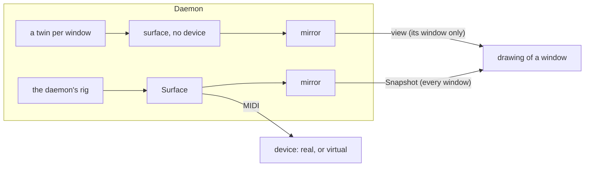

# Design: previews, in the GUI or on the device

Status: **built** (2026-11-19). It replaces [Try changes and situations](../history/try-and-simulate.md) and [The
virtual twin](../history/virtual-twin.md).

## Problem

Two features of the GUI show something that isn't real yet, and both grew a way to show it:

- **Unsaved edits** of the configuration reach the device with "Try on the device" (`StartPreview`).
- **Simulate** shows another situation. It reaches the device with "Try on the device" too, and otherwise runs on a
  virtual twin in the daemon (`StartTwin`).

So edits can only be tried on the device, Simulate in both places, and two protocols with their own heartbeat, timeout
and ending do the same thing for different targets. On top of that, four things all looked like "the device" in the
discussion: the real device, the `SimulatedDevice`, the twin and the drawing. This design names each of them once and
puts both features behind one preview with one control: where the preview shows.

## Terms

One word for one thing, in the code, the docs and here.

| Term | What it is | Where |
|---|---|---|
| **device** | The X-Touch Extender the daemon drives. It is the real one over USB MIDI, or the virtual device. Below, "the device" means either. | `hardware/` |
| **virtual device** | A device model behind a Unix socket, started by `xtouch-daemon virtual-device` or by the GUI ("Try without a device"). The daemon speaks the same MIDI bytes to it as to the real one (`SocketPort`). | `simulator/server.py`, `gui/qt/virtual_device.py` |
| **device model** | `SimulatedDevice`: what a device shows (LCD texts and colors, LEDs, rings, meters, faders, touches), pure Python, without IO or Qt. It is the one model of a device. | `simulator/device.py` |
| **mirror** | The device model in each `Surface`, fed with every byte the surface sends and receives. It shows what the device shows, or will show once it is connected. | `Surface.mirror` |
| **rig** | The strips of a configuration on one surface: the hands on them (`Desk`), the slots (`SlotEngine`), the controllers (`SlotMixer`) and the loop that steps them. | `runtime/rig.py` |
| **twin** | A second rig in the daemon, one per GUI window that asks for it. Its surface has no device, and its sound server and voice chat are made up. Its mirror is all there is of it. | `runtime/twin.py` |
| **drawing** | What the window Device of the GUI paints: always a mirror that the daemon sends, of the device or of the window's twin. | `gui/qt/window/device_view.py` |
| **preview** | What a window shows that isn't real yet: its unsaved edits, with the situation of Simulate while it is open. Simulate always includes the edits. | |
| **situation** | A what-if of Simulate: the mode, the states on, the channels and pools present, and how many people, applications and devices. | `slots.outcomes.Situation` |



## Rules

1. **The drawing is a device preview first.** It can always mirror what the device shows right now.
2. **The daemon drives everything that is drawn.** The GUI computes no strips. The drawing is a mirror of the device or
   of the window's twin. Without a daemon, the strips are dark and the GUI says how to start the daemon.
3. **One model of a device.** The virtual device, every mirror and the tests use the device model.
4. **One rig, two uses.** The daemon's strips and a twin are both a `Rig`, so they behave the same: steps, delays,
   banners, controllers, meters.
5. **One preview per window**: the editor's configuration, in the situation of Simulate while it is open.
6. **One control decides where the preview shows**, for the edits and Simulate alike. "In the GUI" is the default.
   "On the device" is the user's approval that the device changes before the configuration is saved.
7. **Home Assistant never sees a preview.** Its entities show the file and the real situation.

## Where the preview shows

The control "Preview" sits next to Save and apply, while the window has a preview (unsaved edits, or Simulate open).
It has three positions:

| Position | The device runs | A twin runs | The drawing shows | Meant for |
|---|---|---|---|---|
| **In the GUI** (the default) | The file, in reality | The preview | The twin | Seeing the edits and Simulate without touching the device. |
| **On the device** | The preview | Nothing | The device, which shows the preview | Trying it for real: an intentional choice, the device changes before a save. |
| **Off** | The file, in reality | Nothing | The device, as it is | A user who can't see the device and wants to see what it shows. Rarely used. |

- **Without a preview** (no edits, Simulate closed) the control is gone. The device runs the file, and the drawing
  mirrors it: there is nothing else to show.
- **A new window** starts with "In the GUI". The position stays as it is set until the window closes.
- **Simulate opened while "Off"** moves the control to "In the GUI"; closing Simulate (Esc) moves it back to "Off".
- **The cards** of the page Slots (what a slot shows, why, who waits) are the slots of what the drawing shows.
- **Play** acts on what the drawing shows: the twin's strips, or the device's.
- **The configuration** of the preview is the editor's document. The twin needs no daemon that reads this file; "On
  the device" needs one, as now.

### The situation of a twin

- **Simulate open:** the situation of Simulate.
- **Simulate closed** (only edits): the situation of now. The daemon takes it from its real slots at every step: the
  mode, the states that are on, the channels present, and how many people, applications and devices. So the twin shows
  what the device would show with the edits right now, and follows when reality changes. A state or channel that only
  the edits have starts as Simulate would start it (off, present).

Either way its sound server is made up: the twin touches nothing real (see [The twin](#the-twin)).

### Changing the position

- **To "On the device":** the daemon runs the preview on the device (as `StartPreview` does now). The window's twin
  ends, and the drawing shows the device.
- **From "On the device":** the device goes back to the file and the real situation.
- **To "In the GUI":** a twin starts with the preview, and the drawing shows it.
- **To "Off":** the twin ends, and the drawing shows the device.
- **Another window chooses "On the device":** the device runs that window's preview. The first window is told, and
  goes back to "In the GUI".

### How a preview ends

- **Save and apply:** the daemon loads the file. The edits are no preview any more. If Simulate is open, its situation
  stays a preview where the control says.
- **Revert, and Simulate closed (Esc):** nothing is left to preview. The control is gone, the twin ends, and the
  device runs the file again.
- **The window closes or stops answering** (`PREVIEW_TIMEOUT`, 10 s): the daemon ends its twin and, if the window had
  the device, runs the file on it again.
- **The file changes on disk, or the daemon is reloaded:** someone acted on the file on purpose, so the device runs it.
  A window that had the device is told why and goes back to "In the GUI". A twin keeps running the window's document.
- **The daemon stops or restarts:** the window loses its preview. Once a daemon is there again, the window asks again
  where its control says.

### Without a device, without a daemon

- **A daemon, no device connected:** every position works. On the device, the mirror shows what the device will show
  once it is connected, and the bar above the drawing says it isn't.
- **No daemon:** no preview, no Simulate, no drawing. The control and Simulate are off and say how to start the daemon
  (`xtouch-daemon install-service --now`), or offer "Try without a device".

## The twin

A twin is a `Rig` built from a configuration and a situation, and from nothing of the daemon. It gets no reference to
the real sound server, surface, bridge, voice chat, media players or state directory. That is the guarantee, not a
check at each effect.

| Real | In a twin |
|---|---|
| `AudioBackend` (the sound server) | `TwinBackend`: an `AudioState` in memory. Commands change it and report it, like the sound server does. |
| `AudioState` | Made from the situation (`slots/world.py`). The real one is never passed on. |
| Voice chat provider | `DemoProvider` with the people of the situation. |
| Meters (`pw-record` per target) | A made-up signal, fed through the same `Meter`, scaled by the gain of the target. |
| `launch` | A launcher that starts nothing. |
| MQTT, Home Assistant, media players | None. |
| `state_dir` (choices, people) | None: no file is read or written. |
| The device | A `Surface` on `NoPort`: a port that is never there. The surface writes everything into its mirror anyway. |
| Mode and overrides | The situation's only. The chord, the controls and requests of modes and overrides change nothing (`SlotEngine.fixed`). |
| Log | `xtouch_daemon.twin`. |

### The world of a situation

`world(scene, situation, names)` makes the twin's sound server and voice chat:

| Part of the scene | In the world, unless the situation removed it |
|---|---|
| `output` / `input` channel | A device for each of its `devices` (a wildcard gets one that matches it), or the default one without `devices`. |
| `apps` channel | A stream that its first `match` entry takes. |
| `person` channel | That person in the voice chat. |
| `homeassistant` channel | Nothing: it is always present. |
| `apps`, `people`, `devices` pool | As many as the situation says: the real ones first, then made up (`App 1`, `Alice`, `Device 1`). |
| Pools of channels | Their channels, as channels are. |
| Pools of your own | One stand-in that the pool takes, while the situation has it present. |

### Real names first

The stand-ins of the pools take the names of what is real right now first: the applications that play, the people in
the voice chat, the devices without a channel. They are plain strings, copied: the twin has no audio behind them. The
device does the same with a situation, and there it has audio behind them.

The daemon gives a twin new names when they change. So the strips of a twin follow reality: a stand-in "Spotify"
becomes "App 1" when Spotify stops playing. Its volume on the twin starts again at 100 %. That is accepted (decision 4).

## The protocol

One preview per client replaces `StartPreview`/`StartTwin`, `KeepPreview`/`KeepTwin` and `EndPreview`/`EndTwin`:

```python
@dataclass(frozen=True)
class StartPreview:
    """
    Run `config` (None: the file's) in `situation` (None: the situation of now) on the device or on a twin of this
    client; sent again, it follows. "Off" sends `EndPreview`.
    """

    config: str | None
    situation: Situation | None
    on_device: bool


class KeepPreview: ...  # the heartbeat, every 3 s


class EndPreview: ...  # nothing to preview any more


@dataclass(frozen=True)
class Play:
    event: StripEvent
    preview: bool = False  # on the window's twin, not on the device
```

- Replies: `Reply("preview", ok, message)` to `StartPreview`, with the errors of the configuration.
  `Reply("ended", True, why)` when the daemon ended the preview (another window took the device, the file changed, a
  missed heartbeat, the twin failed, the daemon stops). A window that lost its daemon (the connection ended) asks
  again with its next heartbeat.
- The twin's view is a line of its own, `{"twin": TwinView}` (a snapshot has a field `preview` already), sent to its
  window only while it changes. On the device, the snapshot shows the preview as before (`preview`, `simulated`).
- A feature `on_device` in `FEATURES` tells the new `StartPreview`. A daemon without it is too old for the GUI's
  preview, and the GUI says to restart it.
- Only the user's own clients (`peer_uid`), as now: the configuration may hold secrets.

## The GUI

- **The control "Preview"** next to Save and apply: "In the GUI", "On the device", "Off", while there is a preview. It
  replaces the switch "Try on the device" and the bar "Only in the drawing". Each position has a tooltip that says what
  the device and the drawing show.
- **The pill** next to it says where the preview shows and what it is: "In the GUI, not saved", "On the device ·
  simulated", "Off: the device runs the file", "Sending…", "Paused: problems".
- **The bar above the drawing** says what the drawing shows: "Preview in the GUI", or the device's own text with
  "· preview" while it runs the preview (e.g. "Live · preview"). Until the twin's first view arrives, the drawing
  shows the device.
- **The state bar** of Slots always shows the device's states: its overrides change the device, not the preview. The
  cards and the why-panel show the twin while the drawing does.
- **Simulate** needs a daemon of this user, as now. Esc ends it.
- **Edits** reach the preview a moment after each change (debounced, as now). A document with problems is not sent:
  the preview keeps the last one that was.

## Decisions (2026-11-19)

1. **The drawing is a device preview first**: "Off" always shows the device as it is.
2. **One control for edits and Simulate**, with three positions: "In the GUI", "On the device", "Off". Simulate always
   includes the edits and shows where they show.
3. **"In the GUI" is the default.** "On the device" is an intentional choice: the user approves that the device
   changes before a save. "Off" is for a user who can't see the device.
4. **Simulate opened while "Off"** moves to "In the GUI", and back when it closes.
5. **One rig for the device and the twins** (`Rig`). A twin's mode and states are the situation's only.
6. **Real names first on the twin**, following reality. Its strips may change while the situation stays.
7. **Simulate needs a daemon.** There is no rig in the GUI.
8. **One twin per window, no limit.** The device takes one window's preview at a time.

## What changed from what was built before

1. **Protocol**: one `StartPreview` with `on_device`, `Play(preview=...)`; the twin
   messages go. The daemon's preview and twins become one session per client.
2. **Daemon**: a twin with no situation runs the situation of now (`Daemon._situation_now()`: the real mode and
   states, `world_of_now()` with the real names), and follows it.
3. **GUI**: the control "Preview" ("In the GUI" by default); edits preview on the twin; the drawing, cards and Play
   follow the control; the pill's and the bar's texts.
4. **Docs**: the GUI guide (Preview, Simulate), the architecture of the live view, the changelog; the two designs it
   replaces moved to `history/`.

## Tests

- **Where**: for each position, with edits, with Simulate and with both: what the device runs, whether a twin runs,
  and what the window is sent.
- **Changing the position**: each change ends or starts what it should; a second window takes the device, and the first
  one goes back to "In the GUI"; Simulate opened while "Off" moves to "In the GUI" and back.
- **The situation of now**: a twin without Simulate follows a change of the real states and members.
- **Inertness**: a twin with Play and a reconfigure calls nothing real; the real strips and slots stay as they are.
- **Ending**: Save, Revert and Esc, the window gone, a missed heartbeat, a failed twin, the file changed, the daemon
  restarted.
- **GUI**: with a fake daemon, the control sends what it should; the drawing, the cards and Play follow it; without a
  daemon, the guidance.

## Not in this design

- **The GUI doesn't notice when the file changes on disk.** A Save then overwrites a change the user never saw. A file
  watcher with "The file changed on disk: Load it / Keep my changes" is needed with or without previews; it gets a
  design of its own.
