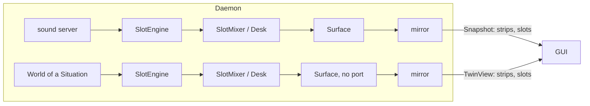

# Design: the virtual twin

Status: **proposed** (2026-11-19). Replaces the situation part of [Try changes and situations](try-and-simulate.md) and
the drawing of the GUI that was made without the device ([A simulated device](device-simulator.md#4-the-mirror-what-the-gui-shows)
says what it shows instead).

## Problem

The GUI draws the device. It has three sources for that drawing:

| Source | Where the strips come from |
|---|---|
| The device, live | The daemon's mirror of the device: every byte its `Surface` sent (`Surface.mirror`, `live.server.strip_states`). |
| Simulate, no "Try on the device" | `gui/domain/simulate.py`: the GUI runs the resolver and paints a label and a color. |
| No daemon | Was the same as Simulate: the file in its default situation (removed on 2026-11-19, the strips are dark now). |

The second row is a second implementation of "what a strip looks like". It knows nothing of meters, rings, LEDs,
faders, banners or the strip controllers, so it can only be wrong in new ways, and nothing can be played on it. The
rule for the GUI is: **the drawing is only ever the mirror of a device that the daemon drives.** A device the user
doesn't have is a virtual one, and the same holds for a situation the user doesn't have: it needs a device of its own
that something drives.

## Idea

A **virtual twin**: a second, complete set of strips that the daemon runs for the situation of Simulate, next to the
real ones. It is built from the same parts as the real device (`Surface`, `Desk`, `SlotMixer`, `SlotEngine`, the strip
controllers) and touches nothing real. The GUI asks for it and draws its mirror, exactly like the mirror of the real
device. Without a daemon there is no twin, so no drawing: the GUI guides to the daemon.



The twin has no port: a `Surface` writes everything it sends into its mirror whether a device is connected or not
(`Surface.send()`), which is how the real mirror shows "what the device will show once it is there". A spike on
2026-11-19 confirmed it: a `Surface` on a port that never opens still mirrors texts, LEDs and rings. The twin
needs no `SimulatedDevice` socket or transport; the mirror *is* its device.

### What "touches nothing real" means

The twin is built from a `Config` and from nothing of the daemon: it gets no reference to the real backend, surface,
bridge, voice chat provider, player list or state directory. That is the guarantee, not a check at each effect. What
each part of the real path becomes:

| Real | Twin |
|---|---|
| `AudioBackend` (the sound server) | `TwinBackend`: holds an `AudioState`, `set_*` change that state and report it like the sound server does. |
| `AudioState` | Made from the situation (see [The world](#the-world-of-a-situation)). Never read from the real one. |
| `VoipProvider` (the plugin) | `TwinVoip`: participants from the situation, volume and mute stay in its memory. |
| Meters (`pw-record` per target) | A signal generator fed through the same `Meter.feed_from()`, scaled by the gain of the target. |
| `Launcher` (`launch`) | The `Launcher` with a `spawn` that does nothing (it takes one already). |
| MQTT bridge, Home Assistant | None: `bridge=None`. Home Assistant never sees the twin. |
| Media players (`encoder = "media"`) | None, as without a player. |
| `state_dir` (choices, people) | None: no file is read or written. |
| Processes (states `processes = [...]`) | None run; states are forced by the situation (overrides, as now). |
| Log | The twin's engine logs at debug level under `xtouch_daemon.twin`. |
| Hands (buttons, faders, encoders) | `Play` events for the twin go to its own `Surface.play()`. |

## The world of a situation

A `Situation` (`slots.outcomes`: `mode`, `on`, `flipped`, `people`, `apps`, `devices`) is today turned into an
`Observation` by `Situation.observation()`, which borrows real applications and people as stand-ins. The twin makes a
whole world from it instead, and the engine goes through its normal path:
`Observer.observe(audio, processes, voip, now)` is what a real step does. `Situation.observation()` and the special
case in `SlotEngine.step()` go away; there is one way to step.

`world(scene, situation) -> World(audio: AudioState, voip: VoipState, processes: frozenset[str])`:

| Part of the scene | In the world, unless the situation `flipped` it |
|---|---|
| `output` / `input` channel | One device per entry of its `devices`: the first (or the second, ...) as a made-up node with a description of its own (`Device 1`), a volume of 100 %. A channel with a wildcard gets one device that matches it. Without `devices` the default one. |
| `apps` channel | One playing stream whose name matches its first `match` entry (a preset: its first name). |
| `person` channel | The person in the voice chat. |
| `homeassistant` channel | Nothing: it is always present. |
| `apps` pool | `situation.apps` playing streams `App 1`, `App 2`, ... (a preset in `flipped`: all slots). |
| `people` pool | `situation.people` people `Alice`, `Bob`, ... |
| `devices` pool | `situation.devices` made-up devices that no channel matches. |
| Pools of channels | Their channels are present as channels are; flipping the pool removes them all. |
| Pools of applications and of people of your own | `flipped`: one stand-in that the pool takes (its `match`, its `people`); absent otherwise. |

Everything else (states, modes) is the situation's `on` and `mode`: overrides and a mode picked in the twin's
`SlotEngine`, as the real preview does it now. Delays and dwells apply as in reality (`delay_on`, `absent_after`,
`hold`): that is the point of a twin that runs.

### Decision 1: the twin never reads reality

Today stand-ins are real where they can be ("a real one has audio behind its strip", try-and-simulate decision 3).
That was for strips on the real device. The twin has no real audio behind anything, so a real name buys nothing, and a
twin that depends on what plays right now answers differently every time it is asked. It is **deterministic**: the
same configuration and situation give the same strips. This also means the twin starts from a world, not from the
real `Simulation` (`carry`): what the people order, the members and the slots they had are not carried over.

## The twin in the daemon

`runtime/twin.py`:

```python
class Twin:
    """The strips of a configuration in a situation, on a device of their own."""
    def __init__(self, config: Config, situation: Situation): ...
    def set_situation(self, situation: Situation) -> None: ...   # a new world, same engine and strips
    def reconfigure(self, config: Config) -> None: ...           # like a reload: ids carry over
    def play(self, event: StripEvent) -> None: ...               # a hand on the twin
    def view(self) -> TwinView: ...                              # strips of the mirror + slots, states, why
    async def run(self) -> None: ...                             # the steps, the meters; cancelled by close()
    def close(self) -> None: ...
```

It owns a `Surface(port=NoPort())`, a `Desk(surface, chord, on_chord, capture=synthetic)`, a `SlotEngine(config,
state_dir=None)`, a `SlotMixer(surface, TwinBackend, config, engine, desk, TwinVoip, bridge=None, players=None,
launcher=Launcher(spawn=...))`, and a task that steps the engine like `Daemon._follow_slots` does (wake on a change
of the world, the deadline of a delay or a dwell, every `PROCESS_INTERVAL`). The loop that both need is factored out
of the daemon (`runtime/follow.py`, `follow_slots(wake, deadline, step)`); the step itself differs (the daemon has
banner, entities and the real sources, the twin its world) and stays in each.

The twin shows its strips like the device after a connect: `Surface.light_up()` (the `send_colors()` of a connect, new
and public) once at the start, since the strips are dark until their colors are sent.

### Seams that the twin needs in the existing code

| Where | Change |
|---|---|
| `hardware/surface.py` | `NoPort` (a `Port` that is never there), `light_up()`. Nothing else: `Surface` already mirrors without a transport. |
| `audio/meter.py`, `runtime/desk.py` | `Meter(..., capture=capture)` and `Desk(..., capture=...)`: the function that feeds peaks of a target. The default is `capture()` (a process); the twin's feeds a fixed, slowly changing pattern while the target plays. |
| `runtime/slots.py` | `SlotEngine(..., logger=...)`. Removed: `situation`, `what_if`, `simulate()`, `active` (it is `simulation` again), the situation branch of `step()`. |
| `slots/outcomes.py` | `Situation.observation()` and `Situation.choices()` go to the twin's world (`slots/world.py`). `simulate()` and `outcomes()` stay: `check-config` and the table of Simulate's inputs use them. |
| `voip/` | `TwinVoip(VoipProvider)`: `update()` with the people of the world; `set_volume` and `set_muted` keep them in the provider. |
| `runtime/daemon.py` | Twins by client; `preview()` loses `situation`; `snapshot()` loses `simulated`. |
| `live/messages.py`, `codec.py`, `server.py` | See [The protocol](#the-protocol). |

## The protocol

The snapshot is one line for every client. A twin belongs to one client, so its view is its own line, sent to its
owner only.

```python
@dataclass(frozen=True)
class StartTwin:
    """Run `config` (the whole TOML text) in `situation` on a twin of your own; again: the twin follows."""
    config: str
    situation: Situation

class KeepTwin: ...   # the heartbeat, as KeepPreview
class EndTwin: ...    # the twin is gone

@dataclass(frozen=True)
class Play:           # gets `twin: bool = False`: the hand is on the twin
    event: StripEvent
    twin: bool = False

@dataclass(frozen=True)
class TwinView:
    config: str                 # fingerprint(config) of the twin, as Snapshot.config
    strips: tuple[StripState, ...]
    slots: SlotsState           # slots, states, mode, why and who waits: the twin's
```

- Replies: `Reply("twin", ok, message)` to `StartTwin` (the errors of the configuration as in "preview"),
  `Reply("twin_ended", True, why)` when the daemon ended it (heartbeat missed, the daemon stops).
- The view line is `{"twin": {...}}`, sent by `LiveServer.tell_view(client, view)` every `INTERVAL` while it changes
  (meters and motors keep it changing, like the snapshot).
- Feature `twin` in `FEATURES`; `situation` leaves it, `StartPreview.situation` and `Snapshot.simulated` are removed.
  An older daemon lacks `twin`: Simulate says it is too old and to restart it. A newer daemon refuses a `situation` in
  `StartPreview` as unreadable. This is a break of the live protocol between GUI and daemon within 0.x; it is
  announced in the changelog.
- Twins per client: at most one per connection, at most `MAX_TWINS` (4) in the daemon, so a leaking GUI can't make
  strips without end. A twin ends with `EndTwin`, with its connection, and after `TWIN_TIMEOUT` (10 s) without
  `KeepTwin`.
- Security: as `StartPreview`, only the user's own clients (`peer_uid`). The configuration text may hold secrets
  (`[mqtt]`); the twin ignores `[mqtt]` and `[voip]` providers (it builds `TwinVoip`, never a socket).

### The twin's own hands

A button, fader or encoder on the twin (Play, the mouse on its drawing) goes through its own `Desk`, changes the
twin's `AudioState` through `TwinBackend` and its slots through its `SlotEngine` (a `toggle:` control, the chord, a
`pick` encoder). The twin's `TwinView` therefore tells states and mode that may differ from the `Situation` the GUI
sent. The GUI follows the twin: when the twin's states or mode differ from its what-if, the bar of Simulate shows the
twin's (`WhatIf.of_live()` exists) and does not send them back. A change of the bar sends a new `StartTwin`, which
sets the overrides and the mode picked again, so the bar wins when it is clicked.

## The GUI

- **Simulate** needs a daemon of this user that takes `twin`. Without one the page says why in its place (like "Try on
  the device" does, `unavailable()`), with the same guidance: start the daemon, or "Try without a device". There is no
  Simulate without a daemon.
- It needs no "Try on the device", and no daemon that runs *this file*: the configuration it sends is the document's, so
  Simulate works on a new file, or on a daemon that reads another one.
- While Simulate is open the GUI sends `StartTwin(document.render(), situation)` a moment after each edit or click
  (`DEBOUNCE_MS`) and `KeepTwin` every `HEARTBEAT_MS`; a document with problems sends nothing (the twin keeps the last
  one that parsed, the problems show as they do).
- **The drawing** shows the `TwinView` strips while Simulate is open, with the accent frame ("simulated"), and the
  real mirror otherwise. Between the request and the first view the drawing keeps what it had.
- **The cards** (what a slot shows, why, who waits) are the twin's `SlotsState`. `gui/domain/simulate.py` shrinks to
  `WhatIf` (a value the user edits), `Inputs` (what a what-if can change) and `presence_text`; `simulated()` and
  `simulated_faces()` are deleted.
- **Play** on the drawing sends `Play(event, twin=True)` while Simulate is open: the faders and buttons of the twin,
  never the real device.
- **"Try on the device"** (the switch) does one thing again: the unsaved configuration on the real device. It no
  longer carries a situation, so its pill loses "simulated".
- **Esc** ends Simulate: `EndTwin`.

## What this gives up

The twin can't make the real device show a situation (the old switch with Simulate open). A situation can be felt on
a device only through the virtual device (`run --virtual-device` with the GUI hosting it) and a daemon whose real
inputs are the situation, which is not what a twin is for. The point of the old feature was to see and play a
situation, and the twin does both.

## Decisions to confirm

1. **Simulate never reaches the real device** (changes decision 1 of try-and-simulate). Safe, and the drawing and the
   device are never the same thing under one name.
2. **The twin never reads reality** (see [Decision 1](#decision-1-the-twin-never-reads-reality)): made-up names, the
   same strips every time.
3. **One twin per client, up to four in the daemon.**
4. **Simulate needs a daemon**: no daemon, no twin, no drawing, only the guidance.

## Implementation order

1. Seams: `NoPort`, `light_up()`, `Meter`/`Desk` capture, `SlotEngine` logger, `follow_slots()`.
2. `slots/world.py` and `TwinBackend`, `TwinVoip`; `Twin`, unit-tested without a daemon: a twin of the example
   configuration shows its slots; the real backend of the daemon is never called.
3. Protocol: messages, codec, `LiveServer.tell_view`, the daemon's twins; remove the situation from the preview path.
4. GUI: Simulate on the twin, the drawing, the cards, Play; delete `simulated()` / `simulated_faces()`.
5. Docs: the GUI guide (Simulate), try-and-simulate (marked as replaced in part), architecture (live view), changelog.

## Tests

- **World**: each row of the table, for the example configuration and for pools of your own.
- **Inertness**: a daemon with spies for the backend, the voice chat provider, the bridge and the launcher. A twin with
  a situation, `Play` on its strips (volume, mute, `launch`), a reconfigure: none of the spies is called, and the
  real strips and the real `SlotsState` are unchanged.
- **Determinism**: the same situation twice gives the same `TwinView` strips (the meter pattern is a function of
  time since the start; tests set it).
- **Protocol**: codec round trips; a second client does not get the first one's view; the limit; the heartbeat; the
  end with the connection.
- **GUI**: Simulate with a fake live daemon: sends `StartTwin`, draws its view, shows the cards of the view, Play sends
  `twin=True`; without a daemon the page guides and the drawing is dark.
