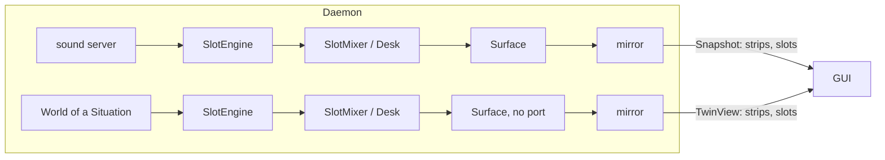

# Design: the virtual twin

Status: **built** (2026-11-19). To be replaced by [Previews, in the GUI or on the device](previews.md)
(proposed 2026-11-19): one control shows edits and Simulate in the GUI (on the twin) or on the device. It adds a twin to [Try changes and situations](try-and-simulate.md), which stays as it
is, and replaces the drawing that the GUI made without a device (what it shows instead: [A simulated
device](device-simulator.md#4-the-mirror-what-the-gui-shows)).

## Problem

The GUI draws the device. It has three sources for that drawing:

| Source | Where the strips come from |
|---|---|
| The device, live | The daemon's mirror of the device: every byte its `Surface` sent (`Surface.mirror`, `live.server.strip_states`). |
| Simulate, no "Try on the device" | `gui/domain/simulate.py`: the GUI runs the resolver and paints a label and a color. |
| No daemon | Was the same as Simulate: the file in its default situation (removed on 2026-11-19, the strips are dark now). |

The second row is a second implementation of "what a strip looks like". It knows nothing of meters, rings, LEDs,
faders, banners or the strip controllers, so it can only be wrong in new ways, and nothing can be played on it. The
rule for the GUI is: **the drawing is only ever the mirror of a device that the daemon drives.** A device the user
doesn't have is a virtual one, and the same holds for a situation the user doesn't have: it needs a device of its own
that something drives.

## Idea

A **virtual twin**: a second, complete set of strips that the daemon runs for the situation of Simulate, next to the
real ones. The situation keeps its second use: with "Try on the device" on, the real device shows it too, as before.
The twin is what Simulate draws and plays on in every case. It is built from the same parts as the real device (`Surface`, `Desk`, `SlotMixer`, `SlotEngine`, the strip
controllers) and touches nothing real. The GUI asks for it and draws its mirror, exactly like the mirror of the real
device. Without a daemon there is no twin, so no drawing: the GUI guides to the daemon.



The twin has no port: a `Surface` writes everything it sends into its mirror whether a device is connected or not
(`Surface.send()`), which is how the real mirror shows "what the device will show once it is there". A spike on
2026-11-19 confirmed it: a `Surface` on a port that never opens still mirrors texts, LEDs and rings. The twin
needs no `SimulatedDevice` socket or transport; the mirror *is* its device.

### What "touches nothing real" means

The twin is built from a `Config` and from nothing of the daemon: it gets no reference to the real backend, surface,
bridge, voice chat provider, player list or state directory. That is the guarantee, not a check at each effect. What
each part of the real path becomes:

| Real | Twin |
|---|---|
| `AudioBackend` (the sound server) | `TwinBackend`: holds an `AudioState`, `set_*` change that state and report it like the sound server does. |
| `AudioState` | Made from the situation and the real names (see [The world](#the-world-of-a-situation)). The real state is never passed on. |
| `VoipProvider` (the plugin) | `DemoProvider` (the provider of the demo mode): people from the situation, volume and mute stay in its memory. |
| Meters (`pw-record` per target) | A signal generator fed through the same `Meter.feed_from()`, scaled by the gain of the target. |
| `Launcher` (`launch`) | The `Launcher` with a `spawn` that does nothing (it takes one already). |
| MQTT bridge, Home Assistant | None: `bridge=None`. Home Assistant never sees the twin. |
| Media players (`encoder = "media"`) | None, as without a player. |
| `state_dir` (choices, people) | None: no file is read or written. |
| Processes (states `processes = [...]`) | None run; states are forced by the situation (overrides, as now). |
| Log | The twin's engine logs at debug level under `xtouch_daemon.twin`. |
| Hands (buttons, faders, encoders) | `Play` events for the twin go to its own `Surface.play()`. |

## The world of a situation

A `Situation` (`slots.outcomes`: `mode`, `on`, `flipped`, `people`, `apps`, `devices`) is turned into an
`Observation` for the real device by `Situation.observation()` (which stays, for "Try on the device"). The twin makes a
whole world from it instead, and its engine goes through the normal path: `Observer.observe(audio, processes, voip,
now)` is what a real step does.

`world(scene, situation, names) -> World(audio: AudioState, voip: VoipState, processes: frozenset[str])`, with
`names` the applications that play and the people in the voice chat right now, as plain strings (see
[Decision 2](#decision-2-the-twin-takes-the-real-names-and-nothing-else)):

| Part of the scene | In the world, unless the situation `flipped` it |
|---|---|
| `output` / `input` channel | One device per entry of its `devices`: the first (or the second, ...) as a made-up node with a description of its own (`Device 1`), a volume of 100 %. A channel with a wildcard gets one device that matches it. Without `devices` the default one. |
| `apps` channel | One playing stream whose name matches its first `match` entry (a preset: its first name). |
| `person` channel | The person in the voice chat. |
| `homeassistant` channel | Nothing: it is always present. |
| `apps` pool | `situation.apps` playing streams: the real applications first, then `App 1`, `App 2`, ... (the pool `flipped`: all slots). |
| `people` pool | `situation.people` people: the real ones first, then `Alice`, `Bob`, ... |
| `devices` pool | `situation.devices` devices: the real ones that no channel has first, then `Device 1`, ... |
| Pools of channels | Their channels are present as channels are; flipping the pool removes them all. |
| Pools of applications and of people of your own | `flipped`: one stand-in that the pool takes (its `match`, its `people`); absent otherwise. |

Everything else (states, modes) is the situation's `on` and `mode`: overrides and a mode picked in the twin's
`SlotEngine`, as the real preview does it now. Delays and dwells apply as in reality (`delay_on`, `absent_after`,
`hold`): that is the point of a twin that runs.

### Decision 2: the twin takes the real names, and nothing else

The device that "Try on the device" drives shows real applications and people as stand-ins where it can (try-and-simulate
decision 3), because it has audio behind them. The twin has no real audio behind anything, but it takes the same
**names** first, so the twin and the device show the same words for the same situation. The daemon hands `StartTwin`'s
world the names as plain strings, copied; the twin holds no reference to the sound server, the voice chat or their
state. Everything else in the world is made up.

The price: the strips of the twin depend on what plays right now, so the same configuration and situation give other
strips at another time. Tests give the names.

## The twin in the daemon

`runtime/twin.py`. Each client's twin is made by the daemon with the current names, and gets new ones when they change
(`Twin.set_names()`), so a stand-in follows what plays:

```python
class Twin:
    """The strips of a configuration in a situation, on a device of their own."""

    def __init__(self, config: Config, situation: Situation): ...
    def set_situation(self, situation: Situation) -> None: ...  # a new world, same engine and strips
    def set_names(self, names: Names) -> None: ...  # the real applications and people changed
    def reconfigure(self, config: Config) -> None: ...  # like a reload: ids carry over
    def play(self, event: StripEvent) -> None: ...  # a hand on the twin
    def view(self) -> TwinView: ...  # strips of the mirror + slots, states, why
    async def run(self) -> None: ...  # the steps, the meters; cancelled by close()
    def close(self) -> None: ...
```

It owns a `Surface(port=NoPort())`, a `Desk(surface, chord, on_chord, capturer=pulse)`, a `SlotEngine(config,
state_dir=None, logger=...)`, a `SlotMixer(surface, TwinBackend, config, engine, desk, DemoProvider, bridge=None, players=None,
launcher=Launcher(spawn=...))`, and a task that steps the engine like the daemon does (wake on a change of the
world, the deadline of a delay or a dwell, every `PROCESS_INTERVAL`). As built, these parts, the loop and the step are
one class that both are (`Rig`, `runtime/rig.py`); the daemon adds the real processes and Home Assistant to the step
(`_processes()`, `_stepped()`), the twin its world.

The twin's strips are lit by the first step: `Surface` writes every color and text into its mirror, connected or not.

### Seams that the twin needs in the existing code

| Where | Change |
|---|---|
| `hardware/surface.py` | `NoPort` (a `Port` that is never there), `hand(data)` (bytes as if the device sent them). Nothing else: `Surface` already mirrors without a transport. |
| `audio/meter.py`, `runtime/desk.py` | `Meter(..., capturer=...)` and `Desk(..., capturer=...)`: the function that feeds peaks of a target (`Capturer`, with the gain it is told). The default is `capture()` (a process); the twin's feeds a fixed, slowly changing pattern while the target plays. |
| `runtime/slots.py` | `SlotEngine(..., logger=...)`. The situation (`what_if`, `simulate()`, `active`) stays: it is the real device's. |
| `slots/outcomes.py`, `slots/world.py` | `Situation.observation()` stays for the real device; `slots/world.py` is new (the twin's world). `simulate()` and `outcomes()` stay: `check-config` and the table of Simulate's inputs use them. |
| `voip/` | `DemoProvider.set_people(names)`: the people of the world, volume and mute of those who stay are kept. |
| `runtime/daemon.py` | Twins by client, fed with the real names. `preview()` and `snapshot().simulated` stay. |
| `live/messages.py`, `codec.py`, `server.py` | See [The protocol](#the-protocol). |

## The protocol

The snapshot is one line for every client. A twin belongs to one client, so its view is its own line, sent to its
owner only.

```python
@dataclass(frozen=True)
class StartTwin:
    """Run `config` (the whole TOML text) in `situation` on a twin of your own; again: the twin follows."""

    config: str
    situation: Situation


class KeepTwin: ...  # the heartbeat, as KeepPreview


class EndTwin: ...  # the twin is gone


@dataclass(frozen=True)
class Play:  # gets `twin: bool = False`: the hand is on the twin
    event: StripEvent
    twin: bool = False


@dataclass(frozen=True)
class TwinView:
    config: str  # fingerprint(config) of the twin, as Snapshot.config
    strips: tuple[StripState, ...]
    slots: SlotsState  # slots, states, mode, why and who waits: the twin's
```

- Replies: `Reply("twin", ok, message)` to `StartTwin` (the errors of the configuration as in "preview"),
  `Reply("twin_ended", True, why)` when the daemon ended it (heartbeat missed, the daemon stops).
- The view line is `{"twin": {...}}`, sent by `LiveServer.tell_view(client, view)` every `INTERVAL` while it changes
  (meters and motors keep it changing, like the snapshot).
- Feature `twin` in `FEATURES`, next to `situation`, which stays. An older daemon lacks `twin`: Simulate says it is
  too old and to restart it. Nothing else of the protocol changes.
- One twin per connection. A twin ends with `EndTwin`, with its connection, and after `TWIN_TIMEOUT` (10 s) without
  `KeepTwin`.
- Security: as `StartPreview`, only the user's own clients (`peer_uid`). The configuration text may hold secrets
  (`[mqtt]`); the twin ignores `[mqtt]` and `[voip]` providers (it builds a `DemoProvider`, never a socket).

### The twin's own hands

A button, fader or encoder on the twin (Play, the mouse on its drawing) goes through its own `Desk` and changes the
twin's `AudioState` through `TwinBackend`, and a `pick` encoder what a slot of `auto` shows. The mode and the states
are the GUI's alone: the chord, a `toggle:` or `mode:` control and requests of modes and overrides change nothing on the
twin (`SlotEngine.fixed`), so the bar of Simulate and the twin never disagree. (Planned first: the twin changes them and
the GUI follows; dropped, two owners of the what-if.)

## The GUI

- **Simulate** needs a daemon of this user that takes `twin`. Without one the page says why in its place (like "Try on
  the device" does, `unavailable()`), with the same guidance: start the daemon, or "Try without a device". There is no
  Simulate without a daemon.
- It needs no "Try on the device", and no daemon that runs *this file*: the configuration it sends is the document's, so
  Simulate works on a new file, or on a daemon that reads another one.
- While Simulate is open the GUI sends `StartTwin(document.render(), situation)` a moment after each edit or click
  (`DEBOUNCE_MS`) and `KeepTwin` every `HEARTBEAT_MS`; a document with problems sends nothing (the twin keeps the last
  one that parsed, the problems show as they do).
- **The drawing** shows the `TwinView` strips while Simulate is open, with the accent frame ("simulated"), and the
  real mirror otherwise. Between the request and the first view the drawing keeps what it had.
- **The cards** (what a slot shows, why, who waits) are the twin's `SlotsState`. `gui/domain/simulate.py` shrinks to
  `WhatIf` (a value the user edits), `Inputs` (what a what-if can change) and `presence_text`; `simulated()` and
  `simulated_faces()` are deleted.
- **Play** on the drawing sends `Play(event, twin=True)` while Simulate is open: the faders and buttons of the twin,
  never the real device.
- **"Try on the device"** (the switch) is as it is: the unsaved configuration, and while Simulate is open its
  situation, on the real device. The twin runs either way.
- **Esc** ends Simulate: `EndTwin`.

## Decisions (2026-11-19)

1. **Simulate still reaches the real device with "Try on the device"** (try-and-simulate decision 1 stands). The twin is
   added; it replaces only the drawing that the GUI made itself.
2. **The twin takes the real names, and nothing else** (see [Decision 2](#decision-2-the-twin-takes-the-real-names-and-nothing-else)).
3. **One twin per client, no limit in the daemon.**
4. **Simulate needs a daemon**: no daemon, no twin, no drawing, only the guidance.

## Implementation order

1. Seams: `NoPort`, `hand()`, `Meter`/`Desk` capture, `SlotEngine` logger, `Rig` (`runtime/rig.py`).
2. `slots/world.py` and `TwinBackend`, `DemoProvider`; `Twin`, unit-tested without a daemon: a twin of the example
   configuration shows its slots; the real backend of the daemon is never called.
3. Protocol: messages, codec, `LiveServer.tell_view`, the daemon's twins.
4. GUI: Simulate on the twin, the drawing, the cards, Play; delete `simulated()` / `simulated_faces()`.
5. Docs: the GUI guide (Simulate), try-and-simulate (marked as replaced in part), architecture (live view), changelog.

## Tests

- **World**: each row of the table, for the example configuration and for pools of your own.
- **Inertness**: a daemon with spies for the backend, the voice chat provider, the bridge and the launcher. A twin with
  a situation, `Play` on its strips (volume, mute, `launch`), a reconfigure: none of the spies is called, and the
  real strips and the real `SlotsState` are unchanged.
- **Names**: the same situation and names give the same `TwinView` strips (the meter pattern is a function of time
  since the start; tests set it); new names reach the stand-ins.
- **Protocol**: codec round trips; a second client does not get the first one's view; the heartbeat; the end with the
  connection.
- **GUI**: Simulate with a fake live daemon: sends `StartTwin`, draws its view, shows the cards of the view, Play sends
  `twin=True`; without a daemon the page guides and the drawing is dark.
