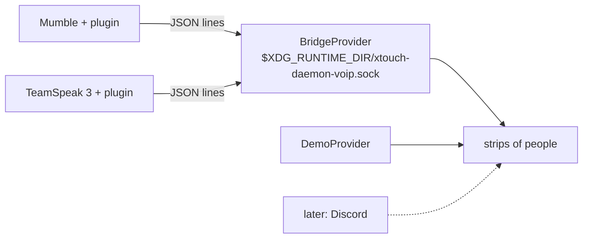

# Design: the voice chat

Status: built. How to use it: [People](../../configuration/channels/people.md), [Mumble](../../guides/mumble.md) and
[TeamSpeak](../../guides/teamspeak.md);
the protocol of the bridge: [The voice chat bridge](../../reference/voice-chat-bridge.md). First designed with the
[layouts](../history/layouts.md).

The wish: a strip per participant of the voice chat, with their level on the meter and their volume on the fader.

## Can a mixer see the participants?

**Not through PipeWire.** Mumble, TeamSpeak and Discord mix every participant into one playback stream, so
`pw-dump` shows one node per client, never one per participant. The participants are only known inside the client.

| Client | Participants and talking | Local volume per participant | From outside on Linux |
|---|---|---|---|
| **Mumble** (1.5) | Plugin API: `getUsersInChannel`, `getUserName`, `mumble_onUserTalkingStateChanged`, `onUserAdded/Removed` | Not in the API (`requestLocalMute`/`isUserLocallyMuted` mute only). But `mumble_onAudioSourceFetched(pcm, …, isSpeech, userID)` gets each participant's audio before the mix, **may change it** (a plugin can apply its own gain) and can measure its peak. The built-in local volume (since 1.3) is not reachable. ([MumblePlugin.h][mumble-plugin]) | D-Bus `net.sourceforge.mumble.mumble`: `getTalkingUsers`, `getCurrentUrl`, self mute/deaf, transmit mode ([DBus.h][mumble-dbus]); `mumble rpc` the same few commands ([RPC docs][mumble-rpc]). No participant list, no per-user volume. Server side (Ice): users and channels, but no talking state and no client-local volume. |
| **TeamSpeak 3** | ClientQuery (local TCP 25639, API key): `clientlist`, `notifytalkstatuschange`, `notifycliententerview` ([client query library][ts3-cq]) | Plugin SDK only: `setClientVolumeModifier(connection, client, dB)`, and the client stores it ([forum][ts3-volume]). No ClientQuery command for it was found. | ClientQuery is reachable from another process. TeamSpeak 5/6 has no stable public API (not re-checked). |
| **Discord** | Local RPC (Unix socket `discord-ipc-N`): `GET_SELECTED_VOICE_CHANNEL`, `SPEAKING_START/STOP` events | `SET_USER_VOICE_SETTINGS` (volume 0..200, mute) ([Userdoccers][discord-rpc]) | The `rpc*` scopes are for "approved partners" only ([Discord OAuth2][discord-oauth]); projects use Discord's own StreamKit client id and token endpoint instead, without refresh tokens, and Discord restores the volumes when the app disconnects ([Noctalia Discord Voice][noctalia]). Fragile and a ToS gray area. |

So per-participant **levels** need code inside the client (a Mumble plugin, a TeamSpeak plugin). Per-participant
**volume** needs the same (Mumble: the plugin applies its own gain in `onAudioSourceFetched`; TeamSpeak:
`setClientVolumeModifier`), or Discord's restricted RPC. Participant lists and talking states alone are possible from
outside for TeamSpeak (ClientQuery) and Discord (RPC), not for Mumble.

## A provider, and a bridge

- `VoipProvider` (`voip/provider.py`): a snapshot of `Participant`s (id, name, talking, muted, volume, level),
  `connected`, an `on_change` callback, `set_volume()`, `set_muted()`, `run()`, and what it can do (capabilities:
  volume, mute, levels). The strips show only what the provider can do.
- `BridgeProvider`: the daemon serves a Unix socket; a plugin inside the client connects, sends the participants as
  JSON lines and gets the commands back. The protocol is the same for every client, so the daemon needs no client
  libraries. To try it by hand: `socat - UNIX-CONNECT:$XDG_RUNTIME_DIR/xtouch-daemon-voip.sock` and a pasted line.
- `DemoProvider`: participants from the configuration, with volume and mute kept in memory and a talking pattern.
- **Volume and mute while away.** The Mumble plugin keeps them per session (one who comes back gets a new session at
  100 %), and the bridge has no notion of names. So the provider remembers what the strips set by the participant's
  name (ignoring case) and sends it again when someone of that name appears. A mute changed in the client replaces the
  kept one, so coming back does not undo it. It lasts while the daemon runs; the provider survives reloads (not a
  changed `[voip]`).
- Later: TeamSpeak (plugin SDK, or ClientQuery without volume); Discord only if the RPC scopes open up; remembering
  the volumes across restarts.

## The Mumble plugin: mute and threads

Mute on a `voip` strip is Mumble's own local mute (`requestLocalMute`, `isUserLocallyMuted` of plugin API 1.0), so
Mumble shows it and a mute set in Mumble lights the button. The first version had its own mute (gain 0 in
`mumble_onAudioSourceFetched`), because the local mute needs API calls the plugin had no safe place for:

- Mumble calls the event callbacks in its main thread, and runs every API function there: called from another
  thread, it is queued to the main thread and the caller waits (Mumble's `docs/dev/plugins/MumbleAPI.md`,
  "Multithreading"). A callback that waits for a thread that waits for an API call would wait for itself, and the
  plugin's `mumble_shutdown` has to wait for its threads before Mumble unloads the library.
- No callback comes regularly in the main thread. The talking states come only while someone talks, the users'
  callbacks only when someone comes or goes; a request of the daemon can wait for neither. The only timers that call
  plugins are those of positional audio (`mumble_initPositionalData` every second while no positional plugin is
  linked), which would make the plugin a positional one in Mumble's settings: rejected.
- Mumble bounds the wait: a call that doesn't get to run within 800 ms is cancelled and fails with
  `MUMBLE_EC_API_REQUEST_TIMEOUT` (`C_WRAPPER` in `src/mumble/API_v_1_x_x.cpp`, the same in every release with
  plugin API 1.0: 1.4.230 to 1.6.870).

So the plugin has two threads: the socket thread never calls the API and only queues the mute requests (a counter per
participant); the "Mumble thread" makes the requests and reads the local mute of the participants every 500 ms while
the daemon is connected (Mumble has no event for it; the callbacks read it too when they refresh the users). No thread
holds the plugin's lock during an API call, so a callback never waits for one. Only `mumble_shutdown` does: it drops
the requests that have not started and waits for a call under way, which can't run then and fails after the 800 ms;
the thread makes no call after that. Shutting down takes those 800 ms only if a call was under way at that moment.

While a request is under way the plugin reports the requested mute; when Mumble refuses one, it logs why (`api.log`)
and reports Mumble's mute again, so the button goes back. A locally muted participant who talks has the talking state
`MUMBLE_TS_TALKING_MUTED`, which counts as talking: the backlight shows it, as with the first version's mute. Their
level is 0: Mumble does not mix them and fetches none of their audio.

**Others' self-mute and deafen are not in the API.** Plugin API 1.0 has no function for them (`isLocalUserMuted` and
`isLocalUserDeafened` are the user's own), `getUserComment` is the free text of the user, and the talking state
`MUMBLE_TS_TALKING_MUTED` of another user means the *local* mute: `AudioOutputSpeech.cpp` sets `MutedTalking` only for
`bLocalMute` (since 1.6 also for a local volume of 0), while `ClientUser::setSelfMute`/`setSelfDeaf` emit
`muteDeafStateChanged`, which the plugin manager doesn't forward (it connects `talkingStateChanged` only). Someone
who muted themselves sends no audio, so they are just passive.

[mumble-plugin]: https://github.com/mumble-voip/mumble/blob/master/plugins/MumblePlugin.h
[mumble-dbus]: https://github.com/mumble-voip/mumble/blob/master/src/mumble/DBus.h
[mumble-rpc]: https://www.mumble.info/documentation/user/rpc/
[ts3-cq]: https://github.com/Nols1000/teamspeak-client-query
[ts3-volume]: https://forum.teamspeak.com/threads/76676-PLUGIN-SDK-setClientVolumeModifier
[discord-rpc]: https://docs.discord.food/topics/rpc
[discord-oauth]: https://docs.discord.com/developers/topics/oauth2
[noctalia]: https://noctalia.dev/plugins/community/discord-voice
