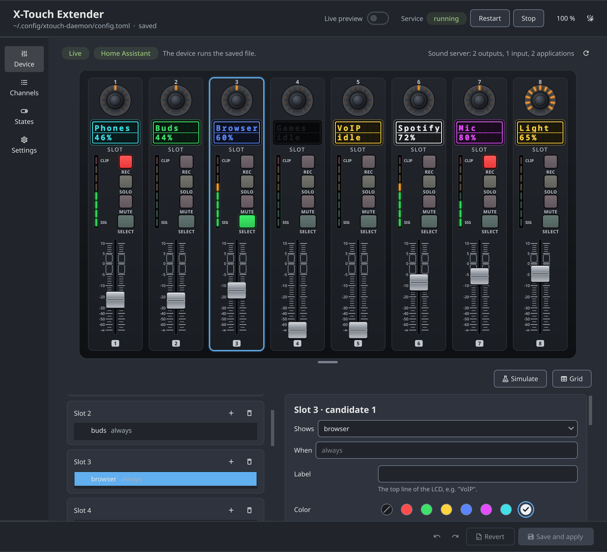

# GUI

`xtouch-daemon gui` edits the configuration file in a window and applies it to the running daemon.

It edits [channels, states and slots](configuration/slots.md). A file with strips and layouts opens migrated (like
`xtouch-daemon migrate-config`): the window lists what the migration did, and saving writes the new format.



## Install and start

On Arch Linux, install the package `xtouch-daemon-gui-bin` (see [Getting started](getting-started.md#arch-linux)).
It uses the system's PyQt6, and starts with `xtouch-daemon-gui` or "X-Touch Extender" in the menu of the desktop:

```shell
xtouch-daemon-gui            # the default configuration file
xtouch-daemon-gui -c FILE    # another one
```

From a checkout, the GUI needs the `gui` extra (PyQt6). The wheels bring Qt along, so it needs no system packages:

```shell
uv tool install --force './xtouch-daemon[gui]'
xtouch-daemon gui            # the default configuration file
xtouch-daemon gui -c FILE    # another one
```

Without the extra, `xtouch-daemon gui` says how to install it.

## The window

The rail on the left has four pages:

- **Device:** the device as it is right now, and below it the [slots](#the-slots).
- **Channels:** the channels of the file, `[pool.auto]` and `[people]`. Add (by type), Duplicate and Remove; the id
  can be renamed. Each says where it is used (`slot 2`, `pool games`, `state call`).
- **States:** the modes first, then the other states: their sources or `when`, delays and `persist`, what the daemon
  says about each right now (since when, from which source), its override (a mode: picked by hand), and which
  stacks and controls use it.
- **Settings:** `[behavior]`, `[aliases]`, `[mqtt]` (as "Home Assistant"), `[switching]` (as "Modes and chord"),
  `[voip]` (as "Voice chat") and `[device]`. "Voice chat" also tells whether Mumble is connected, lists the steps of
  its setup, and installs the [Mumble plugin](integrations/mumble.md) with "Install Mumble plugin".

The drawing of the device shows the encoder with its ring of 13 LEDs (Mackie Control lights the middle 11), the LCD
(the backlight in the strip's color shines around a dark panel and through its characters, as on the device), the
meter next to Rec, Solo, Mute and Select, and the fader with its dB scale: the middle of the cap marks the value, -∞
at the bottom, 0 dB at 77 % of the travel (`behavior.unity_at`). What each slot shows is printed under its LCD. The
handle under the drawing (the short bar) makes it larger or smaller; the GUI keeps the size for the next start.

The footer shows the file, whether the device runs it, the problems, and the buttons Undo, Redo, Revert and "Save and
apply". The header has the switch of the [live preview](#live-preview), the state of the service with buttons to
install, start, restart or stop it (see [The service](#the-service)), what the sound server has, the zoom, and a
switch between the dark and the light theme.

## The service

Next to the state of the service, the header shows which unit systemd uses: "packaged" for the one of the Arch Linux
package (`/usr/lib/systemd/user/xtouch-daemon.service`), or "from" and the program of a unit in
`~/.config/systemd/user`, which [`install-service`](commands.md#install-service) wrote, e.g. for a checkout.

- **Install and start** takes the unit of the package when the GUI is the one of the package: it enables and starts
  it, and writes no file. Any other GUI writes a unit for its own `xtouch-daemon` to `~/.config/systemd/user`.
- **Use the packaged unit** shows while a unit in `~/.config/systemd/user` overrides the one of the package. It removes
  that file; an enabled service stays enabled, and a running one restarts with the program of the package.
- **Restart** stands out (with a tooltip that names both versions) when the daemon runs another version than the one
  installed, e.g. after an upgrade of the package: the daemon keeps running the old version until it restarts. This
  needs a daemon that tells its version (0.1.0 and later), and only counts for the service of the installation the
  GUI runs from.

## Zoom

Ctrl++ (or Ctrl+=) makes the whole window larger, Ctrl+- smaller, Ctrl+0 goes back to 100 %; the zoom button in the
header ("100 %") has the levels from 67 % to 300 %. The GUI keeps the zoom for the next start, like the theme.

Qt scales a window only when it opens, so a new zoom opens the window again at the new size: unsaved changes, undo,
the selected slot and the page stay. The zoom is on top of a `QT_SCALE_FACTOR` of the environment.

## Live view

While the daemon runs, the drawing shows what the device shows right now ("Live"), read from the daemon's live
view. Without a running daemon it is dark, and the window says so. A daemon that runs while the device is not
connected shows "Live · X-Touch-Ext not connected": the strips show what the device will show once it is there.

While the daemon runs with an `[mqtt]` section, a second pill tells how its connection to Home Assistant is doing:
"Home Assistant" while it is connected, otherwise what is wrong, e.g. "Home Assistant · not authorized" or
"Home Assistant · refused". Its tooltip has the broker's own words and what to check; a click opens the settings.

A third pill shows the mode ("Mode gaming", "Mode gaming · by hand"); its tooltip lists the states and what each slot
shows.

## Live preview

The switch "Live preview" in the header makes the device run the configuration in the editor before it is saved:
the device follows every change a moment after it (undo and redo too), and the strips show it live. The file is not
written. The switch is off whenever the window opens.

- **While it is on**, the pill "Previewing unsaved changes" says that the device runs what is in the editor, not the
  file.
- **Save and apply** makes it the configuration: the daemon loads the saved file, which is what the device shows
  already. The switch stays on for the next change.
- **Back to the file:** turning the switch off, closing the window (it asks about unsaved changes as usual, and says
  that the device runs them) or "Revert" brings back the saved file. So does a window that crashed: the daemon goes
  back to the file when the connection of the window ends, or when the window does not answer for 10 seconds. The
  file also comes back when it changes on disk, or the daemon is reloaded; then the switch goes off and the window
  says why.
- **What the daemon does not take** shows in red under the pills, and the device keeps the version before. A preview
  can't change `[mqtt]` (that takes a save and a restart), and a changed `[device] name` takes effect only with a
  restart. A configuration with problems is not sent at all: the pill says "Live preview paused" until they are
  fixed.
- **Channels, states and slots** are all part of it: a stack changed in the editor shows on the device as it is.
- **One window at a time:** a second window that turns the live preview on takes it over, and the first one's switch
  goes off.
- **Home Assistant:** channels the preview does not have keep their entities in Home Assistant (with their state; only
  nothing drives them), so they are as before once the file runs again. Entities of channels only the preview had are
  removed again when it ends.

The switch is off, and its tooltip says why, while no daemon runs, while the daemon reads another file, and for a
daemon from before the live preview (restart it to run the installed version).

## The slots

Under the drawing of the page Device:

- **The state bar** lists the states and modes: ● on, ○ off, with the override in brackets. Its menu overrides a
  state (`auto`, `on`, `off`) or picks a mode (`pick`, `auto`), like Home Assistant or `xtouch-daemon mode`.
- **A card per slot** lists its candidates in order, with their conditions as chips (`call`, `not gaming`; `always`
  for none) and ▶ on the one the device shows. + adds `auto` at the end, the bin removes the candidate picked.
  Drag a candidate, or move it with Ctrl+Up and Ctrl+Down. A slot without candidates shows `auto`.
- **The inspector** edits the candidate picked: what it shows (a channel, a pool, `-`), when (the condition as
  text), and the options of its place (look, and on `auto` the encoder and the volume range). It says why the slot
  shows what it shows (the same as `xtouch-daemon why 2`), which channel the candidate shows, where else that is
  used and where it is now, with "Edit the channel" to its page; below, the controls of the slot (`[controls]`).

Clicking a strip of the drawing (or Left, Right, Home, End) picks its card, with the candidate it shows.

**Simulate** shows what the slots would show in another mode, with other states on, or with channels absent (`auto
plays`: an application plays): a frame goes around the drawing, a bar of what-ifs replaces the state bar, and the
drawing, the cards and the why line follow it. Nothing is sent to the daemon. Esc, or Simulate again, ends it.

**Grid** lists every combination that shows something else, like the table of `xtouch-daemon check-config`. A click
on a row simulates it, a click on a cell also picks the card of its slot.

## Editing options

The forms come from the options of the configuration, so every option has a field. The options of a channel are in
the order of the device, from top to bottom: what it controls, the encoder, the LCD, the meter, the buttons (Rec,
Solo, Mute, Select), the fader and its volume range, then those about slots (`tags`, `in_auto`, ...).

- switches for on/off options, numbers with their ranges, choices, color swatches, lists as chips, masked fields for
  secrets, and file pickers;
- the help of each option under its field, with its default and, where the documentation explains more, a
  "Learn more" link to that section; a button sets the option back to its default;
- `choices` as a table, with the devices, the sound cards and the profiles of the card of each line to pick from.
  While a channel has `choices`, `device` and `profiles` are hidden, and the other way around: a channel has one or
  the other;
- for choices, what the chosen value does (e.g. `recording` for the Rec LED), and each value says it as a tooltip in
  the list;
- the errors next to the options they belong to, with the same messages as `xtouch-daemon check-config`. The
  problems button in the footer lists them all; a click opens the page of the problem. An unknown option can be
  removed from there.

`[mqtt]` can be added and removed on its page. Above its options, the page shows how the daemon's connection is
doing (or that the daemon runs without the section, which it reads only when it starts), and "Test connection"
connects once with the settings as they are in the editor, saved or not, and says what is wrong if that fails.

## Suggestions from the sound server

The GUI reads the sound server and suggests what it has:

| Option | Suggestions |
|---|---|
| `device` | The outputs or inputs by node name, with their descriptions; the default is marked. |
| `profiles` | The profiles of the sound cards of those devices; the active one is marked. |
| `match`, `exclude` of `[pool.auto]`, `apps` and `recording` of a state | The [presets](configuration/presets.md) (`@browsers`, ...) first, then the names and binaries of the applications that play. A preset's tooltip tells what it stands for; its chip is outlined. |
| `processes` of a state | The presets for processes. |
| `[aliases]` | The names of the applications that play. |
| `person` of a `person` channel | The people in the voice chat now, as the running daemon tells them. |

The refresh button in the header reads the sound server again, e.g. after you started an application. Without a
sound server, type the names by hand. The people of the voice chat come from the daemon's live view: without a
running daemon (or nobody in the channel), type the names by hand.

## Undo

Every edit can be undone: Ctrl+Z undoes, Ctrl+Shift+Z redoes. That includes removing a channel and reverting the file,
so neither asks first. Typing into one option is one step. Ctrl+Z undoes in the document also while a text field has
the focus.

Closing the window with unsaved changes asks whether to save them.

## Save and apply

"Save and apply" (Ctrl+S) writes the file and reloads the daemon:

- It saves only a file without problems: the daemon would not take one with problems.
- Unchanged values keep their place and their comments, and a stack keeps its form (a string, a list, tables) where
  it did not change. The file is written in place, so a symlinked configuration stays one.
- It reloads the running daemon when that reads the saved file: the service, or one started from a terminal or an
  IDE.
- A changed `[device] name` is reloaded, but takes a restart to take effect. A changed `[mqtt]` section is not
  reloaded at all. In both cases the window offers "Restart the service" for the service; restart a daemon that runs
  elsewhere where it runs.
- It then tells whether the device runs the saved file: "The device runs the saved file", or "The device does not run
  the saved file yet". If that stays, the daemon did not take the file, and its log says why
  (`journalctl --user -u xtouch-daemon`).

"Revert" drops the changes and reads the file again (Undo brings them back).

## The service

The service button installs, starts and restarts the systemd user service, the same as
`xtouch-daemon install-service`. It asks before it installs or starts it. While the service runs, "Stop" next to it
stops it (`systemctl --user stop`): it stays enabled, so it starts again with the next session, or with "Start".

A daemon that runs outside systemd (e.g. from a terminal or an IDE) is found too: the header shows "running
elsewhere", and saving reloads it. The GUI does not start, restart or stop that one: restart it where it runs.
