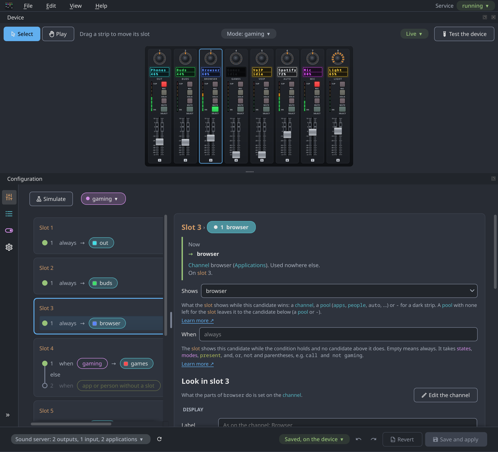
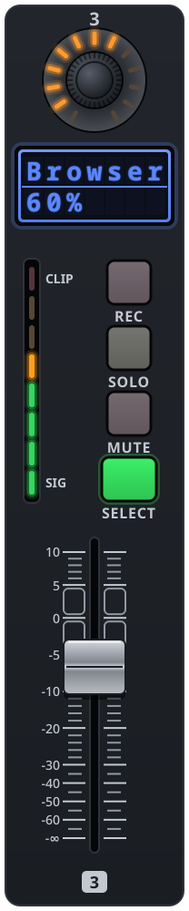
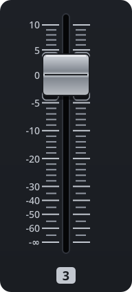
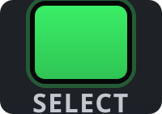
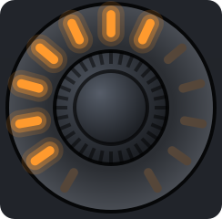
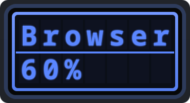
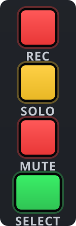

# GUI

The GUI is a window that edits the configuration file (`~/.config/xtouch-daemon/config.toml`) and applies it to the
running daemon. Editing needs no daemon; the daemon is only for the live control surface, tests and previews. Install and
start it as described in [Install](../getting-started/install.md#the-gui) (`-c FILE` opens another file). If the file
does not exist yet, the window starts with an empty one (only the comment at the top of the example configuration)
and writes it when you save.

It edits [channels, states and slots](../configuration/slots.md): what each strip controls, and when.

!!! tip "New here?"

    The [Setup tour](../getting-started/tour.md) builds a configuration with the GUI, page by page. This page is the
    reference.

## The window

The GUI has two panels, which it calls windows: **Configuration**, where you edit, and **Device**, which draws the
control surface (see [The window Device](#the-window-device)). Without hardware it draws the *virtual device*, a control surface made
of software. The window Configuration has a rail of four pages on its left, icons only. » at its foot shows their
names, « hides them again.

=== "Slots"

    What each slot shows when, see [The slots](#the-slots).

=== "Channels"

    Two groups: the channels (each takes one strip), then the pools (a pool hands a member, e.g. the next application
    that plays, to every slot that names it): the built-in `[pool.apps]`, `[pool.people]`, `[pool.auto]` and
    `[pool.devices]`. A *candidate* is one entry of the list of a slot (what it may show).

    Add (by type, or a pool of channels of your own), Duplicate and Remove. Renaming an id updates the slots, conditions,
    pools and controls that name it. Each channel says where it is used (`slot 2`, `pool games`, `state call`).

    While the daemon runs, a channel with sound has a small animation after its name. Play something, and the
    channels that take it move, also those that no slot shows yet:

    - An output and applications have three bars: something plays to the output, or the application plays and is not
      paused.
    - An input has a ring that spreads from a dot: an application records from it.
    - A person has a dot that breathes while they talk.

    Home Assistant and custom channels have no sound, so they never move. The animation tells that sound flows, not
    how loud it is: the meters of the drawing show that.

=== "States"

    The modes first, then the other states. The form asks in order:

    1. State or Mode. A mode has a label and a priority.
    2. On while: Sources or Condition, never both. Switching between them asks before it removes what the other had.
        - **Sources** lists the ones the state has, each with ✕ to remove it. Add source offers the others. The state
          is on while any of them is.
        - **Condition** takes a [condition](../configuration/slots.md#conditions) of other states and modes.

    Delays and overrides (`delay_on`, `delay_off`, `persist`) are folded away until a state has one. Above the form
    the GUI says since when the state is on, from which source, its override, and which slots and controls use it.

=== "Settings"

    `[behavior]` and `[aliases]`; `[mqtt]` as "[Home Assistant](home-assistant.md)" and `[homeassistant]` as "[Home
    Assistant API](home-assistant.md#homeassistant)"; `[switching]` as "Modes and chord"; `[device]` as "Extender"; and
    `[voip]` as "Voice chat", with a box for [Mumble](mumble.md) and [TeamSpeak](teamspeak.md) that tells whether the
    plugin is connected, lists the steps of its setup and installs it.

Slots, Channels and States have a list on the left and what is picked on the right. The handle between them gives
either side more room; each page keeps its share.

### The window Device

The window **Device** shows the control surface on every page, above the window Configuration at first.

- The title bar of either window moves it to another side, or out as a window of its own (e.g. on another screen). The
  GUI keeps where they are.
- View → Device hides and shows the window Device. Configuration always stays open.
- Clicking a strip (or ++left++, ++right++, ++home++, ++end++) shows its slot on the page Slots.

{ .xt-part width="80" }

Each strip is drawn as on the control surface: the [encoder](../configuration/strip/encoders.md) with its ring of 13
[LEDs](../configuration/strip/leds.md) (Mackie Control lights the middle 11), the LCD with its backlight, the meter
next to Rec, Solo, Mute and Select, and the fader with its dB scale (-∞ at the bottom, 0 dB at 77 % of the travel, the
option `unity_at` of `[behavior]`). What each slot shows is printed under its LCD.

### Menu bar, footer and help

- **Menu bar:** the menus, and on its right the state of the service (see [The service](#the-service)).
- **Footer:** the problems, what the sound server has, whether the control surface runs the file, the [Preview](#preview) control, and the buttons Undo,
  Redo, Revert and "Save and apply". The title has • while there are unsaved changes.
- A *pill* is a small status label (e.g. "running"). One with ▾ opens a popover, a small panel inside the window, on a
  click. It says what the pill means in full, with what you can do about it. A problem is tinted, and its fix is the
  main button.
- A control that is off says why next to it (e.g. "Play: device not connected").

### Colors

States and modes are violet, channels and what else a slot can show (pools, people) teal, slots orange, a condition of
presence (`present`) yellow, in the whole window and in the help. The buttons, faders and encoders (Select, Mute, the fader,
...) have the color of the text.

### Menus

File has Save and apply, Revert and Quit; Edit has Undo and Redo; View has the window Device, the window [Log](#log), the
theme and the [zoom](#zoom); Help has this documentation and the keyboard shortcuts. The menus open inside the window:
++alt++ and the underlined letter open one, and the arrows, ++enter++ and ++esc++ work in it.

## The service

The pill of the service, on the right of the menu bar, tells its state: "running", "stopped", "not installed", or the worst problem of
a connection of the daemon. A click opens the service with Install and start, Start, Restart or Stop, the unit systemd uses, and the connections of
the daemon (see [Live view](#live-view)). The button that the service needs also sits next to the pill. Installing and
starting ask first.

| Unit | What it is |
|---|---|
| packaged | The one of the Arch Linux package (`/usr/lib/systemd/user/xtouch-daemon.service`). |
| own unit | A unit in `~/.config/systemd/user`, which [`install-service`](../reference/commands.md#install-service) wrote, e.g. for a checkout. The popover has its path and the program it starts. |

Install and start
:   Does what [`xtouch-daemon install-service --now`](../reference/commands.md#install-service) does. The GUI of the
    Arch Linux package enables and starts the unit of the package. A GUI installed another way writes a unit for its
    own `xtouch-daemon` to `~/.config/systemd/user`, then enables and starts it.

Use the packaged unit
:   Shows while a unit in `~/.config/systemd/user` overrides the one of the package. It removes that file; a running
    service restarts with the program of the package.

Restart
:   Stands out when the daemon runs another version than the one installed, e.g. after an upgrade. Stop runs
    `systemctl --user stop`; the service stays enabled.

A daemon that runs outside systemd (e.g. from a terminal or an IDE) shows as "running elsewhere", and saving reloads
it. The GUI does not start, restart or stop that one.

## Zoom

++ctrl+plus++ (or ++ctrl+equal++) makes the window larger, ++ctrl+minus++ smaller, ++ctrl+0++ back to 100 %; View →
Zoom has the levels from 67 % to 300 %. The GUI keeps the zoom. Qt scales a window only when it opens, so a new zoom
opens the window again; unsaved changes, undo, the selected slot and the page stay.

## Live view

While the daemon runs, the drawing shows what the control surface shows right now. A pill on the right of the bar of the
window Device says what it shows:

| Pill | The drawing |
|---|---|
| Live | What the control surface shows right now. |
| No daemon | Dark strips. Start it, or use "Try without a device". |
| Live · not connected | Dark strips: the daemon runs, but the control surface is not connected. They light up once it is. |
| Live · virtual device | The daemon drives the [virtual device](../getting-started/without-a-device.md). |
| virtual device not running · Open it | The daemon waits for the virtual device: a click opens it in the window (see [below](#the-virtual-device)). |

Over the middle of the drawing, a pill shows the [mode](../configuration/slots.md#states-and-modes): "Mode: gaming", "No mode" while no
mode is on, "· by hand" when it was picked by hand. A click lists the states, with what turned each on, and picks a
mode by hand ("Pick gaming", "Pick no mode", "Back to the rules").

The pill of the service also tells what the daemon is connected to: "running" while all is well, else the worst problem,
e.g. "running · Home Assistant not authorized". A click lists each connection (the control surface and sound server, Home
Assistant with `[mqtt]`, the Home Assistant API, the voice chat with `[voip]`), how it is doing and why, with a button
to its settings.

## Select and Play

A bar above the drawing switches what the mouse does on it:

=== "Select"

    A click picks a strip, and with it its [slot](../configuration/slots.md) on the page Slots. A click beside the
    strips, on the panel around them, picks nothing: no strip is selected, and no slot on the page Slots.

    Dragging a strip moves its slot, with its candidates (`[slots]`) and controls (`[controls]`); ++esc++ puts it back,
    and so does ++ctrl+z++ afterwards. ++ctrl+left++ / ++ctrl+right++ and the context menu do the same.

=== "Play"

    The mouse is a hand on the control surface: no strip is selected, and the drawing has no outlines of the selection.

    | Part | The mouse |
    |---|---|
    | { .xt-icon } Fader | Press to touch it, drag to move it, release to let go. Alt-drag moves it without a touch, as the motor does. |
    | { .xt-icon } Button | Held while the mouse button is down. |
    | { .xt-icon } Encoder | The wheel turns it, and so does a drag on the knob or the ring (up or right is clockwise). A click on the knob pushes it; holding the knob still holds it down. |
    | { .xt-icon } LED of the ring | A click turns the encoder step by step until the ring lights that LED. The LEDs at the two ends mean "all the way": it turns until they light, e.g. the balance at 100 %, or as far as it goes. Holding an LED still turns the encoder with the mouse; a drag that starts on an LED turns it like a drag on the knob. |

    What the mouse can take glows under it, and its tooltip says what a click, a drag and a hold do. While a drag
    turns the encoder, ticks around the knob show its steps, and a pointer on the knob passes one tick per step.

Play works on the [virtual device](#the-virtual-device) the window hosts, and on the control surface of a running daemon, which
takes the mouse as if the control surface sent it. If the drawing shows a [preview in the GUI](#preview), the mouse acts on the
virtual twin. Play is off when no daemon runs (or it belongs to another user, or is too old) or the control surface is not
connected; the bar says why.

"Try without a device" (while no daemon runs) starts a daemon with the virtual device on this file and opens the
control surface in the window, in Play. That daemon ends with the window.

## Test the device

"Test the device", above the drawing, asks the daemon to test the control surface: the strips light up one after the other,
then every strip answers its own controls, on the control surface and in the drawing. [`test`](../reference/commands.md#test)
has the table of what each control shows. During the test, Play works on the drawing. The slots show on the control surface again when the test ends (a click on the button, closing the window, a
preview "On the device", or the control surface going away); the footer says why.

## Log

View → Log (++ctrl+l++) opens the window **Log**: the log of the daemon that runs, at the level the daemon runs with
(`-l debug` for more). It works for the service and for a daemon started in a terminal or an IDE. Like the window
Device, it can go to any side or be a window of its own.

It has a Level filter (that level and above), a Search that marks and counts matches (++enter++ selects the next), and
Follow, which keeps the latest records in view until you scroll up.

The window gets the last 1000 records when it opens, then every new one, and keeps the latest 5000. A daemon of an
older version has no log for the window: restart it.

## The virtual device

While the window hosts the virtual device, Play is on, and a pill next to "Live" says whether the daemon
drives it. A click on the pill opens what the mouse can't do on the drawing:

- **Connection:** "Unplug" and "Plug in" take it away from the daemon and give it back. "Switch off and on" also makes
  it forget what it showed, like the control surface after a power cut. "Close" closes it; closing the window does
  too. For the daemon, it is unplugged.
- **Daemon:** "Restart" stops the daemon and starts it again, so you see its
  [startup and shutdown sequences](../configuration/behavior.md#startup-and-shutdown-sequences) on the virtual device.
  It restarts the service, or the daemon of "Try without a device". A daemon started in a terminal or an IDE is
  restarted where it runs.
- **Broken touch:** a switch per fader breaks its touch sensor, to try
  [`touchless_faders`](../configuration/behavior.md#faders-without-a-touch-sensor). The popover stays open, so you can
  break several.

When the control surface (`[device] name`) is plugged in while the daemon drives the virtual one, a bar says so. Its button:

| Daemon | Button |
|---|---|
| `[device] virtual = true` in the file | **Switch to it**: turns `virtual` off, saves the file (after asking, when it has other changes) and closes the virtual device. The daemon reloads and takes the control surface, without a restart. |
| The daemon of "Try without a device" | **End the trial**: ends that daemon. Start the service to use the control surface. |
| Started elsewhere with `--virtual-device` | No button: it takes the control surface only after a restart without it. |

## The slots

The page Slots has the state bar at the top, a card per slot, and the inspector of the slot picked.

You can pick a whole slot or one of its candidates:

- A click on a candidate picks it, and its slot.
- A click on a card beside its candidates, e.g. on its title, picks the slot alone.
- A click below the cards picks nothing.

The card of the slot picked has an outline, and the drawing selects its strip. When the window opens, nothing is
picked. Then an overview takes the place of the inspector: a line for each slot with what it shows now, how many
candidates it has and its problems. A click on a line picks its slot.

### State bar

The state bar lists the states and modes: ● on, ○ off, with the override in brackets. A click on one shows what turned
it on, its override (`auto`, `on` or `off`; for a mode, "pick it" and "back to the rules"), and a button to Simulate
the state the other way round.

### Cards

A card lists the candidates of its slot as rules, read from the top like "if, else if, else": the first whose
condition holds wins.

| Row | Reads |
|---|---|
| `when gaming → auto` | `auto` while `gaming` is on. |
| `otherwise → browser` (below it) | `browser` the rest of the time. |
| `when app without a slot → apps` | A pool with no `if`, here `apps`: it shows only while it has a member. If there is none, the slot goes on to the next candidate. |

**The rail** on the left joins the candidates, with "else" between two. The node is green on the candidate that the
control surface shows (or that Simulate would show). Above it, candidates are dimmed with why they did not win (`✗ browser
doesn't play`, `✗ browser is on slot 3`); below it, they are dimmed more: not reached. When none has anything to show,
the rail ends in "nothing to show: the strip is dark". A click on that row picks the slot and says why the strip is
dark; so does a click on a dark strip of the drawing.

**The chips:**

- What the slot shows is a filled teal chip. On the one shown, the chip of a pool names what it hands out
  (`apps · firefox`, `people · Alice`). A small square at the start of the chip has the backlight color the LCD gets
  with this candidate, e.g. blue for `browser` (see below).
- Conditions are outlined chips; the states are violet.
- `present` is spelled out in an olive chip (green in the light theme), by the type of the channel: `mic if present`
  reads `mic is connected`, `mum if present` reads `mum is in the voice chat`, `present(people)` reads `someone is in
  the voice chat`.

**The color square** in the chip of what the slot shows is the backlight of the LCD: the candidate's own `color`,
else the channel's or the pool's, else white. A candidate that can show several colors (`auto`: applications and
people) has a square for each. The tooltip of the chip says where each color comes from. A dark strip (`-`) has a
tiny dark LCD after it instead.

**The sound:** a channel with sound has the animation of the page Channels after its chip (see
[The window](#the-window)).

**Editing:** + adds `auto` at the end; the bin (or ++del++) removes the candidate picked; drag a candidate, or move it
with ++ctrl+up++ and ++ctrl+down++.

### Inspector

The inspector starts with the path of the slot's candidates, e.g. `Slot 3 › 1 games › 2 apps`: the slot tried
candidate 1 and then went on to candidate 2. ● marks the candidate that the slot shows, ○ one the slot came to but that
had nothing left to show. While the strip is dark, the path ends in `● dark`. A click picks a candidate; a click on
the one picked picks the slot alone.

Below it, a box says why the slot shows what it shows, the same as
[`xtouch-daemon why 3`](../reference/commands.md#why), and what a pool hands out. Then it edits the candidate picked:

Shows
:   A channel, a pool such as `apps`, `people` or `auto`, or `-`.

When
:   The [condition](../configuration/slots.md#conditions): states violet, channels in `present(...)` teal, a mistake
    underlined in red with what is wrong in its tooltip. Typing offers what fits, ++ctrl+space++ all of it.

Look in slot 3
:   The options of its place. An option left unset is as on the channel or in the pool: the field shows that value, and
    the button next to a set option unsets it. A pool of channels has no options here.

What the parts do is set on the channel or the pool: "Edit the channel" (or "Edit the pool") opens it on the page
Channels.

### Controls of a slot

**Controls of slot 3**, at the end of the inspector, edits
[`[controls]`](../configuration/slots.md#controls-and-the-chord) of the slot: the parts that act the same whatever the
slot shows.

- "Add a part" claims one: the fader, the encoder, Select, Rec, Solo, the meter, the color or the line of the LCD. Each
  has the field it has on the page Channels, with the bind button (see [below](#fields)).
- **When** takes a condition of states and modes. **Id** names the entities in Home Assistant.
- "Add controls" adds another entry, e.g. for another `when`: the first whose `when` holds acts.

### Simulate

**Simulate** shows what the slots would show in another mode, with other states on, with channels absent, with
`auto plays`, `people fill` or `apps fill`, or with so many people and applications (the strips show their names). It
includes the unsaved changes and shows where the [preview](#preview) shows. A frame goes around the drawing, and a bar
of what-ifs replaces the state bar. The drawing, the cards and the box of the inspector show it, and Play can operate
it. ++esc++, or Simulate again, ends it. It needs a running daemon of your user. For the command line, see
[`simulate`](../reference/commands.md#simulate) and [`check-config`](../reference/commands.md#check-config), which
prints what each slot shows in each situation.

## Editing options

The forms come from the options of the configuration, so every option has a field. The options of a
[channel](../configuration/channels/index.md) are in cards in the order of the control surface, from top to bottom: what it
controls, the encoder, the display, the buttons, the fader and the meter, then those about slots.

### Drawings of the parts

The cards of the encoder, the display, the buttons and the fader have a drawing of that part. It shows what the options
do in a few steps (‹ and › go through them), and follows the values in the form at once, saved or not.

-   { .xt-icon }
    **Encoder**

    ---

    The ring as the encoder turns and is pushed.

-   { .xt-icon }
    **Display**

    ---

    The LCD while audio plays, while muted and with nothing to control.

-   { .xt-icon }
    **Buttons**

    ---

    Which LEDs light while audio plays, an application records or the strip is muted, and after a press or a hold.

-   { .xt-icon }
    **Fader and meter**

    ---

    The volume at the bottom, at 0 dB and at the top, with what the meter shows.

### Fields

| Option | Field |
|---|---|
| On or off | A switch. |
| A number | A number field with its range. |
| A choice | A drop-down list; each value says what it does as a tooltip. |
| A color, a list, a secret, a file | Swatches, chips, a masked field, a file picker. |
| `choices`, `profiles` | A list of entries (below). |
| A part that can be [bound](../configuration/strip/bindings.md) | A bind button (below). |
| An entity, an attribute | Suggestions from Home Assistant (below). |

Each field has the help of the option under it, and on a line of its own under the help its default (DEFAULT and the
value) and a "Learn more" link; a button that sets the option
back to its default; and its errors next to it, with the messages of `xtouch-daemon check-config`. The problems button
in the footer lists them all. The mouse wheel never changes a value.

`choices` and `profiles`
:   A list of entries; the pencil or a double click opens one. Drag ⠿ (or ++ctrl+up++ / ++ctrl+down++) to change the
    order, which is the order Select goes through them. A channel has `choices` or `device` and `profiles`, not both.

The bind button
:   Next to each part that can be bound. It offers:

    - Not bound, or Home Assistant (with `[mqtt]`): no further options (the daemon creates an entity for the part, see
      [Home Assistant](home-assistant.md)).
    - An entity (with `[homeassistant]`): the options of the [entity](../configuration/strip/bindings.md), e.g.
      `entity`, `attribute`, `min`, `service`.
    - A program: its options, e.g. `set`, `watch` (or `poll` and `every`), `min` and `max`.

The field of an entity
:   Suggests the entities of Home Assistant (see [below](#suggestions-from-home-assistant)); the field of an attribute
    those of the entity picked. An unset option says what the domain of the entity (e.g. `light`) does, e.g.
    "default: 255, of a light". `data` is typed as an inline table, e.g. `{ brightness_pct = 50 }`.

A button's press, hold and LED
:   On a channel page, typing in their lists binds the button:

    - `run: ...` in a press or a hold runs a program; `service: ...` calls a service of Home Assistant.
    - `watch: ...` in an LED shows what a program prints; `poll: ...` does too, run every `every` seconds;
      `entity: ...` shows an entity.

    A candidate with options of its own in a slot (a "place", see [Slots](../configuration/slots.md#places)) and a pool
    take only entries you pick from the lists (such as `recording`), not the typed ones.

The pages `[mqtt]` (which can be added and removed there) and "Home Assistant API" (`[homeassistant]`) show how the
daemon's connection is doing. "Test connection" tries the settings as they are in the editor, saved or not, and says
what is wrong if that fails (for the API: the version of Home Assistant and how many entities it has).

## Suggestions from Home Assistant

With `[homeassistant]`, the field of an entity suggests the entities of Home Assistant. The window reads them with the
address and the token in the editor, saved or not, and again a minute later or with other settings.

- Each line has the icon of its domain, the name of the entity, its state now (e.g. `21.5 °C`) and its id. Typing
  narrows the list, by any part of the id or the name; ++up++, ++down++, ++enter++ or ++tab++ and ++esc++ work in it.
- The field of an attribute suggests the attributes of the entity picked.

Without suggestions, a line under the field says why: no `[homeassistant]`, a problem of its settings, or that the
window can't reach Home Assistant. "Settings" opens the page of the section. You can always type the id.

!!! warning "The token of `token_env`"

    The window connects on its own, not through the daemon. With `token_env`, the token is in the environment of the
    service, and the window has none: the test fails and there are no suggestions. Start the GUI with the variable set
    (e.g. `HA_TOKEN=... xtouch-daemon gui` for `token_env = "HA_TOKEN"`), or use `token_file`.

## Suggestions from the sound server

The GUI reads the sound server and suggests what it has. Typing narrows the list (by any part of a name or a
description, or a pattern with `*` and `?`). Under `device`, `card` and `profile` of a choice, a line says what the
value matches, e.g. "Matches 2: ..." for `bluez_output.*`, or "Matches nothing known".

- `device`: the outputs and inputs by node name, the default marked; then the sound devices that another profile of
  their card would make (picked for a choice, they fill in its card and profile); then the ones the daemon saw that are
  not there now, e.g. Bluetooth headphones that are off (++del++ forgets one).
- `card` and `profile` of a choice, and `profiles`: the sound cards and their profiles; the active one is marked.
- `match`, `exclude` of `[pool.apps]`, and `apps`, `recording` and `processes` of a state: the
  [presets](../configuration/presets.md) (`@browsers`, ...) first, then the names and binaries of the applications that
  play. `[aliases]` gets the names of the applications.
- `person` of a `person` channel: the people in the voice chat now, as the running daemon tells them.

The pill "Sound server: ..." at the left of the footer says how much the GUI read. A click lists the outputs, inputs
and applications, with "Read again", e.g. after you started an application. Without a sound server, or without a daemon for the people of the
voice chat, type the names by hand.

## Undo

Every edit can be undone: ++ctrl+z++ undoes, ++ctrl+shift+z++ redoes, also while a text field has the focus. That
includes removing a channel and reverting the file, so neither asks first. Typing into one option is one step. Closing
the window with unsaved changes asks whether to save them.

## Keyboard

Help → Keyboard shortcuts lists the keys. The usual ones:

| Keys | What they do |
|---|---|
| ++ctrl+s++ | Save and apply |
| ++ctrl+z++, ++ctrl+shift+z++ | Undo, redo |
| ++ctrl+1++ to ++ctrl+4++ | Slots, Channels, States, Settings |
| ++del++ (or ++backspace++) | Remove the candidate, channel, pool or state picked |
| ++ctrl+c++, ++ctrl+x++, ++ctrl+v++, ++ctrl+d++ | Copy, cut, paste, duplicate it |
| ++f2++ | Rename it: the focus goes to its id (on a candidate: to Shows) |
| ++ctrl+up++, ++ctrl+down++ | Move the candidate picked, or the entry of a table |
| ++left++, ++right++, ++home++, ++end++ | Pick a strip of the drawing; ++ctrl+left++, ++ctrl+right++ move its slot |
| ++tab++, then ++space++ or ++enter++ | Open the details of a pill |
| ++esc++ | End Simulate, close a popover: the focus goes back to its pill |

The keys of the menu Edit work on the list that has the focus; in a field they edit its text. **Copy** puts the entry on
the clipboard as in the file (a channel as `[channel.mic]`, a candidate as `"browser if call"`); **Paste** takes that
back, also from a text editor, and gives a taken id a number (`mic_2`).

## Save and apply

"Save and apply" (++ctrl+s++) writes the file and reloads the daemon:

- It saves only a file without problems. Unchanged values keep their place and their comments.
- It reloads the running daemon when that reads the saved file: the service, or one started from a terminal or an IDE.
  Without unsaved changes the button is also on while the daemon runs another version of the file (e.g. you edited it
  outside the GUI); it then only reloads.
- A changed `[mqtt]` is not reloaded: the window offers "Restart the service"; restart a daemon that runs elsewhere
  where it runs. A changed `[device] name` or `virtual` is reloaded: the daemon switches to that control surface.

"Revert" drops the changes and reads the file again (Undo brings them back).

### What the control surface runs { #what-the-x-touch-runs }

Next to Save and apply, a pill says what the control surface runs. A click tells it in full, with the path of the file.

| Pill | Means |
|---|---|
| Saved, on the device | Nothing is unsaved, and the control surface runs the saved file. |
| Unsaved changes | You changed something; the control surface still runs the saved file. |
| In the GUI, not saved | The changes show on the virtual twin. |
| On the device, not saved | The control surface runs the changes ("Sending to the device…" for a moment after a change). |
| On the device · simulated | The control surface shows the what-if of Simulate. |
| Paused: problems | The configuration has problems and is not sent. |
| Not running, Not on the device yet | What is wrong. For "Not on the device yet" the daemon did not take the file; its log says why (View → [Log](#log)). |

### Preview

While there are unsaved changes, or Simulate is open, the control "Preview" sits next to the pill. It decides where the
changes (and Simulate, which always includes them) show before they are saved, a moment after each change (undo and
redo too). The file is not written.

=== "In the GUI (default)"

    The preview runs on a **virtual twin** of the control surface in the daemon: a second, complete set of strips that drives no
    real sound, voice chat, [Home Assistant](home-assistant.md) or control surface.

    The drawing, the cards of the page Slots and Play show the twin, with a frame around the drawing. Without Simulate,
    the twin runs the changes in the situation of now. The control surface keeps running the saved file.

=== "On the device"

    The control surface runs the preview, before it is saved: pick it to try the changes for real.

=== "Off"

    The drawing shows the control surface as it is, running the saved file. The changes show nowhere until you save them or pick
    another place. Opening Simulate moves the preview to In the GUI, and ending it back to Off.

The place stays until the window closes; a new window starts with In the GUI. In the GUI needs a running daemon of your
user; On the device also needs one that reads this file (the tooltips say why a place is off).

The preview goes back to the saved file with Save and apply, another place, closing the window, Revert, or a crash of the
window (10 seconds without an answer). On the device, it goes back to In the GUI when the file changes on disk or the
daemon is reloaded.

- **What the daemon does not take** shows in red under the status bar, and the preview keeps the version before. On the
  device the preview can't change `[mqtt]`, nor `[device] name` and `virtual` (they take effect when you save). A
  configuration with problems is not sent at all.
- **Simulate** with On the device: the control surface shows the what-if. Real people and applications come first, so their faders
  move real audio; made-up ones (`App 1`) fill the rest. Home Assistant never sees it.
- **One window at a time:** a second window that picks On the device takes over.
- **Home Assistant:** a channel that your changes removed keeps its entities, with their last state, while you preview.

### Changes of the file on disk

The window notices when something else changes the file while it is open (an editor, a script, `init-config`).
Without unsaved changes it reads the file again; the page and the strip stay, and Undo goes back. With unsaved changes a
bar asks: **Reload** drops them (Undo brings them back), **Keep mine** goes on, and the next save overwrites the file. A
file that can't be read leaves the window as it is, and the bar says why. "Save and apply" never overwrites a change it
did not show: if the file changed since the window read it, it asks first (Overwrite, Reload or Cancel).

Next: [Commands](../reference/commands.md) for the same things on the command line, [Troubleshooting](troubleshooting.md).
