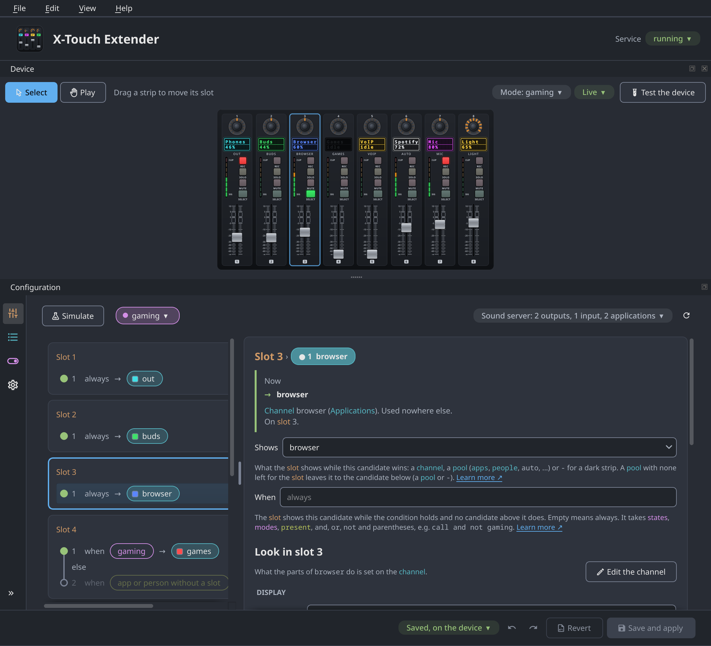

# xtouch-daemon

xtouch-daemon turns a Behringer X-Touch Extender into a hardware mixer for PipeWire on Linux. Its motor faders, LED
meters and scribble strips control your devices, your applications and the people of your voice chat. A strip can
also belong to Home Assistant instead, for lights, speakers in other rooms or scenes. It needs the extender (in MC
mode, on USB) and a Linux desktop with PipeWire; there is no Windows or macOS version.



## How it works

The device has 8 strips, and the configuration has a **slot** for each. A slot lists what its strip can show, top
first, and **states** such as "in a call" or "gaming" decide which entry wins now:

```toml
[slots]
1 = ["buds if present", "auto"]   # Bluetooth headphones while they are connected, else the next application
2 = ["game if gaming", "auto"]    # the game while you play, else the next application
```

What a slot names is a **channel** or a **pool**. A channel is something you define that takes one strip: an output,
an input, a group of applications, a person or Home Assistant. A pool supplies members to every slot that names it:
`auto` and `apps` the applications that play, `people` the people of the voice chat, `devices` outputs without a
channel.

So the device follows what you do: the game gets a fader while it runs, the voice chat and the microphone while you
are in a call, and the next application that plays takes a free strip. When one strip changes the others stay as they
are, and a strip you are touching keeps what it shows until you let go.

[Concepts](concepts.md) explains each of these words and the ones that look alike.

## What a strip can control

- **Devices** (`output`, `input`): an output or input, whichever of several is there, or the default one. With
  `choices`, Select switches between devices, e.g. headphones, speakers and Bluetooth buds. See
  [Devices](configuration/channels/devices.md).
- **Applications** (`apps`): every stream of a group of applications at once, e.g. every browser, with
  [presets](configuration/presets.md) for browsers, voice chats, games, music and video players. Select can start the
  application. See [Applications](configuration/channels/applications.md).
- **The people of the voice chat**: a strip per person in your Mumble or TeamSpeak channel, with their name, their
  voice on the meter and their volume on the fader. See [People](configuration/channels/people.md),
  [Mumble](guides/mumble.md) and [TeamSpeak](guides/teamspeak.md).
- **Home Assistant**: a strip whose fader, encoder, LCD, LEDs and buttons are entities for your automations, e.g. to
  dim a light or set the volume of a speaker in another room. See [Home Assistant](guides/home-assistant.md).

Every strip has a motor fader that glides to new values and stays still under your finger, a volume range up to 200 %,
an LCD with a label and the volume, an encoder (balance, volume, picking an application, or the media player),
LEDs for Mute, Select, Rec and Solo, and a level meter that never wakes a device or switches Bluetooth headphones
into headset mode. See [Encoders](configuration/strip/encoders.md) and [Buttons and LEDs](configuration/strip/leds.md).

## Tools

- **A GUI** (`xtouch-daemon gui`): the device as it is right now, every option with its help and errors, suggestions
  from the sound server, Simulate (what the slots show in another situation), and a preview of the changes, in the
  window or on the device, before you save. See [GUI](guides/gui.md).
- **No device needed to start**: a virtual device stands in for it. See
  [Without a device](getting-started/without-a-device.md).
- **Command line**: a device test, a check of the configuration with a table of what the slots show when, and why a
  slot shows what it shows. See [Commands](reference/commands.md).
- **A systemd user service** that recovers when the device is unplugged or the sound server restarts, applies a
  changed configuration without a restart, and leaves the device dark when it stops.

## Requirements

- Linux with PipeWire and `pipewire-pulse` (or PulseAudio).
- `pw-record` (part of PipeWire) for the meters.
- Python 3.14 (the Arch Linux package brings its own).
- A Behringer X-Touch Extender in **MC** mode on **USB** (see [Getting started](getting-started/first-steps.md#set-up-the-device)).
- For Home Assistant: an MQTT broker that Home Assistant uses (e.g. the Mosquitto add-on).

## Where to go next

| Section | What it covers |
|---|---|
| [Getting started](getting-started/install.md) | Install, set up and test the device, write a first configuration, run the service; or try it [without a device](getting-started/without-a-device.md). Start here. |
| [Concepts](concepts.md) | Channels, slots, states, pools and the words that look alike. |
| Guides | The [GUI](guides/gui.md), [Home Assistant](guides/home-assistant.md), [Mumble](guides/mumble.md), [TeamSpeak](guides/teamspeak.md), and [Troubleshooting](guides/troubleshooting.md). |
| [Configuration](configuration/index.md) | The file, applying changes, and every option: [channels, states and slots](configuration/slots.md), the [channel types](configuration/channels/index.md), the parts of a strip. |
| Reference | Every [command](reference/commands.md), the [hardware and its protocol](reference/hardware.md), the [voice chat bridge](reference/voice-chat-bridge.md). |
