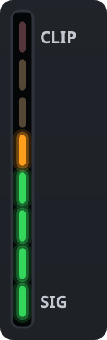

# Hardware and protocol

The Behringer X-Touch Extender has 8 strips. It extends the bigger X-Touch (9 faders), which the daemon doesn't
need. Each strip has a 100 mm motorized, touch-sensitive fader, four buttons with
LEDs (Rec, Solo, Mute, Select), an [encoder](../configuration/strip/encoders.md) with a push button and an [LED](../configuration/strip/leds.md) ring, an LED meter, and an LCD with two lines
of 7 characters and one of 8 backlight colors:

{ .xt-row }

{ .xt-part width="56" }

The meter has 8 LEDs: seven for the level (green, then orange) and a red clip LED at the top. The host sets it to one
of 15 levels: 0 (dark) and 1 to 14. The [table below](#to-the-device) says which LEDs each level lights; only
level 14 lights the clip LED. The X-Touch Extender lets the meter fall by itself, so the host must send the level again to hold it. What the levels
mean on an audio strip, and whether they are taken before or after the fader, is in
[Meters](../configuration/channels/index.md#meters).

Mackie Control (MC) is a standard way for a mixing surface and a computer program to talk over MIDI. xtouch-daemon
drives the X-Touch Extender over USB in its MC mode, so it acts as the "host" that a DAW (a music program) would be. The
X-Touch Extender needs no driver: it is a USB class compliant MIDI device, and Linux lists it as a sound card.

[First steps](../getting-started/first-steps.md#set-up-the-device) shows how to switch the X-Touch Extender to MC mode on USB
in its setup menu and how to test it.

## Linux access

Linux lists the X-Touch Extender as a sound card (`/proc/asound/cards`: `XTouchExt ... X-Touch-Ext`) with the raw MIDI device
`/dev/snd/midiC<card>D0`. xtouch-daemon finds the card by its name (`[device] name`) and opens the MIDI device
directly, without ALSA sequencer or JACK.

The user needs read and write access to it. Desktop sessions give it to the logged-in user through the seat (logind).
Without a session, add the user to the `audio` group.

Only one program can have the MIDI device open: close DAWs that use it. While the daemon runs, it has the MIDI device,
and [`xtouch-daemon test`](commands.md#test) then asks the daemon to run the test.

To check the X-Touch Extender, run [`xtouch-daemon test`](commands.md#test), or use "Test the device" in the
[GUI](../guides/gui.md#test-the-device), which draws the X-Touch Extender next to it. Every strip answers its own controls, so
you can check each LED, the ring in each mode, the LCD colors, the meter, the motor and the touch sensor of every
fader by hand, and compare them with the drawing. The labels `dot+c`, `boost+c` and `wrap+c` that the test shows
are ring modes with the `center` bit set in the message of the ring. That bit lights the two LEDs at the ends of the
ring (see the table [To the X-Touch Extender](#to-the-device)).

## Motor faders

- **Touch:** while a finger is on a fader, its motor does not follow outside changes. When the fader is let go, it
  moves to the strip's current value, usually the one that was set last.
- **Only a touched fader sets a value:** the daemon counts a fader move only if the X-Touch Extender also reports a touch. The
  touch report comes late: about 50-100 ms after the first moves of a quick hand. So the daemon holds a move that has
  no touch yet for 0.3 s, and does not drive the motor meanwhile. If a touch comes in that time, the hand made the
  move, and the move counts. If none comes, the X-Touch Extender moved the fader itself (e.g. its faders going down after it
  was switched on), and the daemon sends the fader back to its value. A fader whose touch sensor failed can't change
  the volume until it is repaired, or until it is one of the [`touchless_faders`](../configuration/behavior.md#faders-without-a-touch-sensor). With the option `touch_required = false` of
  [`[device]`](../configuration/behavior.md#device), every move of every fader counts.
- **Smooth motion:** a fader glides to a new value instead of jumping there. It follows its target like a critically
  damped spring (no overshoot) that gets there in about 100 ms, starting from where it is, also from where a hand left
  it. The spring keeps its speed when the target moves on, so a volume dragged in another mixer, which arrives in small
  steps, becomes one even movement.
- **Arriving:** once a fader is there, the daemon sends its value twice more (after 0.15 s and 0.4 s), in case the
  motor stopped short of it. Stopping the daemon waits for that.
- **Slow moves:** the daemon moves a fader three times slower than usual, until it has arrived, in two cases: when
  the strip goes dark and its fader is put away (the daemon stops, an application ended, a reload), and for the first
  move after a connect. Both are long moves, to or from the bottom. After a fast move the motor stops a little short
  of the bottom; a slow one gets there. Sending the value again, or a nudge (a little up, then down), worked less well.
- **Startup and shutdown sequences:** after a connect the strips light up and their faders come up; when the daemon
  stops they go dark and their faders go down. By default the strips come one after the other from the left at
  startup, and from the right at shutdown; `[device] startup` and `shutdown` choose others, see
  [Startup and shutdown sequences](../configuration/behavior.md#startup-and-shutdown-sequences). The X-Touch Extender can't
  blink a ring and has no brightness levels, so the light effects are steps of on and off. In the sequence `show`,
  each fader moves only twice, smoothly: up with the light and down with it (at startup to its value, at shutdown to
  the bottom).
- **Disconnect:** an X-Touch Extender that goes away (unplugged or switched off) gets no shutdown sequence: nothing reaches it
  any more. Switched off, its faders stay where they are; switched on again, it moves them to the bottom by itself,
  and after the connect the daemon brings them up to their values. Not known yet: whether it moves them, or keeps its
  LCDs and LEDs, when only the USB cable is pulled while it stays on. The daemon assumes the faders at the bottom
  after every connect either way (see "Start" below).
- **Start:** the X-Touch Extender can't tell where its faders are. It reports a position only while a finger moves a fader,
  not after a connect, not on the host query, not after a motor move. So after a connect a fader is assumed at the
  bottom, where the daemon leaves the faders when it stops, and glides from there. If it was moved while the daemon
  did not run, the fader is not at the bottom, and the volume that its first move sets jumps from where the fader
  really is.
- **Motor noise:** slight steps can be heard while a fader moves, more above about 70 %. They come from the X-Touch Extender,
  not from the values sent: a perfectly even 14-bit ramp at 100 Hz sounds the same. The motor control works in small
  steps (the positions the X-Touch Extender reports are multiples of 4, so 12 bits), and the slider has play on its rail: the
  belt tilts it one way going up and the other way going down, which clicks. Don't grease it: the touch sensing goes
  through the knob and slider.
- **Fast moves:** the X-Touch Extender sends many positions per second. Only the latest one is set when the previous command
  finished, so a slow sound server does not build a queue.

## The virtual device

`xtouch-daemon virtual-device` and the GUI simulate the X-Touch Extender, byte for byte, on a Unix
socket in the runtime directory instead of `/dev/snd`. The daemon keeps the same model as a mirror of the real
X-Touch Extender, which is what the GUI draws. What the virtual device does like the X-Touch Extender, as described on this page: the messages of
[Protocol](#protocol) both ways, the LCD as two lines of characters across the strips, a touch on a fader, positions
reported in steps of 4, the motor that moves only when the host sets a value or a finger lets go, never under a
finger, a fader whose touch sensor failed (no touch reported), and switching it off and on (its query, everything
dark, the faders going down by themselves and reporting it).

While the X-Touch Extender is not there, the daemon looks for it every 2 seconds. It looks for the virtual device
every 0.1 seconds: Play in the GUI opens it, and the daemon connects to it right away.

What is assumed: how fast the motor goes (0.1 s over the whole travel), how fast a meter falls (one level per
0.15 s), and when the touch of a quick hand comes (70 ms after its first move).

## Protocol

The Mackie Control protocol; the X-Touch Extender is an MCU XT (model id `0x15`). Verified on the X-Touch Extender (2026-11-15); the text marks what is not.
`n` is the strip, 0..7.

### From the X-Touch Extender { #from-the-device }

| Element | Message |
|---|---|
| Host query | `F0 00 00 66 15 01 <7 byte serial> <4 byte challenge> F7`, sent by the X-Touch Extender on its own after it starts. In Mackie Control a host answers it; the X-Touch Extender works without an answer, and the daemon sends none. |
| Fader | Pitch bend on channel `n`: `En lsb msb`, 14 bits (`0x0000..0x3FFF`) |
| Fader touch | Note `0x68 + n`, velocity `7F` touched, `00` released |
| Buttons | Note on, velocity `7F` pressed, `00` released: Rec `0x00 + n`, Solo `0x08 + n`, Mute `0x10 + n`, Select `0x18 + n` |
| Encoder turn | CC `0x10 + n`: `01..3F` clockwise, `41..7F` counter-clockwise (the low 6 bits are the steps) |
| Encoder push | Note `0x20 + n` |

### To the X-Touch Extender { #to-the-device }

| Element | Message |
|---|---|
| Fader motor | Pitch bend, like the fader position |
| Button LEDs | Note of the button, velocity `7F` on, `01` flashing, `00` off |
| LED ring | CC `0x30 + n`, value `0x40` (center LED) \| mode `<< 4` (0 dot, 1 boost/cut, 2 wrap, 3 spread) \| position 0 (off) or 1..11. The ring has 13 LEDs: the positions 1..11 light the middle 11 LEDs. The bit `0x40` (called the center LED in Mackie Control) is not one of them: on the X-Touch Extender it lights the two LEDs at the two ends of the ring together. |
| Meter | Channel pressure `D0`, value `n << 4 \| level`, level 0..14. The levels light these LEDs of the 8: 1–2 one, 3–4 two, 5–6 three, 7–8 four, 9–10 five, 11 six, 12–13 seven, 14 all eight (with the red one at the top). 0 and 15 light none. The X-Touch Extender lets every level fall by itself, level 14 too: Mackie Control defines level 14 (`0x0E`) as an "overload" that stays lit until the host clears it, but the X-Touch Extender does not hold it. So the host must send a level again to hold it. |
| LCD text | `F0 00 00 66 15 12 <offset> <ASCII> F7`, offset `line * 56 + n * 7` |
| LCD colors | `F0 00 00 66 15 72 <8 colors> F7` (a Behringer extension, works in MC mode): 0 black (the backlight is off), 1 red, 2 green, 3 yellow, 4 blue, 5 magenta, 6 cyan, 7 white. The picture at the top shows the same colors in another order. |

The codec is in
[`hardware/protocol.py`](https://github.com/markusressel/xtouch-daemon/blob/main/src/xtouch_daemon/hardware/protocol.py): pure
functions that decode the messages of the X-Touch Extender into events and build the messages that drive it.

Messages the daemon does not use are not lost: `xtouch-daemon test` prints them (`unknown message: ...`), and the
daemon logs them at debug level (`xtouch-daemon run -l debug`). They show what the X-Touch Extender sends that differs from the
table above, e.g. a touch that is not the usual note.

See [Troubleshooting](../guides/troubleshooting.md) for problems with the X-Touch Extender.
